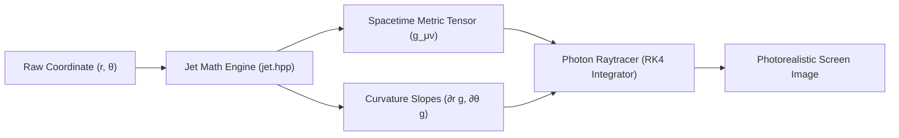

# File 01: `include/gravastar/math/jet.hpp` — Automatic Differentiation Engine

> **Target Audience**: 9th-Grade High School Student (Algebra 1 knowledge, Zero C++, Zero Calculus)  
> **Source Code**: [`include/gravastar/math/jet.hpp`](file:///home/abrsdxd/Projects/GravastarLab/include/gravastar/math/jet.hpp)  
> **Role in GravastarLab**: The Spacecraft's Magic Calculus Co-Pilot

---

## 1. The Big Picture (What is this file's job?)

Imagine you are designing a space-flight simulator for a video game. In your game, a spaceship is orbiting a **gravastar**—a giant, spinning cosmic sphere made of dark energy encased in a hyper-dense crust. 

Near this star, gravity is not a simple downward pull like on Earth. The star is spinning so fast that it drags space and time around with it like a giant cosmic whirlpool! 

To draw how light bends around this star, your computer needs to ask at every microsecond:
> *"If a beam of light moves one millimeter to the left, how much does gravity change?"*
> *"If it moves one millimeter up toward the north pole, how much does gravity twist?"*

In mathematics, the fancy word for "how much something changes when you nudge it" is a **derivative** (or slope). 



If GravastarLab were a spaceship, `jet.hpp` is the **Magic Calculus Co-Pilot**. 

### What terrible thing happens if we delete this file or turn it off?
If you delete this file, the entire graphics engine goes completely blind! To steer light rays through curved space, the computer needs to know the exact slope of gravity in two directions at once:
1. **$r$**: Distance from the center of the gravastar.
2. **$\theta$** (theta): Latitude (whether you are hovering over the star's equator or its north pole).

Without `jet.hpp`, a human physicist would have to sit down with pencil and paper to calculate thousands of lines of hideous calculus formulas by hand. If that human makes even one tiny mistake—like writing a plus sign instead of a minus sign—light rays will curve the wrong way, shoot off into outer space, or smash into an invisible wall, turning your screen into a glitchy soup of radioactive purple static!

---

## 2. High-School Physics & Math Intuition

### The Problem: The "Catastrophic Cancellation" Cliff
How do you usually measure how steep a hill is? You take one tiny step forward ($\Delta x$), measure how much higher you got ($\Delta y$), and divide:
$$\text{Slope} \approx \frac{y_{\text{new}} - y_{\text{old}}}{\Delta x}$$
This is called a **numerical difference** or **finite difference**. 

In high school math class, this works fine on paper. But inside a computer, it is a deadly trap! 

Computers store decimals using a system called floating-point (usually a 64-bit `double`), which only has about 15 to 17 digits of precision. If your step $\Delta x$ is tiny (say, $0.00000001$), then $y_{\text{new}}$ and $y_{\text{old}}$ are almost identical in their first 8 digits:
$$1.000000084321945 - 1.000000000000000 = 0.000000084321945$$
When the computer subtracts them, all those identical leading digits cancel out into zeros. Any tiny random electrical rounding errors left over at the tail end get magnified by $100,000,000\times$! The result is noisy, jittery garbage that causes our light rays to wobble and twitch.

### The Solution: Numbers Carrying Backpacks (Jets)
Instead of taking tiny steps and subtracting, what if a number wasn't just a lonely point on a number line? 

What if every number was a **student wearing a backpack**?
* In their hand, the student holds their current value: $f(r, \theta)$.
* In pocket 1 of the backpack, they carry their speed: $\frac{\partial f}{\partial r}$.
* In pocket 2, they carry their angle-speed: $\frac{\partial f}{\partial \theta}$.
* In pocket 3, they carry their acceleration, jerk, and snap!

When two students meet and add or multiply, they don't just calculate their hand values; they follow strict algebraic rules to update the contents of their backpacks too. 

In mathematics, this backpack is called a **Jet** (specifically, a truncated 2D Taylor polynomial). Whenever you ask a Jet: *"What is your slope?"*, it doesn't approximate anything. It reaches into its backpack and hands you the **exact, 100% algebraic derivative** down to the very last decimal place, with **zero rounding noise**!

---

## 3. The Line-by-Line Anatomy ("Why This Line?")

Here is the entire source code of [`jet.hpp`](file:///home/abrsdxd/Projects/GravastarLab/include/gravastar/math/jet.hpp), analyzed chunk-by-chunk.

```
Lines 1–7:   License & Header Setup
Lines 8–15:  The Jet Data Structure (4x4 Taylor Grid)
Lines 16–20: Creating Independent Variables (variable)
Lines 21–26: Reading Values and Derivatives
Lines 28–42: Addition and Subtraction Operators
Lines 43–51: Multiplication via 2D Polynomial Convolution
Lines 52–58: Reciprocal and Division via Taylor Expansion
Lines 59–71: Automatic Trigonometry (sin & cos)
```

---

### Chunk 1: Lines 1–7 — License, Header Guard, and Toolkits

```cpp
// SPDX-License-Identifier: GPL-3.0-or-later
#pragma once

#include <array>
#include <cmath>
#include <cstddef>
```

#### Plain English Meaning
1. **Line 1** declares that this code is open-source under the GNU General Public License v3.
2. **Line 2 (`#pragma once`)** is an iron shield for the C++ compiler. When building huge programs, dozens of different files might ask to `#include "jet.hpp"`. `#pragma once` commands the compiler: *"Only read this file once per build pass. Never duplicate it."*
3. **Lines 4–6** bring in basic tools from the standard C++ toolbox:
   - `<array>`: Fixed-size, ultra-fast memory boxes.
   - `<cmath>`: Standard math functions like $\sin$, $\cos$, and square roots.
   - `<cstddef>`: Standard system definitions, such as `std::size_t` (an integer guaranteed to hold array sizes).

> [!TIP]
> **Why `std::array` instead of `std::vector`?**  
> A `std::vector` asks the computer's operating system to allocate memory on the "heap" (like having to run across the room to a filing cabinet). A `std::array` lives directly on the "stack" (like having the tools directly inside your pocket). In a raytracer shooting millions of rays every second, heap allocations are far too slow. `std::array` costs zero extra time!

#### The "What If It Breaks?" Debugging Clue
* **If Line 2 is commented out (`//#pragma once`)**: If two different files include `jet.hpp`, the compiler halts with `error: redefinition of 'struct gravastar::math::Jet'`. The build fails immediately before any code can run.

---

### Chunk 2: Lines 8–15 — The Namespace, The Struct, and the 4×4 Grid

```cpp
namespace gravastar::math {

// Bivariate Taylor coefficients, c[i][j] = d_r^i d_theta^j f / (i! j!).
// Terms of total order > 3 are identically zero. No numerical differences.
struct Jet {
    std::array<std::array<double, 4>, 4> c{};
    Jet() = default;
    Jet(double value) { c[0][0] = value; }  // NOLINT: scalar algebra
```

#### Plain English Meaning
1. **Line 8** creates a folder named `gravastar::math` so our code doesn't clash with anyone else's code.
2. **Lines 10–11** are comments explaining the secret math trick:
   - Any smooth function $f(r, \theta)$ can be written as a 2D Taylor series:
     $$f(r + \Delta r, \theta + \Delta \theta) \approx \sum_{i,j} c[i][j] (\Delta r)^i (\Delta \theta)^j$$
   - Each coefficient stored in our grid $c[i][j]$ is already divided by factorials:
     $$c[i][j] = \frac{1}{i! \cdot j!} \frac{\partial^{i+j} f}{\partial r^i \partial \theta^j}$$
   - Any term with total order $i + j > 3$ is truncated to zero.
3. **Lines 12–13** define the `Jet` struct. Inside, it stores a 4×4 grid of 64-bit decimal numbers (`double`). The `{}` at the end zeroes out all 16 slots.
4. **Line 14 (`Jet() = default;`)** allows creating a blank Jet where all 16 slots are $0.0$.
5. **Line 15 (`Jet(double value)`)** lets an ordinary constant number (like `5.0`) become a Jet. Since a constant never changes, its value sits in slot $c[0][0]$, and all its derivative slots remain zero.

```
       θ order = 0     θ order = 1     θ order = 2     θ order = 3
     +---------------+---------------+---------------+---------------+
r=0  |    c[0][0]    |    c[0][1]    |    c[0][2]    |    c[0][3]    |
     | (Base Value)  | (d/dθ / 1!)   | (d²/dθ² / 2!) | (d³/dθ³ / 6!) |
     +---------------+---------------+---------------+---------------+
r=1  |    c[1][0]    |    c[1][1]    |    c[1][2]    |       x       |
     |  (d/dr / 1!)  | (d²rθ / 1!1!) | (d³rθ² / 1!2!)|  (order > 3)  |
     +---------------+---------------+---------------+---------------+
r=2  |    c[2][0]    |    c[2][1]    |       x       |       x       |
     | (d²/dr² / 2!) | (d³r²θ / 2!1!)|  (order > 3)  |  (order > 3)  |
     +---------------+---------------+---------------+---------------+
r=3  |    c[3][0]    |       x       |       x       |       x       |
     | (d³/dr³ / 6!) |  (order > 3)  |  (order > 3)  |  (order > 3)  |
     +---------------+---------------+---------------+---------------+
```

> [!NOTE]
> **Why divide by factorials inside the storage grid?**  
> When you multiply two Taylor series, keeping the factorials inside the table turns messy derivative product rules (like the Leibniz rule: $(fg)'' = f''g + 2f'g' + fg''$) into simple polynomial multiplication! The binomial coefficients ($\binom{n}{k}$) cancel out automatically!

#### The "What If It Breaks?" Debugging Clue
* **If you remove `{}` on Line 13 (`std::array<std::array<double, 4>, 4> c;`)**: C++ will leave the memory uninitialized! The array will contain random garbage left over in RAM. When you run the simulation, the screen will turn black or fill with `NaN` (Not a Number) immediately.

---

### Chunk 3: Lines 16–20 — Creating Independent Variables

```cpp
    static Jet variable(double value, std::size_t axis) {
        Jet result(value);
        result.c[axis == 0 ? 1 : 0][axis == 0 ? 0 : 1] = 1.0;
        return result;
    }
```

#### Plain English Meaning
This is how we plant our "seeds" of calculus. 
* When our spacecraft is at radius $r = 5.0$, we call `Jet::variable(5.0, 0)`:
  - `axis == 0` means this is the first coordinate: radius $r$.
  - It puts $5.0$ in slot $c[0][0]$.
  - It puts $1.0$ in slot $c[1][0]$, because $\frac{dr}{dr} = 1$ (the slope of $r$ with respect to itself is always $1$).
* When we measure latitude $\theta = 0.785$, we call `Jet::variable(0.785, 1)`:
  - `axis == 1` means the second coordinate: angle $\theta$.
  - It puts $0.785$ in slot $c[0][0]$.
  - It puts $1.0$ in slot $c[0][1]$, because $\frac{d\theta}{d\theta} = 1$.

> [!TIP]
> **The Ternary Operator `? :`**:  
> `axis == 0 ? 1 : 0` is shorthand for: *"If axis is 0, pick 1; otherwise pick 0."*

#### The "What If It Breaks?" Debugging Clue
* **If you swap `0` and `1` on Line 18 (`result.c[axis == 0 ? 0 : 1][...]`)**: The computer mixes up radius and angle! The simulation will think that moving away from the star is the same as flying to the North Pole. Light rays will corkscrew wildly and crash into nonsense coordinates.

---

### Chunk 4: Lines 21–26 — Reading Values and Derivatives

```cpp
    double value() const { return c[0][0]; }
    double derivative(std::size_t r_order, std::size_t theta_order) const {
        constexpr std::array<double, 4> factorial{1, 1, 2, 6};
        return c[r_order][theta_order] * factorial[r_order] * factorial[theta_order];
    }
};
```

#### Plain English Meaning
1. **Line 21 (`value()`)** returns the actual number stored at slot $c[0][0]$.
2. **Lines 22–25 (`derivative(...)`)** unpacks the physical slope from the backpack.
   - Because our grid holds $c[i][j] = \frac{1}{i! j!} \frac{\partial^{i+j} f}{\partial r^i \partial \theta^j}$, to get the true physical derivative back, we must multiply by the factorials we stripped out earlier!
   - **Line 23** stores the factorials of $0, 1, 2, 3$:
     - $0! = 1$
     - $1! = 1$
     - $2! = 2 \times 1 = 2$
     - $3! = 3 \times 2 \times 1 = 6$
   - **Line 24** computes:
     $$\text{Physical Derivative} = c[i][j] \times i! \times j!$$

#### The "What If It Breaks?" Debugging Clue
* **If Line 23 has a typo (`factorial{1, 1, 1, 1}`)**: Second-order derivatives will be off by $2\times$, and third-order derivatives by $6\times$. Spacetime curvature will feel $6\times$ too weak; light rays passing near the gravastar won't bend enough to form the shadow of the star!

---

### Chunk 5: Lines 28–42 — Addition and Subtraction

```cpp
inline Jet operator+(const Jet& a, const Jet& b) {
    Jet result;
    for (std::size_t i = 0; i <= 3; ++i)
        for (std::size_t j = 0; i + j <= 3; ++j)
            result.c[i][j] = a.c[i][j] + b.c[i][j];
    return result;
}
inline Jet operator-(const Jet& a, const Jet& b) {
    Jet result;
    for (std::size_t i = 0; i <= 3; ++i)
        for (std::size_t j = 0; i + j <= 3; ++j)
            result.c[i][j] = a.c[i][j] - b.c[i][j];
    return result;
}
inline Jet operator-(const Jet& a) { return Jet(0) - a; }
```

#### Plain English Meaning
This teaches C++ how to use the plus (`+`) and minus (`-`) symbols with our `Jet` objects.
* When you add two functions: $(f + g)(x) = f(x) + g(x)$, their derivatives simply add up: $(f + g)' = f' + g'$.
* **Lines 30–31 & 37–38** run a double loop over all orders $i$ and $j$ where $i + j \le 3$:
  - When $i=0$: $j \in \{0, 1, 2, 3\}$
  - When $i=1$: $j \in \{0, 1, 2\}$
  - When $i=2$: $j \in \{0, 1\}$
  - When $i=3$: $j \in \{0\}$
* **Line 42** handles negation (unary minus, like `-x`): it simply subtracts `a` from zero (`Jet(0) - a`).

#### The "What If It Breaks?" Debugging Clue
* **If Line 31 loops `j <= 3` instead of `i + j <= 3`**: The loop steps into slots where $i + j > 3$ (like $i=3, j=3$). If another function assumes those high slots are zero, unmanaged high-order junk will leak into lower-order terms during multiplication, causing subtle drift over long orbits.

---

### Chunk 6: Lines 43–51 — Multiplication (2D Cauchy Convolution)

```cpp
inline Jet operator*(const Jet& a, const Jet& b) {
    Jet result;
    for (std::size_t i = 0; i <= 3; ++i)
        for (std::size_t j = 0; i + j <= 3; ++j)
            for (std::size_t k = 0; k <= i; ++k)
                for (std::size_t l = 0; l <= j; ++l)
                    result.c[i][j] += a.c[k][l] * b.c[i-k][j-l];
    return result;
}
```

#### Plain English Meaning
This is the mathematical centerpiece of the file! 
When you multiply two polynomials:
$$(A_0 + A_1 x)(B_0 + B_1 x) = A_0 B_0 + (A_0 B_1 + A_1 B_0)x + A_1 B_1 x^2$$
Every term of total degree $n$ is formed by summing all combinations of $k$ and $n-k$.

Because our `Jet` has **two** directions ($r$ and $\theta$), it uses a **4-deep nested loop** to compute the 2D discrete convolution (also called the **Cauchy product**):
* We want to find the term for $r^i \theta^j$ in the output.
* We sum over all $k$ from $0$ to $i$, and all $l$ from $0$ to $j$.
* We multiply $a$'s term at $(k, l)$ by $b$'s term at $(i-k, j-l)$.

Because we divided by factorials in our definition of $c[i][j]$, the product rule:
$$(fg)' = f'g + fg'$$
$$(fg)'' = f''g + 2f'g' + fg''$$
happens **automatically**! 
For instance, for the second derivative:
$$\frac{(fg)''}{2!} = \frac{f''}{2!} g + \frac{f'}{1!} \frac{g'}{1!} + f \frac{g''}{2!}$$
Notice that all the coefficients in front of each term are just $1$! No messy binomial combinations needed!

#### The "What If It Breaks?" Debugging Clue
* **If Line 49 says `=` instead of `+=` (`result.c[i][j] = ...`)**: Instead of accumulating all combinations of products, it keeps only the very last loop iteration ($k=i, l=j$). The product rule of calculus breaks completely! Space fails to curve, and the gravastar's gravitational field collapses to zero.

---

### Chunk 7: Lines 52–58 — Reciprocal ($1/x$) and Division

```cpp
inline Jet reciprocal(const Jet& x) {
    const double inv = 1.0 / x.value();
    const Jet normalized = (x - Jet(x.value())) * Jet(inv);
    const Jet squared = normalized * normalized;
    return Jet(inv) * (Jet(1) - normalized + squared - squared * normalized);
}
inline Jet operator/(const Jet& a, const Jet& b) { return a * reciprocal(b); }
```

#### Plain English Meaning
How do you do division $\frac{1}{x}$ on a Jet without doing polynomial long division? 
You use the famous **Geometric Series**!
Remember the infinite series from algebra:
$$\frac{1}{1 + u} = 1 - u + u^2 - u^3 + u^4 - \dots$$
Let's break our number $x$ into its base value $x_0$ plus a tiny nudge $\Delta x$:
$$x = x_0 + \Delta x = x_0 \left(1 + \frac{\Delta x}{x_0}\right) = x_0 (1 + u)$$
where $u = \frac{x - x_0}{x_0}$ is the `normalized` nudge. 
Notice that $u$'s base value is exactly $0$! That means:
* $u^1$ has order $\ge 1$.
* $u^2$ has order $\ge 2$.
* $u^3$ has order $\ge 3$.
* $u^4$ has order $\ge 4$ $\rightarrow$ **which is identically zero in our 3rd-order Jet!**

Therefore:
$$\frac{1}{x} = \frac{1}{x_0} \cdot (1 - u + u^2 - u^3)$$
This is **not an approximation**! For any 3rd-order truncated polynomial, this formula is **100% algebraically exact**!
* **Line 53**: `inv` is $\frac{1}{x_0}$.
* **Line 54**: `normalized` is $u = (x - x_0) \cdot \frac{1}{x_0}$.
* **Line 55**: `squared` is $u^2$.
* **Line 56**: Evaluates $\frac{1}{x_0} \cdot (1 - u + u^2 - u^3)$.
* **Line 58**: Division $\frac{a}{b}$ is simply multiplying $a$ by the reciprocal of $b$.

> [!WARNING]
> **Division by Zero!**  
> If `x.value()` is $0.0$, Line 53 computes `1.0 / 0.0 = Infinity`. Multiplying infinity produces `NaN`. This is why gravastar models must never let the radial coordinate $r$ drop to zero!

#### The "What If It Breaks?" Debugging Clue
* **If Line 56 has a typo (`+ squared * normalized` instead of `-`)**: The third derivative of the inverse function has the wrong sign. When calculating the metric tensor component $g^{rr} = \frac{1}{g_{rr}}$, the spacetime acceleration slope pulls photons outward instead of inward, turning gravity into an anti-gravity repulsive cannon!

---

### Chunk 8: Lines 59–71 — Automatic Trigonometry ($\sin$ and $\cos$)

```cpp
inline Jet sin(const Jet& x) {
    const Jet h = x - Jet(x.value());
    const Jet h2 = h * h;
    return Jet(std::sin(x.value())) * (Jet(1) - h2 * Jet(0.5))
         + Jet(std::cos(x.value())) * (h - h2 * h * Jet(1.0 / 6.0));
}
inline Jet cos(const Jet& x) {
    const Jet h = x - Jet(x.value());
    const Jet h2 = h * h;
    return Jet(std::cos(x.value())) * (Jet(1) - h2 * Jet(0.5))
         - Jet(std::sin(x.value())) * (h - h2 * h * Jet(1.0 / 6.0));
}
}  // namespace gravastar::math
```

#### Plain English Meaning
How do we take the sine of a Jet? We use the high-school angle addition formulas!
$$\sin(x_0 + h) = \sin(x_0)\cos(h) + \cos(x_0)\sin(h)$$
$$\cos(x_0 + h) = \cos(x_0)\cos(h) - \sin(x_0)\sin(h)$$
Here, $x_0$ is the base number, and $h = x - x_0$ is the perturbation in the backpack.
Now we substitute the standard Taylor expansions for $\cos(h)$ and $\sin(h)$:
$$\cos(h) \approx 1 - \frac{h^2}{2!} = 1 - 0.5 h^2$$
$$\sin(h) \approx h - \frac{h^3}{3!} = h - \frac{1}{6} h^3$$
Since any term $h^4$ or higher is automatically dropped by our 3rd-order Jet, these formulas are **exact up to the 3rd derivative**!
* **Lines 60 & 66**: $h = x - x_0$.
* **Lines 61 & 67**: $h^2 = h \times h$.
* **Lines 62–63**: $\sin(x_0)(1 - 0.5 h^2) + \cos(x_0)(h - \frac{1}{6} h^3)$.
* **Lines 68–69**: $\cos(x_0)(1 - 0.5 h^2) - \sin(x_0)(h - \frac{1}{6} h^3)$. Note the minus sign!

#### The "What If It Breaks?" Debugging Clue
* **If Line 69 has a typo (`+` instead of `-` in `cos`)**: 
  $$\cos(x_0 + h) \to \cos(x_0) + \sin(x_0) h$$
  The derivative of $\cos(\theta)$ becomes $+\sin(\theta)$ instead of $-\sin(\theta)$! In the rotating Kerr metric, terms like $\sin^2\theta$ and $\cos^2\theta$ describe the flattening of spacetime at the poles. With this sign flipped, the spinning gravastar distorts into an elongated football shape instead of flattening at the poles!

---

## 4. Debugger's Cheat Sheet: `jet.hpp`

| Symptom on Screen | Suspect Line in `jet.hpp` | Root Cause |
| :--- | :--- | :--- |
| Screen fills with `NaN` / black void immediately | Line 13 | Uninitialized array memory: forgot `{}` on `c{}` |
| Gravastar looks spherical even when spinning at 99% light speed | Line 18 | `variable()` axis swapped: $r$ and $\theta$ mixed up |
| Light rays scatter wildly at boundary edges | Line 23 | Factorial table wrong: derivatives mis-scaled by $2\times$ or $6\times$ |
| Gravastar creates zero curvature (light travels in straight lines) | Line 49 | Convolution assignment typo: wrote `=` instead of `+=` |
| Photons bounce outward off an invisible anti-gravity shield | Line 56 | Geometric series sign error: wrote `+` instead of `-` on $u^3$ |
| Star bulges out at the poles instead of flattening | Line 69 | Cosine Taylor expansion sign error: wrote `+` instead of `-` |
