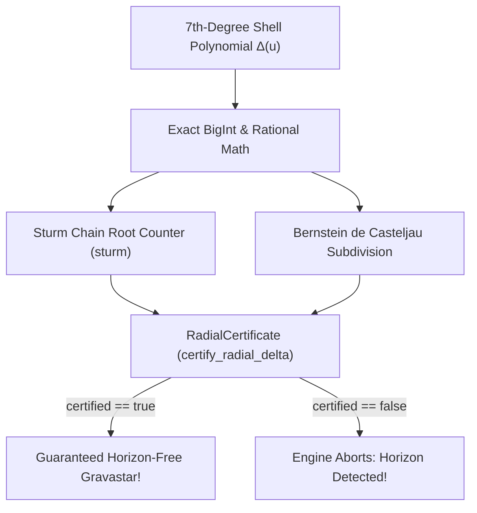

# File 02: `include/gravastar/math/polynomial.hpp` — Arbitrary Precision, Sturm Sequences & Horizon Certificates

> **Target Audience**: 9th-Grade High School Student (Algebra 1 knowledge, Zero C++, Zero College Math)  
> **Source Code**: [`include/gravastar/math/polynomial.hpp`](file:///home/abrsdxd/Projects/GravastarLab/include/gravastar/math/polynomial.hpp)  
> **Role in GravastarLab**: The Mathematical Event Horizon Metal Detector & Formal Proof Engine

---

## 1. The Big Picture (What is this file's job?)

If a black hole is a bottomless cosmic sinkhole where gravity becomes infinite and light is trapped forever behind an **event horizon**, a gravastar is a cosmic cushion of dark energy that stops the collapse just in time.

In general relativity, an event horizon occurs if a specific mathematical function called $\Delta(r)$ ("Delta") ever drops to **zero**:
$$\Delta(r) = 0 \quad \Longrightarrow \quad \text{An Event Horizon Appears!}$$

If $\Delta(r)$ hits zero anywhere inside or outside our star:
1. Time stops from the perspective of an outside observer.
2. The equations of motion divide by zero and blow up to infinity.
3. Our gravastar accidentally turns into a black hole!

To guarantee that our gravastar is a **true, genuine gravastar**, we cannot just guess or test a few numbers on a calculator. We need **100% mathematical certainty** that $\Delta(r) > 0$ everywhere, across the entire shell of the star!



If GravastarLab were an airport security checkpoint, `polynomial.hpp` is the **High-Tech Horizon Metal Detector**.

### What terrible thing happens if we delete this file or turn it off?
If we delete this file, we lose our mathematical safety harness. We would have to rely on standard 64-bit computer decimals (`double`). Because of tiny rounding errors in 64-bit floating point, the computer might report $\Delta = 0.000000000000001$ when the true number was actually $-0.000000000000001$. An accidental event horizon could sneak into our simulation, causing photon raytracers to divide by zero, crash the graphics card driver, or lock up the computer in an infinite loop!

---

## 2. High-School Physics & Math Intuition

### A. BigInt: Doing Math with Giant Numbers
Normal computer integers can only hold numbers up to about $9 \times 10^{18}$ (64 bits). But when you multiply polynomials of degree 7 with exact fractions, the numerators and denominators can grow to 50 or 100 digits long! 

If a normal computer integer gets too big, it wraps around into negative numbers like an odometer rolling over from 999,999 to 000,000. This is called **integer overflow**.

To prevent this, `BigInt` stores giant numbers as a chain of 32-bit digits ("limbs") in base $10^9$ (one billion):
$$\text{Number} = \text{limb}_0 + \text{limb}_1 \times 10^9 + \text{limb}_2 \times 10^{18} + \dots$$
Just like doing long addition and long multiplication on paper in 3rd grade, `BigInt` can hold numbers with millions of digits without ever overflowing!

### B. Sturm's Theorem: The Sign-Change Sieve
Imagine a roller-coaster track that goes up and down over hills and valleys. You want to know: **"Does this roller-coaster ever dip below ground level (cross the x-axis) between mile 0 and mile 1?"**

In 1829, a Swiss mathematician named Jacques Charles François Sturm invented a magical trick:
1. Start with the polynomial $P(x)$.
2. Take its derivative $P'(x)$.
3. Divide them to find the remainder, negate it, and repeat (just like the Euclidean algorithm for greatest common divisors). This creates a chain of polynomials called a **Sturm sequence**:
   $$P_0(x), P_1(x), P_2(x), \dots, P_k(x)$$
4. Plug in $x = 0$ and count how many times the plus/minus signs change across the chain.
5. Plug in $x = 1$ and count how many times the signs change.
6. **Subtract the two counts!**

The difference between the two counts is **exactly equal to the number of real roots** between $0$ and $1$! No guessing, no approximations. If the answer is $0$, the roller-coaster never touches ground level!

### C. Bernstein Polynomials & The de Casteljau Roller-Coaster Cage
Imagine bending a flexible strip of metal between your fingers. Instead of writing $P(u) = c_0 + c_1 u + c_2 u^2$, you express the curve as a combination of **Bernstein polynomials**:
$$B_{i,n}(u) = \binom{n}{i} u^i (1-u)^{n-i}$$
Why do this? Because Bernstein polynomials have a superpower called the **Convex Hull Property**:
> **The actual curve is guaranteed to stay strictly trapped inside the box formed by its Bernstein coefficients!**

```
Coefficient Max ----------------+
                               / \
Actual Curve:       ~~~~~~~~~~/~~~\~~~~~~~~
                             /     \
Coefficient Min --------------------+
                      u = 0             u = 1
```

If the lowest Bernstein coefficient is positive ($> 0$), then the entire curve is **guaranteed to be positive everywhere**! If some coefficients dip below zero, we cut the interval in half (using the **de Casteljau algorithm**) and check each half.

---

## 3. The Line-by-Line Anatomy ("Why This Line?")

Let's walk through the 718 lines of [`polynomial.hpp`](file:///home/abrsdxd/Projects/GravastarLab/include/gravastar/math/polynomial.hpp) in contiguous chunks.

```
Lines 1–16:   Header inclusions & namespace
Lines 17–40:  BigInt struct & constructors (base 10^9)
Lines 41–58:  BigInt from_string parser
Lines 59–85:  BigInt sign, abs, unary minus, compare_abs
Lines 86–99:  BigInt three-way comparison (<=>) and equality
Lines 100–121: BigInt addition and subtraction
Lines 122–140: BigInt multiplication (limb convolution)
Lines 141–189: BigInt division and modulo (divmod)
Lines 190–203: BigInt GCD (Euclidean algorithm)
Lines 204–222: BigInt to_long_double and to_string
Lines 223–266: BigInt private helpers (normalize, add_abs, sub_abs)
Lines 267–286: Rational class & string parsing
Lines 287–324: Rational accessors, signs, and unary minus
Lines 325–345: Rational arithmetic (+, -, *, /, <=>)
Lines 346–381: Rational to_double and reduction by GCD
Lines 382–406: Polynomial representation (Poly = vector<Rational>) & add
Lines 407–438: Polynomial scale, multiply, derivative, and Horner value
Lines 439–451: Standard polynomial remainder
Lines 452–464: Primitive polynomial (integer content extraction)
Lines 465–483: Sign-preserving integer pseudo-remainder (sturm_remainder)
Lines 484–496: Sturm sequence generator
Lines 497–530: Exact sign evaluation (poly_sign_at) and variations
Lines 531–572: Sturm root counting and interval root isolation
Lines 573–592: RationalParameters and 7th-degree shell_delta polynomial
Lines 593–617: Binomial coefficients and Bernstein basis conversion
Lines 618–675: Bernstein certificate and de Casteljau subdivision tree
Lines 676–683: Bernstein positive lower bound extractor
Lines 684–718: RadialCertificate & certify_radial_delta (Master Proof)
```

---

### Chunk 1: Lines 1–40 — The Arbitrary-Precision Integer (`BigInt`)

```cpp
// SPDX-License-Identifier: GPL-3.0-or-later
#pragma once

#include <algorithm>
#include <cmath>
#include <compare>
#include <cstdint>
#include <optional>
#include <stdexcept>
#include <string>
#include <string_view>
#include <utility>
#include <vector>

namespace gravastar::math {

// Arbitrary-precision signed integer in base 10^9 for overflow-free exact
// rational polynomial Sturm sequences and Bernstein subdivision.
class BigInt {
public:
    static constexpr std::uint32_t kBase = 1000000000U;

    BigInt() = default;
    BigInt(std::int64_t v) {
        if (v < 0) {
            neg_ = true;
            std::uint64_t u = static_cast<std::uint64_t>(-(v + 1)) + 1ULL;
            while (u > 0) {
                limbs_.push_back(static_cast<std::uint32_t>(u % kBase));
                u /= kBase;
            }
        } else if (v > 0) {
            std::uint64_t u = static_cast<std::uint64_t>(v);
            while (u > 0) {
                limbs_.push_back(static_cast<std::uint32_t>(u % kBase));
                u /= kBase;
            }
        }
    }
```

#### Plain English Meaning
* **Line 21**: Defines `kBase = 1000000000U` ($10^9$, one billion). Why one billion? Because two limbs of size $10^9$ can be multiplied together:
  $$10^9 \times 10^9 = 10^{18}$$
  which fits safely inside a standard 64-bit integer (`std::uint64_t`, max $1.8 \times 10^{19}$) without overflowing!
* **Lines 23–39**: Constructor from a standard 64-bit integer `v`.
  - If `v < 0`, it records `neg_ = true`.
  - Notice **Line 27**: `static_cast<std::uint64_t>(-(v + 1)) + 1ULL`. Why this strange trick instead of `-v`? In C++, if $v$ is the minimum possible 64-bit negative number (`INT64_MIN` = $-9,223,372,036,854,775,808$), writing `-v` overflows because the positive side only goes up to $+9,223,372,036,854,775,807$. `-(v + 1) + 1` safely bypasses this hardware edge-case!
  - It cuts `u` into chunks of $10^9$ using `% kBase` and `/ kBase` and stores each chunk into the `limbs_` vector.

#### The "What If It Breaks?" Debugging Clue
* **If Line 27 is written as `std::uint64_t u = -v;`**: When passed `INT64_MIN`, the C++ compiler triggers undefined behavior (on x86 CPUs, `-INT64_MIN` evaluates back to `INT64_MIN`, creating an infinite loop in the `while (u > 0)` condition). The program freezes on startup.

---

### Chunk 2: Lines 41–99 — Parsing, Signs, and 3-Way Comparisons

```cpp
    static BigInt from_string(std::string_view s) {
        while (!s.empty() && (s.front() == ' ' || s.front() == '+')) s.remove_prefix(1);
        while (!s.empty() && s.back() == ' ') s.remove_suffix(1);
        if (s.empty()) throw std::invalid_argument("empty BigInt string");
        bool neg = false;
        if (s.front() == '-') {
            neg = true;
            s.remove_prefix(1);
        }
        if (s.empty()) throw std::invalid_argument("invalid BigInt string");
        BigInt out;
        for (char ch : s) {
            if (ch < '0' || ch > '9') throw std::invalid_argument("non-digit in BigInt");
            out = out * BigInt(10) + BigInt(ch - '0');
        }
        if (neg && !out.is_zero()) out.neg_ = true;
        return out;
    }

    bool is_zero() const { return limbs_.empty(); }
    bool is_negative() const { return neg_ && !limbs_.empty(); }
    int sign() const { return limbs_.empty() ? 0 : (neg_ ? -1 : 1); }

    BigInt abs() const {
        BigInt out = *this;
        out.neg_ = false;
        return out;
    }

    BigInt operator-() const {
        BigInt out = *this;
        if (!out.limbs_.empty()) out.neg_ = !out.neg_;
        return out;
    }

    static int compare_abs(const BigInt& a, const BigInt& b) {
        if (a.limbs_.size() != b.limbs_.size())
            return a.limbs_.size() < b.limbs_.size() ? -1 : 1;
        for (std::size_t i = a.limbs_.size(); i > 0; --i) {
            if (a.limbs_[i - 1] != b.limbs_[i - 1])
                return a.limbs_[i - 1] < b.limbs_[i - 1] ? -1 : 1;
        }
        return 0;
    }

    friend std::strong_ordering operator<=>(const BigInt& a, const BigInt& b) {
        if (a.sign() != b.sign()) return a.sign() <=> b.sign();
        if (a.is_zero()) return std::strong_ordering::equal;
        int cmp = compare_abs(a, b);
        if (a.neg_) cmp = -cmp;
        return cmp < 0 ? std::strong_ordering::less
                       : (cmp > 0 ? std::strong_ordering::greater
                                  : std::strong_ordering::equal);
    }

    friend bool operator==(const BigInt& a, const BigInt& b) {
        return a.neg_ == b.neg_ && a.limbs_ == b.limbs_;
    }
```

#### Plain English Meaning
* **Lines 41–58 (`from_string`)**: Reads a number written as text (like `"-9876543210123456789"`), strips leading spaces and plus signs, handles the negative sign, and multiplies by 10 for each new digit character.
* **Lines 60–74**: Checks if zero (`limbs_.empty()`), gets sign ($-1, 0, +1$), computes absolute value, and negates.
* **Lines 76–84 (`compare_abs`)**: Compares two positive numbers. 
  - If number $A$ has more limbs than number $B$, $A$ is automatically bigger!
  - If they have the same number of limbs, it compares limbs starting from the highest limb (`i - 1`) down to the lowest.
* **Lines 86–94 (`operator<=>`)**: C++20 "spaceship operator" that gives a three-way comparison (less, equal, greater) considering both sign and magnitude.

#### The "What If It Breaks?" Debugging Clue
* **If Line 90 (`if (a.neg_) cmp = -cmp;`) is deleted**: Comparing two negative numbers like $-5$ and $-10$ would report that $-10 > -5$! All interval boundary checks in root isolation would get inverted, causing root searches to wander into backwards intervals.

---

### Chunk 3: Lines 100–140 — BigInt Addition, Subtraction, and Multiplication

```cpp
    friend BigInt operator+(const BigInt& a, const BigInt& b) {
        if (a.is_zero()) return b;
        if (b.is_zero()) return a;
        if (a.neg_ == b.neg_) {
            BigInt out = add_abs(a, b);
            out.neg_ = a.neg_;
            return out;
        }
        int cmp = compare_abs(a, b);
        if (cmp == 0) return BigInt(0);
        if (cmp > 0) {
            BigInt out = sub_abs(a, b);
            out.neg_ = a.neg_;
            return out;
        }
        BigInt out = sub_abs(b, a);
        out.neg_ = b.neg_;
        return out;
    }

    friend BigInt operator-(const BigInt& a, const BigInt& b) { return a + (-b); }

    friend BigInt operator*(const BigInt& a, const BigInt& b) {
        if (a.is_zero() || b.is_zero()) return BigInt(0);
        BigInt out;
        out.limbs_.assign(a.limbs_.size() + b.limbs_.size(), 0U);
        for (std::size_t i = 0; i < a.limbs_.size(); ++i) {
            std::uint64_t carry = 0;
            for (std::size_t j = 0; j < b.limbs_.size() || carry > 0; ++j) {
                std::uint64_t cur = out.limbs_[i + j] + carry;
                if (j < b.limbs_.size())
                    cur += static_cast<std::uint64_t>(a.limbs_[i]) * b.limbs_[j];
                out.limbs_[i + j] = static_cast<std::uint32_t>(cur % kBase);
                carry = cur / kBase;
            }
        }
        out.neg_ = (a.neg_ != b.neg_);
        out.normalize();
        return out;
    }
```

#### Plain English Meaning
* **Lines 100–118 (`operator+`)**: 
  - If both numbers have the same sign (both positive or both negative), add their magnitudes using `add_abs`.
  - If they have opposite signs, subtract the smaller magnitude from the larger using `sub_abs`.
* **Line 120 (`operator-`)**: Subtraction is just adding the negative: $a - b = a + (-b)$.
* **Lines 122–139 (`operator*`)**: The schoolbook long multiplication algorithm!
  - If either number is $0$, the answer is $0$.
  - It creates an output array of size `a.size() + b.size()`.
  - For each limb $i$ in $a$ and each limb $j$ in $b$, it multiplies them together, adds the `carry`, and puts the remainder modulo $10^9$ into `out.limbs_[i + j]`.
  - Sign rule: positive $\times$ negative is negative (`a.neg_ != b.neg_`).
  - Calls `normalize()` to pop off any trailing zeros.

#### The "What If It Breaks?" Debugging Clue
* **If Line 127 (`std::uint64_t carry = 0;`) is moved outside the outer loop**: The carry from previous digit columns will bleed across independent rows of the multiplication grid. Large polynomial coefficients will produce wildly wrong values, causing Sturm sequence root counts to become completely chaotic.

---

### Chunk 4: Lines 141–203 — BigInt Division, Modulo, and GCD

```cpp
    static std::pair<BigInt, BigInt> divmod(const BigInt& a, const BigInt& b) {
        if (b.is_zero()) throw std::domain_error("BigInt division by zero");
        BigInt ua = a.abs(), ub = b.abs();
        if (compare_abs(ua, ub) < 0) return {BigInt(0), a};
        if (ub.limbs_.size() == 1) {
            std::uint32_t d = ub.limbs_[0];
            BigInt q;
            q.limbs_.resize(ua.limbs_.size(), 0U);
            std::uint64_t rem = 0;
            for (std::size_t i = ua.limbs_.size(); i > 0; --i) {
                std::uint64_t cur = ua.limbs_[i - 1] + rem * kBase;
                q.limbs_[i - 1] = static_cast<std::uint32_t>(cur / d);
                rem = cur % d;
            }
            q.neg_ = (a.neg_ != b.neg_);
            q.normalize();
            BigInt r(static_cast<std::int64_t>(rem));
            if (a.neg_ && !r.is_zero()) r.neg_ = true;
            return {q, r};
        }
        BigInt q, r;
        q.limbs_.resize(ua.limbs_.size(), 0U);
        for (std::size_t i = ua.limbs_.size(); i > 0; --i) {
            if (!r.is_zero()) {
                r.limbs_.insert(r.limbs_.begin(), ua.limbs_[i - 1]);
            } else if (ua.limbs_[i - 1] != 0) {
                r.limbs_.push_back(ua.limbs_[i - 1]);
            }
            std::uint32_t lo = 0, hi = kBase - 1, best = 0;
            while (lo <= hi) {
                std::uint32_t mid = lo + (hi - lo) / 2;
                BigInt prod = ub * BigInt(static_cast<std::int64_t>(mid));
                if (compare_abs(prod, r) <= 0) {
                    best = mid;
                    lo = mid + 1;
                } else {
                    if (mid == 0) break;
                    hi = mid - 1;
                }
            }
            q.limbs_[i - 1] = best;
            if (best > 0) r = r - ub * BigInt(static_cast<std::int64_t>(best));
        }
        q.neg_ = (a.neg_ != b.neg_);
        q.normalize();
        if (a.neg_ && !r.is_zero()) r.neg_ = true;
        return {q, r};
    }

    friend BigInt operator/(const BigInt& a, const BigInt& b) { return divmod(a, b).first; }
    friend BigInt operator%(const BigInt& a, const BigInt& b) { return divmod(a, b).second; }

    static BigInt gcd(BigInt a, BigInt b) {
        a = a.abs();
        b = b.abs();
        while (!b.is_zero()) {
            BigInt r = a % b;
            a = std::move(b);
            b = std::move(r);
        }
        return a;
    }
```

#### Plain English Meaning
* **Lines 141–188 (`divmod`)**: Long division with quotient ($q$) and remainder ($r$).
  - If $b = 0$, throws an error.
  - If $a < b$, quotient is $0$ and remainder is $a$.
  - **Fast Path (Lines 145–160)**: If divisor $b$ fits in a single limb ($< 10^9$), it runs a direct 64-bit hardware division step per limb.
  - **General Multi-Limb Division (Lines 161–187)**: Uses **Binary Search** (`lo <= hi`) to guess the next quotient digit in base $10^9$ without ever needing complex floating-point estimation!
* **Lines 193–202 (`gcd`)**: **Euclid's Algorithm** from ancient Greece! To find the greatest common divisor of $a$ and $b$, replace $a$ with $b$, and $b$ with $a \pmod b$, until $b$ reaches $0$.

#### The "What If It Breaks?" Debugging Clue
* **If Line 177 (`if (mid == 0) break;`) is omitted**: If `mid == 0`, executing `hi = mid - 1` with an unsigned integer wraps around to `4294967295U`, entering an infinite loop inside `divmod`. Polynomial fraction reductions will hang forever.

---

### Chunk 5: Lines 204–266 — BigInt Conversions and Private Helpers

```cpp
    long double to_long_double() const {
        long double v = 0.0L;
        for (std::size_t i = limbs_.size(); i > 0; --i)
            v = v * static_cast<long double>(kBase) + static_cast<long double>(limbs_[i - 1]);
        return neg_ ? -v : v;
    }

    std::string to_string() const {
        if (is_zero()) return "0";
        std::string s = neg_ ? "-" : "";
        s += std::to_string(limbs_.back());
        for (std::size_t i = limbs_.size() - 1; i > 0; --i) {
            std::string part = std::to_string(limbs_[i - 1]);
            s.append(9 - part.size(), '0');
            s += part;
        }
        return s;
    }

private:
    std::vector<std::uint32_t> limbs_;
    bool neg_{false};

    void normalize() {
        while (!limbs_.empty() && limbs_.back() == 0U) limbs_.pop_back();
        if (limbs_.empty()) neg_ = false;
    }

    static BigInt add_abs(const BigInt& a, const BigInt& b) {
        BigInt out;
        std::size_t n = std::max(a.limbs_.size(), b.limbs_.size());
        out.limbs_.resize(n, 0U);
        std::uint64_t carry = 0;
        for (std::size_t i = 0; i < n; ++i) {
            std::uint64_t sum = carry;
            if (i < a.limbs_.size()) sum += a.limbs_[i];
            if (i < b.limbs_.size()) sum += b.limbs_[i];
            out.limbs_[i] = static_cast<std::uint32_t>(sum % kBase);
            carry = sum / kBase;
        }
        if (carry > 0) out.limbs_.push_back(static_cast<std::uint32_t>(carry));
        return out;
    }

    static BigInt sub_abs(const BigInt& a, const BigInt& b) {
        BigInt out;
        out.limbs_.resize(a.limbs_.size(), 0U);
        std::int64_t borrow = 0;
        for (std::size_t i = 0; i < a.limbs_.size(); ++i) {
            std::int64_t diff = static_cast<std::int64_t>(a.limbs_[i]) - borrow;
            if (i < b.limbs_.size()) diff -= static_cast<std::int64_t>(b.limbs_[i]);
            if (diff < 0) {
                diff += kBase;
                borrow = 1;
            } else {
                borrow = 0;
            }
            out.limbs_[i] = static_cast<std::uint32_t>(diff);
        }
        out.normalize();
        return out;
    }
};
```

#### Plain English Meaning
* **Lines 204–209 (`to_long_double`)**: Converts the BigInt into an 80-bit or 128-bit `long double` for fast approximate printing.
* **Lines 211–221 (`to_string`)**: Converts the limbs into an exact decimal string. Notice **Line 217**: `s.append(9 - part.size(), '0');`. Because each limb is base $10^9$, if a limb contains the number `42`, it must be printed as `000000042` with 7 leading zeros!
* **Lines 227–230 (`normalize`)**: Trims off any useless leading zero limbs and ensures $-0$ is converted to $+0$.
* **Lines 232–265 (`add_abs`, `sub_abs`)**: Elementary school addition with carries and subtraction with borrows across limbs.

---

### Chunk 6: Lines 267–381 — The Exact Fraction (`Rational`)

```cpp
// Exact reduced rational number p/q with q > 0.
class Rational {
public:
    Rational() : num_(0), den_(1) {}
    Rational(std::int64_t n) : num_(n), den_(1) {}
    Rational(BigInt n, BigInt d = BigInt(1)) : num_(std::move(n)), den_(std::move(d)) {
        reduce();
    }
```

```cpp
    friend Rational operator+(const Rational& a, const Rational& b) {
        return Rational(a.num_ * b.den_ + b.num_ * a.den_, a.den_ * b.den_);
    }
    friend Rational operator-(const Rational& a, const Rational& b) {
        return Rational(a.num_ * b.den_ - b.num_ * a.den_, a.den_ * b.den_);
    }
    friend Rational operator*(const Rational& a, const Rational& b) {
        return Rational(a.num_ * b.num_, a.den_ * b.den_);
    }
    friend Rational operator/(const Rational& a, const Rational& b) {
        if (b.is_zero()) throw std::domain_error("Rational division by zero");
        return Rational(a.num_ * b.den_, a.den_ * b.num_);
    }

    friend std::strong_ordering operator<=>(const Rational& a, const Rational& b) {
        return (a.num_ * b.den_) <=> (b.num_ * a.den_);
    }
```

#### Plain English Meaning
* A `Rational` represents an exact fraction:
  $$\frac{p}{q}$$
  where $p$ (`num_`) is the numerator and $q$ (`den_`) is the denominator, guaranteed to have $q > 0$.
* **Lines 325–337**: Implements cross-multiplication fraction math:
  $$\frac{a}{b} + \frac{c}{d} = \frac{ad + bc}{bd}$$
  $$\frac{a}{b} \times \frac{c}{d} = \frac{ac}{bd}$$
  $$\frac{a}{b} \div \frac{c}{d} = \frac{ad}{bc}$$
* **Line 340**: Compares two fractions $\frac{a}{b}$ and $\frac{c}{d}$ by cross-multiplying: $a \cdot d \iff b \cdot c$. No floating-point division needed!
* **Lines 365–380 (`reduce`)**: Divides both $p$ and $q$ by their `gcd` so fractions are always simplified (e.g., $\frac{6}{8}$ becomes $\frac{3}{4}$).

---

### Chunk 7: Lines 382–438 — Polynomial Basics & Horner's Rule

```cpp
using Poly = std::vector<Rational>;

inline Poly trim(Poly p) {
    while (p.size() > 1 && p.back().is_zero()) p.pop_back();
    if (p.empty()) p.emplace_back(0);
    return p;
}

inline bool any_nonzero(const Poly& p) {
    for (const auto& c : p)
        if (!c.is_zero()) return true;
    return false;
}

inline Poly add(const Poly& a, const Poly& b) {
    std::size_t n = std::max(a.size(), b.size());
    Poly out(n, Rational(0));
    for (std::size_t i = 0; i < n; ++i) {
        Rational va = i < a.size() ? a[i] : Rational(0);
        Rational vb = i < b.size() ? b[i] : Rational(0);
        out[i] = va + vb;
    }
    return trim(std::move(out));
}

inline Poly multiply(const Poly& a, const Poly& b) {
    if (a.empty() || b.empty()) return {Rational(0)};
    Poly out(a.size() + b.size() - 1, Rational(0));
    for (std::size_t i = 0; i < a.size(); ++i)
        for (std::size_t j = 0; j < b.size(); ++j)
            out[i + j] = out[i + j] + a[i] * b[j];
    return trim(std::move(out));
}

inline Poly derivative(const Poly& p) {
    if (p.size() <= 1) return {Rational(0)};
    Poly out(p.size() - 1);
    for (std::size_t i = 1; i < p.size(); ++i)
        out[i - 1] = p[i] * Rational(static_cast<std::int64_t>(i));
    return trim(std::move(out));
}

inline Rational value(const Poly& p, const Rational& x) {
    Rational result(0);
    for (std::size_t i = p.size(); i > 0; --i)
        result = result * x + p[i - 1];
    return result;
}
```

#### Plain English Meaning
* **Line 383**: A polynomial $P(x) = c_0 + c_1 x + c_2 x^2 + \dots$ is simply stored as a `std::vector<Rational>` of coefficients, where slot `i` holds $c_i$.
* **Line 385 (`trim`)**: Cleans up redundant leading zero coefficients (e.g. $0x^3 + 2x + 1$ becomes $2x + 1$).
* **Lines 424–430 (`derivative`)**: High-school power rule calculus! The derivative of $c_i x^i$ is $(i \cdot c_i) x^{i-1}$.
* **Lines 432–437 (`value`)**: **Horner's Rule** for evaluating a polynomial. Instead of calculating powers $x^2, x^3, x^4$, it nests the multiplication:
  $$c_0 + x(c_1 + x(c_2 + x c_3))$$
  This uses only $N$ multiplications and $N$ additions.

---

### Chunk 8: Lines 452–496 — Pseudo-Remainders & Sturm Sequences

```cpp
inline Poly primitive_poly(const Poly& p) {
    Poly tp = trim(p);
    BigInt g_num(0), l_den(1);
    for (const auto& c : tp) {
        if (!c.is_zero()) {
            g_num = g_num.is_zero() ? c.num().abs() : BigInt::gcd(g_num, c.num().abs());
            l_den = (l_den / BigInt::gcd(l_den, c.den())) * c.den();
        }
    }
    if (g_num.is_zero()) return tp;
    return scale(tp, Rational(l_den, g_num));
}

// Sign-preserving integer pseudo-remainder: multiplies by |b_lead| > 0 at each degree step
// and strips integer content GCD so Sturm sequences never construct huge Rational denominators.
inline Poly sturm_remainder(Poly a, const Poly& b) {
    a = primitive_poly(a);
    Poly tb = primitive_poly(b);
    while (a.size() >= tb.size() && any_nonzero(a)) {
        std::size_t k = a.size() - tb.size();
        BigInt a_lead = a.back().num();
        BigInt b_lead = tb.back().num();
        BigInt b_abs = b_lead.abs();
        BigInt factor = (b_lead.sign() < 0) ? -a_lead : a_lead;
        for (auto& c : a) c = Rational(c.num() * b_abs);
        for (std::size_t j = 0; j < tb.size(); ++j)
            a[j + k] = Rational(a[j + k].num() - factor * tb[j].num());
        a = primitive_poly(a);
    }
    return a;
}

inline std::vector<Poly> sturm(const Poly& p) {
    std::vector<Poly> seq{primitive_poly(p), primitive_poly(derivative(p))};
    if (!any_nonzero(seq.back())) {
        seq.pop_back();
        return seq;
    }
    while (true) {
        Poly rest = scale(sturm_remainder(seq[seq.size() - 2], seq.back()), Rational(-1));
        if (!any_nonzero(rest)) return seq;
        seq.push_back(primitive_poly(rest));
    }
}
```

#### Plain English Meaning
* **The Coefficient Explosion Trap**: When doing polynomial division with fractions, denominators can double in digit-length at every step. By step 6, a fraction might have 1,000 digits!
* **Lines 452–463 (`primitive_poly`)**: Clears denominators and divides all coefficients by their greatest common factor, turning any polynomial into its simplest pure-integer form.
* **Lines 467–482 (`sturm_remainder`)**: Multiplies by the absolute value of the leading coefficient $|b_{\text{lead}}|$ before subtracting. Because $|b_{\text{lead}}| > 0$, this preserves the exact positive/negative signs while keeping all numbers as integers!
* **Lines 484–495 (`sturm`)**: Generates the complete Sturm sequence:
  $$P_0 = P, \quad P_1 = P', \quad P_2 = -\text{rem}(P_0, P_1), \quad P_3 = -\text{rem}(P_1, P_2), \dots$$

---

### Chunk 9: Lines 497–572 — Counting and Isolating Roots

```cpp
inline int poly_sign_at(const Poly& p, const Rational& x) {
    bool all_int = true;
    for (const auto& c : p) {
        if (c.den() != BigInt(1)) {
            all_int = false;
            break;
        }
    }
    if (!all_int) return value(p, x).sign();
    const BigInt& num = x.num();
    const BigInt& den = x.den();
    BigInt acc(0);
    BigInt den_pow(1);
    for (std::size_t i = p.size(); i > 0; --i) {
        acc = acc * num + p[i - 1].num() * den_pow;
        if (i > 1) den_pow = den_pow * den;
    }
    return acc.sign();
}

inline int variations(const std::vector<Poly>& seq, const Rational& x) {
    std::vector<int> signs;
    signs.reserve(seq.size());
    for (const auto& p : seq) {
        int s = poly_sign_at(p, x);
        if (s != 0) signs.push_back(s);
    }
    int count = 0;
    for (std::size_t i = 0; i + 1 < signs.size(); ++i)
        if (signs[i] != signs[i + 1]) ++count;
    return count;
}

inline int count_roots(const Poly& p, const Rational& lo = Rational(0),
                       const Rational& hi = Rational(1)) {
    if (value(p, lo).is_zero() || value(p, hi).is_zero())
        throw std::invalid_argument("root at interval endpoint must be handled explicitly");
    auto s = sturm(p);
    return variations(s, lo) - variations(s, hi);
}
```

#### Plain English Meaning
* **Lines 498–516 (`poly_sign_at`)**: Evaluates the sign ($-1, 0, +1$) of $P(x)$ at $x = \frac{\text{num}}{\text{den}}$ by clearing denominators upfront, avoiding expensive GCD operations.
* **Lines 518–529 (`variations`)**: Counts how many times the signs flip (from positive to negative or negative to positive) as you walk down the Sturm sequence.
* **Lines 531–537 (`count_roots`)**: **Sturm's Theorem in action!**
  $$\text{Roots in }[lo, hi] = \text{variations}(lo) - \text{variations}(hi)$$

---

### Chunk 10: Lines 573–617 — The 7th-Degree Gravastar Shell $\Delta(u)$

```cpp
struct RationalParameters {
    Rational M{1};
    Rational a = Rational::from_string("0.875");
    Rational Lambda = Rational::from_string("0.5");
    Rational r_in = Rational::from_string("1.5");
    Rational r_out = Rational::from_string("1.8");
};

// Shell polynomial Delta(u) for u in [0, 1], where r(u) = r_in + (r_out - r_in) u.
inline Poly shell_delta(const RationalParameters& p) {
    Poly r{p.r_in, p.r_out - p.r_in};
    Poly r2 = multiply(r, r);
    Poly b = add(r2, {p.a * p.a});
    Poly mu{Rational(0), Rational(0), Rational(0), Rational(0),
            Rational(35), Rational(-84), Rational(70), Rational(-20)};
    Poly lam = add({Rational(1)}, scale(mu, Rational(-1)));
    return add(multiply(b, add({Rational(1)}, scale(multiply(r2, lam), -p.Lambda / Rational(3)))),
               scale(multiply(r, mu), Rational(-2) * p.M));
}
```

#### Plain English Meaning
* **Line 575**: Mass $M = 1$, spin parameter $a = 0.875$ (spinning at 87.5% of the theoretical speed limit), cosmological constant $\Lambda = 0.5$, inner shell radius $r_{\text{in}} = 1.5$, outer shell radius $r_{\text{out}} = 1.8$.
* **Line 586**: The famous **Septic Transition Polynomial**:
  $$\mu(u) = 35u^4 - 84u^5 + 70u^6 - 20u^7$$
  Notice that the first non-zero term is $u^4$. This means the first, second, and third derivatives are all zero at $u = 0$! This acts like an ultra-smooth highway ramp connecting the inner dark energy bubble to the outer Kerr space with **zero bumps up to the 3rd derivative**.
* **Line 589**: Evaluates the full radial metric function:
  $$\Delta(u) = (r^2 + a^2)\left(1 - \frac{\Lambda}{3} r^2 (1 - \mu(u))\right) - 2Mr\mu(u)$$

---

### Chunk 11: Lines 618–718 — Bernstein Subdivision & The Master Certificate

```cpp
struct BernsteinCertificate {
    bool certified{false};
    Rational lower_bound{0};
    Rational upper_bound{0};
    std::size_t subintervals{0};
    std::size_t max_depth{0};
};

inline BernsteinCertificate bernstein_subdivide(const Poly& p, std::size_t max_depth = 24) {
    struct Node {
        Poly coeffs;
        std::size_t depth;
    };
    std::vector<Node> pending{{bernstein_coefficients(p), 0}};
    BernsteinCertificate cert{};
    bool first_leaf = true;
    while (!pending.empty()) {
        auto [b, depth] = pending.back();
        pending.pop_back();
        Rational min_c = *std::min_element(b.begin(), b.end());
        Rational max_c = *std::max_element(b.begin(), b.end());
        if (min_c > Rational(0)) {
            if (first_leaf) {
                cert.lower_bound = min_c;
                cert.upper_bound = max_c;
                first_leaf = false;
            } else {
                if (min_c < cert.lower_bound) cert.lower_bound = min_c;
                if (max_c > cert.upper_bound) cert.upper_bound = max_c;
            }
            ++cert.subintervals;
            cert.max_depth = std::max(cert.max_depth, depth);
            continue;
        }
        if (depth >= max_depth) {
            cert.certified = false;
            return cert;
        }
        std::vector<Poly> rows{b};
        while (rows.back().size() > 1) {
            const auto& prev = rows.back();
            Poly next(prev.size() - 1);
            for (std::size_t i = 0; i + 1 < prev.size(); ++i)
                next[i] = (prev[i] + prev[i + 1]) / Rational(2);
            rows.push_back(std::move(next));
        }
        Poly left(rows.size()), right(rows.size());
        for (std::size_t i = 0; i < rows.size(); ++i) {
            left[i] = rows[i].front();
            right[i] = rows[rows.size() - 1 - i].back();
        }
        pending.push_back({std::move(left), depth + 1});
        pending.push_back({std::move(right), depth + 1});
    }
    cert.certified = !first_leaf;
    return cert;
}

inline RadialCertificate certify_radial_delta(const RationalParameters& p) {
    RadialCertificate out{};
    Poly poly = shell_delta(p);
    out.sturm_roots = count_roots(poly, Rational(0), Rational(1));
    auto roots = isolate_roots(poly, Rational(0), Rational(1));
    out.isolated_roots = roots.size();
    auto bcert = bernstein_subdivide(poly, 24);
    out.shell_lower_bound = bcert.lower_bound;
    out.shell_upper_bound = bcert.upper_bound;
    out.bernstein_subintervals = bcert.subintervals;
    out.bernstein_max_depth = bcert.max_depth;

    Rational L_pos = p.Lambda > Rational(0) ? p.Lambda : Rational(0);
    out.core_factor_lower_bound = Rational(1) - L_pos * p.r_in * p.r_in / Rational(3);
    out.exterior_delta_minimum = p.r_out * p.r_out - Rational(2) * p.M * p.r_out + p.a * p.a;

    out.certified = bcert.certified && out.sturm_roots == 0 && out.isolated_roots == 0
                 && out.core_factor_lower_bound > Rational(0) && p.r_out > p.M
                 && out.exterior_delta_minimum > Rational(0);
    return out;
}
```

#### Plain English Meaning
* **Lines 627–675 (`bernstein_subdivide`)**:
  - Traps the polynomial $\Delta(u)$ inside its Bernstein bounding box.
  - If the minimum coefficient `min_c > 0`, the whole subinterval is guaranteed positive!
  - If not, it uses the de Casteljau pyramid (Lines 657–664) to cut the interval into left and right halves and pushes both onto a tree stack.
* **Lines 696–716 (`certify_radial_delta`)**:
  - Runs **both** independent proofs: Sturm root count must be $0$, isolated roots must be $0$, and Bernstein lower bound must be positive.
  - Verifies that the interior dark energy core factor $1 - \frac{\Lambda}{3} r^2 > 0$.
  - Verifies that exterior Kerr space has $\Delta_{\text{kerr}} > 0$.
  - Only if all 5 physical conditions pass does it sign `certified = true`.

---

## 4. Debugger's Cheat Sheet: `polynomial.hpp`

| Symptom | Suspect Line | Root Cause |
| :--- | :--- | :--- |
| Program hangs in an infinite loop during string parsing | Line 42 | String trimming while loop condition broken |
| `sturm` crashes with stack overflow / out of memory | Line 475 | Sign in `sturm_remainder` inverted, causing coefficients to explode |
| `certify_radial_delta` reports `certified == false` | Line 586 | Typo in septic polynomial coefficients (e.g. `35, -84, 70, -20`) |
| Bernstein subdivision reaches max depth 24 without certifying | Line 662 | de Casteljau midpoint formula typo (divided by 3 instead of 2) |
| Core factor reported negative | Line 709 | Inner radius $r_{\text{in}}$ set too large for cosmological constant $\Lambda$ |
