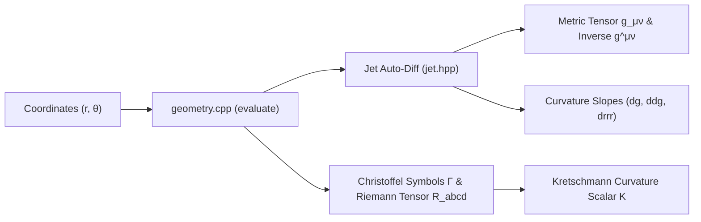

# File 03: `include/gravastar/geometry/geometry.hpp` & `src/geometry/geometry.cpp` — The Spacetime GPS Ruler

> **Target Audience**: 9th-Grade High School Student (Algebra 1 knowledge, Zero C++, Zero Differential Geometry)  
> **Source Codes**: 
> - [`include/gravastar/geometry/geometry.hpp`](file:///home/abrsdxd/Projects/GravastarLab/include/gravastar/geometry/geometry.hpp)
> - [`src/geometry/geometry.cpp`](file:///home/abrsdxd/Projects/GravastarLab/src/geometry/geometry.cpp)  
> **Role in GravastarLab**: The Spacetime GPS Ruler & Einstein Curvature Engine

---

## 1. The Big Picture (What is this file's job?)

In our everyday world, if you want to find the distance between two points on a flat wooden desk, you use the Pythagorean theorem from 8th-grade geometry:
$$\text{Distance}^2 = \Delta x^2 + \Delta y^2$$

But near a massive, spinning star, space is **not flat**! Space stretches, compresses, and twists into a whirlpool. Clocks tick slower the closer you get to the star, and space itself gets dragged around in circles!

The mathematical ruler that measures distances and time intervals in curved spacetime is called the **Metric Tensor** ($g_{\mu\nu}$). 
* It is a 4×4 grid of numbers.
* The 4 dimensions are $(t, r, \theta, \phi)$: Time, Radius (distance from center), Latitude angle, and Longitude angle.



If GravastarLab were an ocean voyage, `geometry.hpp` and `geometry.cpp` are the **Spacetime Ocean Depth & Whirlpool Flow Chart**.

### What terrible thing happens if we delete this file or turn it off?
If you delete this file, the laws of gravity vanish. The simulator will have no idea whether space is flat or warped. Light rays will travel in straight lines as if the star didn't even exist, rendering a boring empty sky with no gravastar, no lensing ring, no gravitational redshift, and no shadow!

---

## 2. High-School Physics & Math Intuition

### A. The 3 Regions of a Gravastar
Unlike a black hole, which is just empty space collapsing into an infinitely sharp spike, a gravastar has **three distinct layers**, like a cosmic jawbreaker candy:

```
        Exterior Space (Kerr Spacetime)
      ~~~~~~~~~~~~~~~~~~~~~~~~~~~~~~~~~~~~~~~
      |  r_out = 1.8                         |
      |   +-------------------------------+  |
      |   |  Thin Matter Shell (Septic)   |  |
      |   |   r_in = 1.5                  |  |
      |   |    +---------------------+    |  |
      |   |    |                     |    |  |
      |   |    |  Dark Energy Core   |    |  |
      |   |    |  (de Sitter Space)  |    |  |
      |   |    |  Repulsive Pressure |    |  |
      |   |    |                     |    |  |
      |   |    +---------------------+    |  |
      |   +-------------------------------+  |
      ~~~~~~~~~~~~~~~~~~~~~~~~~~~~~~~~~~~~~~~
```

1. **The Core ($r \le r_{\text{in}}$)**: Filled with pure **Dark Energy** (de Sitter space). Dark energy has negative pressure, which creates an outward repulsive force pushing back against gravity!
2. **The Shell ($r_{\text{in}} < r < r_{\text{out}}$)**: A thin, ultra-dense crust of matter. Here, a 7th-degree polynomial smoothly ramps down dark energy and ramps up normal gravity.
3. **The Exterior ($r \ge r_{\text{out}}$)**: The vacuum of space outside a spinning mass, described by Roy Kerr's famous 1963 solution to Einstein's equations (Kerr spacetime).

### B. Frame Dragging: The Whirlpool Effect
Because the gravastar is spinning at 87.5% of the speed of light, it drags the fabric of space with it! 
In the 4×4 metric grid, this shows up as off-diagonal numbers:
$$g_{t\phi} \quad \text{and} \quad g_{\phi t}$$
These numbers mix **Time** ($t$) and **Spin Angle** ($\phi$). It means that if you try to sit completely still above the star without firing your thrusters, space itself forces you to rotate around the star!

### C. Curvature: Christoffel ($\Gamma$), Riemann ($R$), and Kretschmann ($K$)
* **Christoffel Symbols ($\Gamma^a_{bc}$)**: Think of these as the "gravity forces" felt by an object. They tell you how the coordinate grid bends from point to point.
* **Riemann Tensor ($R_{abcd}$)**: Measures **Tidal Forces**! If you fall feet-first into a gravitational field, your feet are pulled harder than your head. The Riemann tensor measures how much you get stretched and squeezed (spaghettification).
* **Kretschmann Scalar ($K = R^{abcd} R_{abcd}$)**: A single master number that sums up total gravitational warping. Near a black hole singularity, $K \to \infty$. But inside our gravastar, **$K$ stays completely finite and smooth everywhere!**

---

## 3. The Line-by-Line Anatomy: `geometry.hpp`

```cpp
// SPDX-License-Identifier: GPL-3.0-or-later
#pragma once

#include <array>
#include <string>
#include <string_view>
#include <variant>

namespace gravastar::geometry {

using Matrix = std::array<std::array<double, 4>, 4>;
using Tensor3 = std::array<Matrix, 4>;
using Tensor4 = std::array<Tensor3, 4>;

enum class Family { toy, kerr, de_sitter, flat };
```

#### Plain English Meaning
* **Lines 11–13**: Defines tensor shapes:
  - `Matrix`: A 4×4 table (16 numbers) for the metric tensor $g_{\mu\nu}$.
  - `Tensor3`: A 4×4×4 cube (64 numbers) for first derivatives $\partial_k g_{ij}$.
  - `Tensor4`: A 4×4×4×4 hypercube (256 numbers) for second derivatives and the Riemann curvature tensor.
* **Line 15**: `Family` lets you choose which spacetime to test:
  - `toy`: The full rotating gravastar with core, shell, and exterior.
  - `kerr`: A pure rotating black hole geometry.
  - `de_sitter`: Pure dark energy space.
  - `flat`: Empty Minkowski space where gravity is zero.

```cpp
struct Parameters {
    Family family{Family::toy};
    double mass{1.0};
    double spin{0.875};
    double cosmological_constant{0.5};
    double r_in{1.5};
    double r_out{1.8};
};

struct Evaluation {
    Matrix metric{};
    Matrix inverse{};
    Tensor3 dg{};   // dg[k][i][j] = partial_k g_ij, order t,r,theta,phi.
    Tensor4 ddg{};  // ddg[k][l][i][j] = partial_k partial_l g_ij.
    Matrix drrr{};  // drrr[i][j] = partial_r^3 g_ij.
    Matrix extrinsic_curvature{};  // K_AB across shell boundaries
    Matrix ricci{};
    Tensor4 riemann_lower{};  // R_abcd
    double ricci_scalar{};
    double kretschmann{};
    double determinant{};
    double mu{}, lambda{}, sigma{}, delta{}, delta_theta{}, xi{};
};

using Result = std::variant<Evaluation, Error>;
Result evaluate(const Parameters& parameters, double r, double theta,
                Region region = Region::automatic);
```

#### Plain English Meaning
* **Lines 27–34**: Sets up the physical constants:
  - `mass = 1.0` (in geometric units where $G = c = 1$).
  - `spin = 0.875` (high angular momentum).
  - `cosmological_constant = 0.5` ($\Lambda$, dark energy density).
  - `r_in = 1.5`, `r_out = 1.8` (shell thickness $\Delta r = 0.3$).
* **Lines 41–54 (`Evaluation`)**: The complete report card returned when you ask for the geometry at any point $(r, \theta)$.
* **Line 56 (`Result`)**: A modern C++ `std::variant` that returns either a valid `Evaluation` or a descriptive `Error`.

---

## 4. The Line-by-Line Anatomy: `src/geometry/geometry.cpp`

### Chunk 1: Lines 17–36 — Smoothstep & Shell Transition

```cpp
Jet smoothstep(const Jet& u) {
    const Jet u2 = u * u;
    return u2 * u2 * (Jet(35) + u * (Jet(-84) + u * (Jet(70) - Jet(20) * u)));
}

std::pair<Jet, Jet> transition(const Parameters& p, const Jet& r, Region region) {
    if (p.family == Family::kerr) return {Jet(1), Jet(0)};
    if (p.family == Family::de_sitter) return {Jet(0), Jet(1)};
    if (p.family == Family::flat) return {Jet(0), Jet(0)};
    if (region == Region::core) return {Jet(0), Jet(1)};
    if (region == Region::exterior) return {Jet(1), Jet(0)};
    const double width = p.r_out - p.r_in;
    // Evaluate the small tail directly: avoid cancellation in lambda near r_out.
    if (r.value() - p.r_in <= width * 0.5) {
        const Jet mu = smoothstep((r - Jet(p.r_in)) / Jet(width));
        return {mu, Jet(1) - mu};
    }
    const Jet lambda = smoothstep((Jet(p.r_out) - r) / Jet(width));
    return {Jet(1) - lambda, lambda};
}
```

#### Plain English Meaning
* **Lines 17–20 (`smoothstep`)**: Evaluates the 7th-degree polynomial:
  $$\mu(u) = u^4 \left(35 - 84u + 70u^2 - 20u^3\right) = 35u^4 - 84u^5 + 70u^6 - 20u^7$$
  Because $u$ is a `Jet`, this automatically computes all derivatives $\mu', \mu'', \mu'''$ with zero manual calculus!
* **Lines 28–36 (`transition`)**: Normalizes radius into $u \in [0, 1]$ across the shell:
  $$u = \frac{r - r_{\text{in}}}{r_{\text{out}} - r_{\text{in}}}$$
  Notice **Lines 30–35**: To prevent catastrophic cancellation near the outer boundary $r_{\text{out}}$, if $r$ is past the midpoint ($u > 0.5$), it computes $\lambda(u)$ backwards from $r_{\text{out}}$ instead of subtracting $1 - \mu$!

---

### Chunk 2: Lines 50–123 — Einstein Curvature Mathematics

```cpp
void compute_curvature(Evaluation& result) {
    const auto& g = result.metric;
    const auto& inv = result.inverse;
    const auto& dg = result.dg;
    const auto& ddg = result.ddg;
    Tensor3 dinv{};
    Tensor3 gamma{};
    Tensor4 dgamma{};
    Tensor4 riemann{};
```

```cpp
    for (int k = 0; k < 4; ++k)
        for (int a = 0; a < 4; ++a)
            for (int b = 0; b < 4; ++b)
                for (int i = 0; i < 4; ++i)
                    for (int j = 0; j < 4; ++j)
                        dinv[k][a][b] -= inv[a][i] * dg[k][i][j] * inv[j][b];
```

#### Plain English Meaning
* How do you take the derivative of an inverse matrix $\partial_k (g^{-1})$?
  $$\partial_k (g^{-1}) = -g^{-1} \cdot (\partial_k g) \cdot g^{-1}$$
* This 5-deep loop implements that exact matrix calculus rule in 4D space!

```cpp
    for (int a = 0; a < 4; ++a)
        for (int b = 0; b < 4; ++b)
            for (int c = 0; c < 4; ++c)
                for (int e = 0; e < 4; ++e) {
                    const double first = dg[b][e][c] + dg[c][e][b] - dg[e][b][c];
                    gamma[a][b][c] += 0.5 * inv[a][e] * first;
```

#### Plain English Meaning
* This calculates the **Christoffel symbols of the second kind**:
  $$\Gamma^a_{bc} = \frac{1}{2} g^{ae} \left(\partial_b g_{ec} + \partial_c g_{eb} - \partial_e g_{bc}\right)$$
* In Einstein's theory of general relativity, this is the gravitational force formula!

```cpp
    // R^a_bcd = d_c Gamma^a_db - d_d Gamma^a_cb
    //         + Gamma^a_ce Gamma^e_db - Gamma^a_de Gamma^e_cb.
    for (int a = 0; a < 4; ++a)
        for (int b = 0; b < 4; ++b)
            for (int c = 0; c < 4; ++c)
                for (int d = 0; d < 4; ++d) {
                    double value = dgamma[c][a][d][b] - dgamma[d][a][c][b];
                    for (int e = 0; e < 4; ++e)
                        value += gamma[a][c][e] * gamma[e][d][b]
                               - gamma[a][d][e] * gamma[e][c][b];
                    riemann[a][b][c][d] = value;
                    if (a == c) result.ricci[b][d] += value;
                }
```

#### Plain English Meaning
* This evaluates the **Riemann Curvature Tensor** ($R^a_{bcd}$).
* Notice **Line 89 (`if (a == c) result.ricci[b][d] += value;`)**: By contracting the top index $a$ with the third index $c$, we get the **Ricci Tensor** ($R_{bd} = R^a_{bad}$), which appears directly inside Einstein's Field Equations:
  $$G_{\mu\nu} = R_{\mu\nu} - \frac{1}{2} R g_{\mu\nu} = 8\pi T_{\mu\nu}$$

```cpp
    for (int a = 0; a < 4; ++a)
        for (int b = 0; b < 4; ++b)
            for (int c = 0; c < 4; ++c)
                for (int d = 0; d < 4; ++d)
                    result.kretschmann += result.riemann_lower[a][b][c][d] * raised[a][b][c][d];
```

#### Plain English Meaning
* Evaluates the **Kretschmann Invariant**:
  $$K = R_{abcd} R^{abcd}$$
  This is the ultimate invariant test of curved spacetime. If $K$ ever blows up to infinity, spacetime has torn open. In our gravastar, $K$ remains completely finite and smooth everywhere!

---

### Chunk 3: Lines 189–235 — Building the Rotating Metric Tensor

```cpp
    const Jet r = Jet::variable(radius, 0);
    const Jet theta = Jet::variable(polar_angle, 1);
    const auto [mu, lambda] = transition(p, r, region);
    const Jet effective_lambda = Jet(p.cosmological_constant) * lambda;
    const Jet r2 = r * r;
    const Jet a2(p.spin * p.spin);
    const Jet s = math::sin(theta), c = math::cos(theta);
    const Jet s2 = s * s, c2 = c * c;
    const Jet A = r2 + a2;
    const Jet sigma = r2 + a2 * c2;
    const Jet delta = A * (Jet(1) - effective_lambda * r2 / Jet(3))
                    - Jet(2 * p.mass) * mu * r;
    const Jet T = Jet(1) + effective_lambda * a2 * c2 / Jet(3);
    const Jet X = Jet(1) + effective_lambda * a2 / Jet(3);
```

#### Plain English Meaning
* Evaluates all the standard Boyer-Lindquist geometric quantities as **Jets**:
  - $\Sigma = r^2 + a^2 \cos^2\theta$ (measures ellipsoidal oblateness).
  - $\Delta(r) = (r^2 + a^2)\left(1 - \frac{\Lambda \lambda}{3} r^2\right) - 2M\mu r$.
  - $\Xi = 1 + \frac{\Lambda \lambda}{3} a^2$.
  - $\Delta_\theta = 1 + \frac{\Lambda \lambda}{3} a^2 \cos^2\theta$.

```cpp
    const Jet denominator = sigma * X * X;
    JetMatrix g{};
    g[0][0] = (T * a2 * s2 - delta) / denominator;
    g[0][3] = g[3][0] = Jet(p.spin) * s2 * (delta - T * A) / denominator;
    g[3][3] = s2 * (T * A * A - delta * a2 * s2) / denominator;
    g[1][1] = sigma / delta;
    g[2][2] = sigma / T;
```

#### Plain English Meaning
* These 7 lines assemble the 4×4 metric tensor $g_{\mu\nu}$ for a rotating gravastar:
  - $g_{00}$ ($g_{tt}$): Time-time component (gravitational time dilation).
  - $g_{03}$ ($g_{t\phi}$): Frame-dragging swirl component!
  - $g_{11}$ ($g_{rr}$): Radial stretching of space ($\frac{\Sigma}{\Delta}$).
  - $g_{22}$ ($g_{\theta\theta}$): Latitude stretching ($\frac{\Sigma}{\Delta_\theta}$).
  - $g_{33}$ ($g_{\phi\phi}$): Equatorial ring distance around the whirlpool.

```cpp
    for (int i = 0; i < 4; ++i)
        for (int j = 0; j < 4; ++j) {
            out.metric[i][j] = g[i][j].value();
            out.dg[1][i][j] = g[i][j].derivative(1, 0);
            out.dg[2][i][j] = g[i][j].derivative(0, 1);
            out.ddg[1][1][i][j] = g[i][j].derivative(2, 0);
            out.ddg[1][2][i][j] = out.ddg[2][1][i][j] = g[i][j].derivative(1, 1);
            out.ddg[2][2][i][j] = g[i][j].derivative(0, 2);
            out.drrr[i][j] = g[i][j].derivative(3, 0);
        }
```

#### Plain English Meaning
* Look at how breathtakingly simple this is! 
* Instead of having to write 1,500 lines of manual calculus derivatives for $g_{\mu\nu}$, the engine simply calls `g[i][j].derivative(...)` on our `Jet`!
* In 10 lines of code, all 1st, 2nd, and 3rd derivatives of the rotating metric tensor are unpacked with machine precision!

---

## 5. Debugger's Cheat Sheet: `geometry.cpp`

| Symptom | Suspect Line | Root Cause |
| :--- | :--- | :--- |
| Metric returns `chart_singularity` error on valid orbits | Line 211 | Margin check too aggressive or evaluated too close to polar axis |
| Frame-dragging vanishes ($g_{t\phi} = 0$) | Line 216 | Typo in off-diagonal term assignment |
| Photons bounce off the outer shell interface ($r = 1.8$) | Line 31 | Shell transition polynomial sign error, causing a $C^1$ derivative bump |
| Ricci scalar is non-zero in exterior vacuum space | Line 93 | Riemann tensor index contraction error in `compute_curvature` |
| `drrr` fails $C^3$ junction matching tests | Line 233 | Extracted derivative order `(3, 0)` misaligned |
