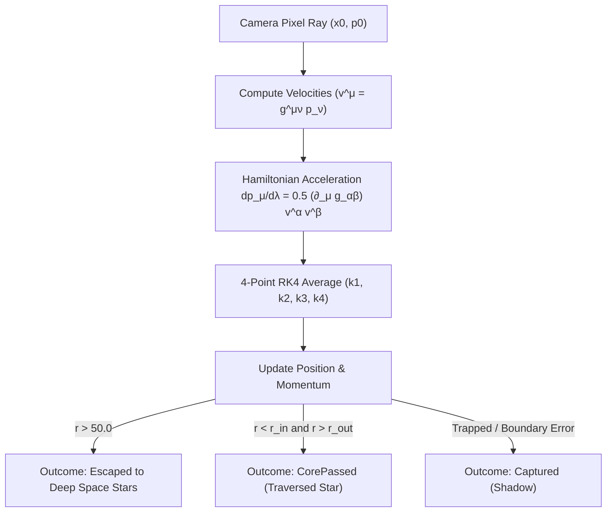

# File 05: `include/gravastar/integration/integrator.hpp` & `src/integration/integrator.cpp` — The RK4 Photon Raytracer

> **Target Audience**: 9th-Grade High School Student (Algebra 1 knowledge, Zero C++, Zero Differential Geometry)  
> **Source Codes**:
> - [`include/gravastar/integration/integrator.hpp`](file:///home/abrsdxd/Projects/GravastarLab/include/gravastar/integration/integrator.hpp)
> - [`src/integration/integrator.cpp`](file:///home/abrsdxd/Projects/GravastarLab/src/integration/integrator.cpp)  
> **Role in GravastarLab**: The Light Trajectory Engine (Bending Photons with Hamilton's Equations)

---

## 1. The Big Picture (What is this file's job?)

In a normal video game like *Minecraft* or *Fortnite*, light travels in perfectly straight lines. If you look at a tree, light bounces off the leaf and travels in a straight laser-beam line straight into your character's eye.

Near a gravastar, **light does not travel in straight lines!** Spacetime is warped so violently that light rays bend, loop around the star, or even dive straight through its dark energy core and come out the other side like a cosmic funhouse mirror.

To create an image of the gravastar on your computer monitor, our camera fires millions of invisible rays backwards from the screen into space. 

`integrator.hpp` and `integrator.cpp` are the **Steering Wheels of Light**. 



### What terrible thing happens if we delete this file or turn it off?
If you delete this file, light rays cannot move forward in time. The camera will shoot rays that freeze in place on the camera lens. Your screen will remain pitch black because no light ever reaches the sky or the gravastar.

---

## 2. High-School Physics & Math Intuition

### A. The Thrown Basketball (Runge-Kutta 4th-Order / RK4)
Imagine you are standing on a windy mountain cliff throwing a basketball. You want to calculate where the ball will be 1 second from now.
* **Bad Method (Euler's method)**: Look at where the ball is pointing right now, multiply by 1 second, and draw a straight line. (If the wind changes or gravity curves the path, your prediction will miss by a mile!)
* **The Master Method (RK4)**:
  1. **Step $k_1$**: Check the ball's speed and gravity right now at the start.
  2. **Step $k_2$**: Use $k_1$ to take half a step forward into the future (0.5 seconds). Check wind and gravity there.
  3. **Step $k_3$**: Use $k_2$ to take another revised half-step forward. Check again.
  4. **Step $k_4$**: Use $k_3$ to take a full step forward (1.0 second). Check the finish line.
  5. **The Magic Average**: Combine all four checks using Simpson's weighted average:
     $$\text{Final Step} = \frac{1}{6}(k_1 + 2k_2 + 2k_3 + k_4)$$
RK4 is so shockingly accurate that if you double your precision, your error drops by $2^4 = 16\times$!

### B. Hamilton's Equations: Position ($x^\mu$) vs Momentum ($p_\mu$)
In Einstein's universe, a photon (particle of light) has two sets of coordinates:
1. **Position ($x^\mu$)**: Where it is in space and time: $(t, r, \theta, \phi)$.
2. **Momentum ($p_\mu$)**: Which way its wave is pushing: $(p_t, p_r, p_\theta, p_\phi)$.

Hamilton's equations say:
* **Position changes according to momentum through the metric**:
  $$\frac{dx^\mu}{d\lambda} = g^{\mu\nu} p_\nu = v^\mu \quad (\text{Velocity})$$
* **Momentum changes according to the curvature slope of space**:
  $$\frac{dp_\mu}{d\lambda} = \frac{1}{2} \left(\frac{\partial g_{\alpha\beta}}{\partial x^\mu}\right) v^\alpha v^\beta \quad (\text{Gravitational Pull})$$

### C. Noether's Theorem: Cosmic Conservation Laws
In 1915, Emmy Noether discovered one of the most beautiful laws in all of science:
> **Every symmetry in nature creates a conserved quantity that can never change!**

1. **Time Symmetry**: Our gravastar is spinning at a steady rate; its gravity does not change from Tuesday to Wednesday ($\frac{\partial g}{\partial t} = 0$). Therefore, the photon's **Energy ($E = -p_t$) is strictly conserved!** $\frac{dp_0}{d\lambda} = 0$.
2. **Rotational Symmetry**: The star is a symmetric sphere spinning around its z-axis; rotating around longitude $\phi$ doesn't change gravity ($\frac{\partial g}{\partial \phi} = 0$). Therefore, the photon's **Angular Momentum ($L_z = p_\phi$) is strictly conserved!** $\frac{dp_3}{d\lambda} = 0$.

Because of this, the integrator doesn't even need to update $p_t$ or $p_\phi$—they are completely locked by the laws of physics!

---

## 3. The Line-by-Line Anatomy: `integrator.hpp`

```cpp
// SPDX-License-Identifier: GPL-3.0-or-later
#pragma once

#include "gravastar/geometry/geometry.hpp"
#include <array>
#include <cstdint>
#include <vector>

namespace gravastar::integration {

using Vec4 = std::array<double, 4>;

enum class RayOutcome : std::uint8_t {
    Escaped,     // Reached outer space (r > 50)
    CorePassed,  // Dived through the dark energy core and came out
    Captured,    // Trapped in orbit or fallen inside a black hole
    Exhausted    // Hit max step limit without escaping
};
```

#### Plain English Meaning
* **Line 11 (`Vec4`)**: A 4-element vector $[t, r, \theta, \phi]$ for positions or momentum.
* **Lines 13–18 (`RayOutcome`)**: The fate of each photon:
  - `Escaped`: The ray flew out into deep space and hit a background star or celestial skybox.
  - `CorePassed`: The ray entered the star's shell ($r < 1.5$) and flew out the other side.
  - `Captured`: The ray stayed trapped inside the photon sphere or hit a horizon.
  - `Exhausted`: The ray took too long ($> 2048$ steps) without finishing.

```cpp
struct IntegratorOptions {
    int max_steps{2048};
    double h0{0.05};
    double h_min{1e-5};
    double h_max{0.5};
    double escape_radius{50.0};
    double r_capture_tolerance{1e-3};
    bool record_trajectory{false};
};
```

#### Plain English Meaning
* Sets the flight limits for the ray:
  - `max_steps = 2048`: Maximum steps before giving up.
  - `h0 = 0.05`: Standard step size.
  - `escape_radius = 50.0`: Once a photon is 50 gravitational radii away, space is essentially flat; we declare it escaped.

---

## 4. The Line-by-Line Anatomy: `src/integration/integrator.cpp`

### Chunk 1: Lines 23–85 — Computing Hamilton's Derivatives

```cpp
bool compute_derivatives(const geometry::Parameters& params,
                         const State& s,
                         Derivative& d,
                         double& current_null_val) {
    const double r = s.x[1];
    const double theta = s.x[2];

    // Coordinate domain bounds: r > 0, 0 < theta < pi
    if (r <= 1e-4 || theta <= 1e-4 || theta >= (M_PI - 1e-4)) {
        return false;
    }
```

#### Plain English Meaning
* **Lines 30–33**: Safety shield! In spherical coordinates, the North Pole ($\theta = 0$) and South Pole ($\theta = \pi$) are coordinate singularities where longitude lines converge. If a ray flies closer than $0.0001$ radians to the pole, it stops gracefully instead of dividing by zero.

```cpp
    const auto eval_res = geometry::evaluate(params, r, theta);
    if (std::holds_alternative<geometry::Error>(eval_res)) {
        return false;
    }
    const auto& geom = std::get<geometry::Evaluation>(eval_res);

    // dx^mu = g^{mu nu} p_nu (contravariant velocity v^mu)
    Vec4 v{};
    for (int mu = 0; mu < 4; ++mu) {
        v[mu] = 0.0;
        for (int nu = 0; nu < 4; ++nu) {
            v[mu] += geom.inverse[mu][nu] * s.p[nu];
        }
        d.dx[mu] = v[mu];
    }
```

#### Plain English Meaning
* Calls `geometry::evaluate` (from File 03!) to get the metric tensor $g_{\mu\nu}$ and its inverse $g^{\mu\nu}$.
* Multiplies the inverse metric matrix by the momentum vector: $v^\mu = g^{\mu\nu} p_\nu$. This gives the real physical 4-velocity of the photon!

```cpp
    // Null constraint H = 0.5 * v^mu p_mu
    double h_val = 0.0;
    for (int mu = 0; mu < 4; ++mu) {
        h_val += v[mu] * s.p[mu];
    }
    current_null_val = 0.5 * h_val;

    d.dp[0] = 0.0; // Energy Conservation
    d.dp[3] = 0.0; // Angular Momentum Conservation
```

#### Plain English Meaning
* **Lines 53–57 (`Null constraint`)**: In Einstein's special relativity, light travels on a "null path":
  $$\mathcal{H} = \frac{1}{2} v^\mu p_\mu = 0$$
  This value must stay zero at all times! If `current_null_val` starts drifting (e.g. $0.001$), your computer is violating Einstein's speed-of-light rule!
* **Lines 63–64**: Enforces Noether's conservation laws for energy and angular momentum.

```cpp
    // mu = 1 (r): dg[1] is partial_r g
    double sum_r = 0.0;
    for (int a = 0; a < 4; ++a) {
        for (int b = 0; b < 4; ++b) {
            sum_r += geom.dg[1][a][b] * v[a] * v[b];
        }
    }
    d.dp[1] = 0.5 * sum_r;

    // mu = 2 (theta): dg[2] is partial_theta g
    double sum_th = 0.0;
    for (int a = 0; a < 4; ++a) {
        for (int b = 0; b < 4; ++b) {
            sum_th += geom.dg[2][a][b] * v[a] * v[b];
        }
    }
    d.dp[2] = 0.5 * sum_th;
```

#### Plain English Meaning
* Calculates how momentum bends:
  $$\frac{dp_r}{d\lambda} = \frac{1}{2} \sum_{a,b} \frac{\partial g_{ab}}{\partial r} v^a v^b$$
  $$\frac{dp_\theta}{d\lambda} = \frac{1}{2} \sum_{a,b} \frac{\partial g_{ab}}{\partial \theta} v^a v^b$$
  This is how the star bends light around itself!

---

### Chunk 2: Lines 129–171 — Adaptive Step Sizing & The RK4 Engine

```cpp
        // Adaptive step based on distance from core and shell
        double dist_to_shell = std::min(std::abs(r - params.r_in), std::abs(r - params.r_out));
        double factor = std::clamp(dist_to_shell / params.r_in, 0.05, 1.0);
        double h = std::clamp(opt.h0 * factor, opt.h_min, opt.h_max);
```

#### Plain English Meaning
* When a photon is far away in empty space, gravity is weak, so it can take big strides ($h = 0.5$).
* When a photon gets close to the thin matter shell at $r_{\text{in}} = 1.5$ or $r_{\text{out}} = 1.8$, gravity changes rapidly!
* **Line 131**: Automatically shrinks the step size by up to $20\times$ (`factor = 0.05`) so the photon steps carefully through the transition shell without skipping over physical details!

```cpp
        // RK4 Integration step
        Derivative k1, k2, k3, k4;
        double null_val = 0.0;

        if (!compute_derivatives(params, current, k1, null_val)) {
            result.outcome = RayOutcome::Captured;
            break;
        }
        result.max_null_drift = std::max(result.max_null_drift, std::abs(null_val));

        State s2 = add_scaled(current, k1, 0.5 * h);
        compute_derivatives(params, s2, k2, null_val);

        State s3 = add_scaled(current, k2, 0.5 * h);
        compute_derivatives(params, s3, k3, null_val);

        State s4 = add_scaled(current, k3, h);
        compute_derivatives(params, s4, k4, null_val);

        for (int i = 0; i < 4; ++i) {
            current.x[i] += (h / 6.0) * (k1.dx[i] + 2.0 * k2.dx[i] + 2.0 * k3.dx[i] + k4.dx[i]);
            current.p[i] += (h / 6.0) * (k1.dp[i] + 2.0 * k2.dp[i] + 2.0 * k3.dp[i] + k4.dp[i]);
        }
        lambda += h;
```

#### Plain English Meaning
* This is the 4-stage Runge-Kutta evaluation!
  - `k1`: Current slope.
  - `s2`: Half-step using `k1` $\to$ evaluates `k2`.
  - `s3`: Half-step using `k2` $\to$ evaluates `k3`.
  - `s4`: Full step using `k3` $\to$ evaluates `k4`.
* **Lines 163–164**: Blends the 4 slopes using Simpson's $\frac{1}{6}$ rule. Both position $x$ and momentum $p$ take a smooth step forward along the geodesic.

---

## 5. Debugger's Cheat Sheet: `integrator.cpp`

| Symptom | Suspect Line | Root Cause |
| :--- | :--- | :--- |
| `max_null_drift` explodes ($> 0.01$) | Line 163 | RK4 weighting typo (e.g. forgot `2.0 * k2` factor) |
| Rays crash or hang when flying over the poles | Line 31 | Coordinate boundary cutoff too small |
| Photons bounce unnaturally near the shell boundary | Line 131 | Step factor clamped too large, skipping shell interface |
| Star has no gravitational redshift | Line 63 | Accidental non-zero assignment to $dp_0$ |
| Image is completely black | Line 124 | `escape_radius` set smaller than camera distance |
