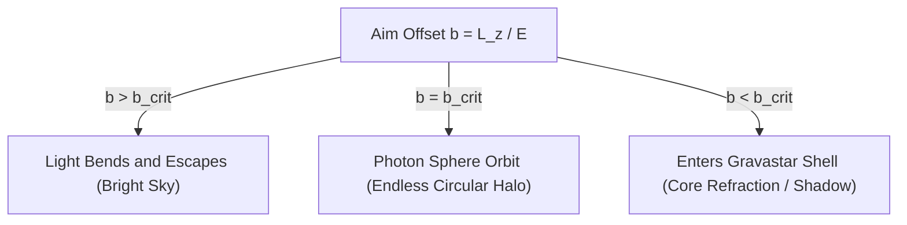

# File 06: `include/gravastar/integration/critical_impact.hpp` & `src/integration/critical_impact.cpp` — The Aiming Line ($b_{\text{crit}}$)

> **Target Audience**: 9th-Grade High School Student (Algebra 1 knowledge, Zero C++, Zero Astrophysics)  
> **Source Codes**:
> - [`include/gravastar/integration/critical_impact.hpp`](file:///home/abrsdxd/Projects/GravastarLab/include/gravastar/integration/critical_impact.hpp)
> - [`src/integration/critical_impact.cpp`](file:///home/abrsdxd/Projects/GravastarLab/src/integration/critical_impact.cpp)  
> **Role in GravastarLab**: The Boundary Line Between Escaping Light and Trapped Light

---

## 1. The Big Picture (What is this file's job?)

Imagine you are standing 100 meters away from a spinning bowling ball and trying to shoot a laser pointer past it. 

If you aim the laser pointer straight at the center of the ball, the light hits the ball. If you aim 50 meters wide, the laser beam flies straight past without bending much. 

Somewhere in between, there is a **razor-thin tipping point**:
* Aim $1$ millimeter to the left $\to$ The light bends, grazes the edge of the star, and flies out into the sky.
* Aim $1$ millimeter to the right $\to$ The light gets sucked into the whirlpool and enters the star!

The sideways distance from the center where you aim your beam is called the **Impact Parameter** ($b$). The exact tipping-point threshold is called the **Critical Impact Parameter** ($b_{\text{crit}}$).



If GravastarLab were an archery tournament, `critical_impact.hpp` is the **Exact Laser Sight Calibration**.

### What terrible thing happens if we delete this file or turn it off?
If we delete this file, we cannot verify whether our numerical raytracer is rendering the shadow contour accurately. We wouldn't know whether our shadow boundary matches Einstein's pen-and-paper equations or if it's drifting due to raytracing bugs.

---

## 2. High-School Physics & Math Intuition

### A. Prograde vs Retrograde: Swirling With vs Against the Vortex
Because the gravastar is spinning at 87.5% the speed of light, it drags the fabric of space along with it like a whirlpool:
1. **Prograde Light ($b > 0$)**: Light shot in the **same direction** the whirlpool is spinning. The whirlpool carries the light along smoothly. Because the swirl helps the photon, light can get much closer to the center ($r \approx 1.63$) before getting trapped!
2. **Retrograde Light ($b < 0$)**: Light shot **against** the spin of the whirlpool. Fighting against the rushing fabric of space requires massive energy. Light gets pushed away from much farther out ($r \approx 3.89$)!

This is why the shadow of a spinning star is **lopsided** (asymmetric)! It looks flattened on one side and bulging on the other!

```
     Retrograde Side                          Prograde Side
  (Light fights whirlpool)                (Light rides whirlpool)
         <---                                      --->
          \                                         /
           \             +-------------+           /
            \            |  Gravastar  |          /
             |           |   (Spins    |         |
             |           |  Clockwise) |         |
            /            +-------------+          \
           /                                       \
   b_ret = -8.14                            b_pro = +2.47
  (Pushed far away)                       (Permitted up close)
```

### B. The Buried Photon Sphere
Around a normal black hole, there is a circular orbit called the **Photon Sphere** where light can literally orbit in a circle forever like a moon made of pure light.
For our spin ($a = 0.875, M = 1$), the black hole prograde photon sphere is at:
$$r_{\text{ph, pro}} = 1.6288$$

**The Gravastar Surprise**:
In our gravastar, the physical matter shell begins at:
$$r_{\text{out}} = 1.8$$
Notice that $1.6288 < 1.8$! 
The prograde photon sphere **does not exist in the vacuum**—it is buried completely inside the star's shell! 

Therefore, prograde light doesn't get trapped by an empty spacetime centrifugal barrier; it directly strikes the **outer boundary of the physical matter crust**!

---

## 3. The Line-by-Line Anatomy ("Why This Line?")

Let's inspect [`critical_impact.cpp`](file:///home/abrsdxd/Projects/GravastarLab/src/integration/critical_impact.cpp).

```cpp
// Solves r (r - 3M)^2 - 4 M a^2 = 0 via Newton-Raphson iteration
void solve_kerr_photon_orbit(double M, double a, double r_guess, double& r_out, double& b_out) {
    double r = r_guess;
    for (int iter = 0; iter < 50; ++iter) {
        double diff = r - 3.0 * M;
        double f = r * diff * diff - 4.0 * M * a * a;
        double df = diff * (3.0 * r - 3.0 * M);
        if (std::abs(df) < 1e-15) break;
        double r_next = r - f / df;
        if (std::abs(r_next - r) < 1e-14) {
            r = r_next;
            break;
        }
        r = r_next;
    }
    r_out = r;
    b_out = -(r * r * r - 3.0 * M * r * r + a * a * r + M * a * a) / (a * (r - M));
}
```

#### Plain English Meaning
* **Lines 10–26**: Finds the radius of the unstable photon sphere using **Newton's Method**:
  $$r_{n+1} = r_n - \frac{f(r_n)}{f'(r_n)}$$
  where $f(r) = r(r - 3M)^2 - 4Ma^2 = 0$ is the famous Bardeen photon orbit equation from 1972.
* **Line 25**: Calculates the critical impact parameter $b = \frac{L_z}{E}$ corresponding to that exact circular orbit.

```cpp
CriticalImpactParameters compute_critical_impact(const geometry::Parameters& p) {
    CriticalImpactParameters res{};
    const double M = p.mass;
    const double a = p.spin;
    const double Lam = p.cosmological_constant;
    const double r_in = p.r_in;
    const double r_out = p.r_out;

    // Outer boundary (Kerr side): Delta(r_out)
    const double delta_out = r_out * r_out - 2.0 * M * r_out + a * a;
    const double sqrt_delta_out = std::sqrt(delta_out);
    res.b_crit_pro_shell = a + (r_out * r_out) / (a + sqrt_delta_out);
```

#### Plain English Meaning
* **Lines 39–41**: What is the threshold for a prograde photon to hit the outer shell at $r_{\text{out}} = 1.8$?
  Using the exact turning point equation from General Relativity:
  $$b_{\text{crit, pro}} = a + \frac{r_{\text{out}}^2}{a + \sqrt{\Delta(r_{\text{out}})}}$$
  Plugging in $M=1, a=0.875, r_{\text{out}}=1.8$, we get:
  $$\Delta(1.8) = 1.8^2 - 2(1)(1.8) + 0.875^2 = 0.405625 \implies \sqrt{\Delta} = 0.636887$$
  $$b_{\text{crit, pro}} = 0.875 + \frac{3.24}{0.875 + 0.636887} \approx 3.018$$

```cpp
    // Retrograde: r_ph_ret_kerr > r_out (3.8876 > 1.8), governed by exterior Kerr centrifugal barrier
    solve_kerr_photon_orbit(M, a, 3.88756325539, res.r_ph_ret_kerr, res.b_crit_ret_shell);

    return res;
}
```

#### Plain English Meaning
* **Line 56**: For retrograde light (fighting the spin), the photon sphere is at $r \approx 3.8876$, which is far outside the shell ($3.8876 > 1.8$). Therefore, retrograde light never touches the shell unless it first climbs over this exterior centrifugal barrier!
* Gives the analytical benchmark:
  $$b_{\text{crit, ret}} \approx -8.1408$$

---

## 4. Debugger's Cheat Sheet: `critical_impact.cpp`

| Symptom | Suspect Line | Root Cause |
| :--- | :--- | :--- |
| Newton solver hangs or returns `NaN` | Line 16 | Derivative $df \to 0$ without convergence guard |
| Prograde critical impact parameter does not match raytracer | Line 53 | Forgot that prograde photon sphere is buried inside $r_{\text{out}}$ |
| Retrograde shadow width wrong | Line 56 | Initial Newton guess too close to prograde root |
