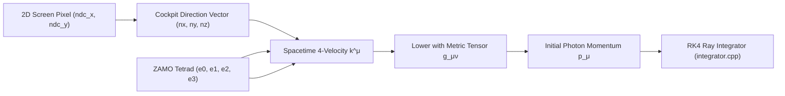

# File 07: `include/gravastar/optics/camera.hpp` & `src/optics/camera.cpp` — The ZAMO Whirlpool Camera

> **Target Audience**: 9th-Grade High School Student (Algebra 1 knowledge, Zero C++, Zero General Relativity)  
> **Source Codes**:
> - [`include/gravastar/optics/camera.hpp`](file:///home/abrsdxd/Projects/GravastarLab/include/gravastar/optics/camera.hpp)
> - [`src/optics/camera.cpp`](file:///home/abrsdxd/Projects/GravastarLab/src/optics/camera.cpp)  
> **Role in GravastarLab**: The Cockpit Windshield & Observer Tetrad (Shooting Pixel Rays into Curved Space)

---

## 1. The Big Picture (What is this file's job?)

Imagine you are in a tiny spaceship holding a video camera, flying near a colossal, spinning gravastar. You want to point your camera at the star and take a high-resolution photograph.

In ordinary video games, placing a camera is easy: you set an $(x, y, z)$ position, point the camera forward, and click render.

Near a spinning gravastar, **you cannot just park your spaceship and stand still!** 
Because the star is spinning at 87.5% the speed of light, it drags the very fabric of space with it like water swirling into a giant drain. Close to the star (in a region called the **ergosphere**), space is spinning so fast that to stand completely motionless relative to distant stars would require you to travel faster than the speed of light! Your spaceship engines would explode.

To survive and take a clear picture, your spaceship puts its thrusters in neutral and drifts along with the swirling current. This is called a **Zero-Angular-Momentum Observer (ZAMO)**. 

`camera.hpp` and `camera.cpp` are the **Cockpit Windshield & Gyroscopic Camera Gimbal**. 



### What terrible thing happens if we delete this file or turn it off?
If you delete this file, you have no way to convert a pixel on your 2D computer screen into a physical light ray in 4D curved spacetime. The graphics engine will have no camera, no perspective, and no point of view—the screen will stay completely blank.

---

## 2. High-School Physics & Math Intuition

### A. The Whirlpool Effect: Why We Use a ZAMO
Imagine you are sitting in a rubber dinghy right above a giant swirling whirlpool in a river:
* **The Static Observer Trap**: If you try to hold onto a wooden pole hammered into the riverbed to remain completely stationary, the rushing water smashes into your boat with tremendous violence.
* **The ZAMO Solution**: If you let go of the pole, your dinghy naturally swirls around the whirlpool with the current. Inside your boat, the water around you looks calm! You feel no sideways g-forces tearing you apart.

In astrophysics, an observer who lets spacetime carry them along with zero sideways angular momentum is called a **ZAMO** (or a *Bardeen Locally Non-Rotating Observer*).

### B. What is an Orthonormal Tetrad?
Inside your spaceship cockpit, Einstein's equivalence principle says: **Gravity disappears locally!** 
If you close your window blinds, space inside your cabin feels just like normal flat high-school physics!

A **Tetrad** is simply a set of 4 perpendicular ruler-arrows you draw inside your cockpit:
1. **$e_0$ (Time Arrow)**: Your wristwatch ticking forward into the future.
2. **$e_1$ (Forward Arrow)**: Laser pointer pointing straight out the windshield at the gravastar.
3. **$e_2$ (Upward Arrow)**: Arrow pointing toward the cockpit ceiling (towards the North Pole).
4. **$e_3$ (Rightward Arrow)**: Arrow pointing out the right-hand window (towards the East).

Because these 4 arrows are mutually perpendicular ("orthonormal"):
$$g(e_a, e_b) = \eta_{ab} = \text{diag}(-1, +1, +1, +1)$$
This allows us to aim camera rays using simple high-school trigonometry ($dx, dy, dz$), and then multiply by the tetrad to launch the ray into Einstein's warped universe!

---

## 3. The Line-by-Line Anatomy: `camera.cpp`

Let's walk through the actual C++ code in [`src/optics/camera.cpp`](file:///home/abrsdxd/Projects/GravastarLab/src/optics/camera.cpp).

```
Lines 61–86:   Reading Metric Components & Lorentzian Signature Check
Lines 87–100:  Computing Whirlpool Drag Speed (omega)
Lines 101–119: Computing Observer Time Flow Rate (alpha lapse)
Lines 120–144: Building the 4 Orthonormal Cockpit Vectors (e0, e1, e2, e3)
Lines 165–185: 2D Screen Pixel to 3D Cockpit Unit Vector
Lines 186–200: Transforming Cockpit Ray to Universe Coordinates (k_up)
Lines 201–214: Lowering to Covariant Momentum (p_down = g * k_up)
```

---

### Chunk 1: Lines 61–100 — Reading the Metric and Frame-Dragging $\omega$

```cpp
Tetrad make_observer_tetrad(const geometry::Parameters& params, double r, double theta) {
    const auto eval_res = geometry::evaluate(params, r, theta);
    if (std::holds_alternative<geometry::Error>(eval_res)) {
        throw std::runtime_error("Cannot construct observer frame: invalid coordinate or domain");
    }
    const auto& g = std::get<geometry::Evaluation>(eval_res);

    Tetrad tetrad{};

    const double g_tt     = g.metric[0][0]; // Time-time component
    const double g_rr     = g.metric[1][1]; // Radius-radius component
    const double g_thth   = g.metric[2][2]; // Theta-theta component
    const double g_phiphi = g.metric[3][3]; // Phi-phi component
    const double g_tphi   = g.metric[0][3]; // Frame-dragging cross-term

    if (g_phiphi <= 0.0 || g_rr <= 0.0 || g_thth <= 0.0) {
        throw std::runtime_error("Invalid metric signature for observer frame: spatial diagonals must be > 0");
    }

    const double omega = -g_tphi / g_phiphi;
```

#### Plain English Meaning
* **Lines 62–68**: Evaluates the metric tensor $g_{\mu\nu}$ at the camera's location $(r, \theta)$.
* **Lines 74–78**: Extracts the diagonal terms ($g_{tt}, g_{rr}, g_{\theta\theta}, g_{\phi\phi}$) and the off-diagonal swirl term ($g_{t\phi}$).
* **Lines 81–85**: Physical sanity check! In real physics, space has 3 positive spatial directions. If any diagonal term is $\le 0$, space has collapsed or divided by zero.
* **Line 100 (`omega`)**: Calculates the frame-dragging angular velocity:
  $$\omega = -\frac{g_{t\phi}}{g_{\phi\phi}}$$
  This is the exact speed (in radians per second) that space is swirling around the gravastar! By setting your spaceship's drift speed to $\omega$, you eliminate all sideways Coriolis and centrifugal forces.

#### The "What If It Breaks?" Debugging Clue
* **If you remove the minus sign on Line 100 (`const double omega = g_tphi / g_phiphi;`)**: The observer will drift *against* the spin of the whirlpool! As the camera approaches the ergosphere, the frame will violently tilt, roll, and distort into a stretched funhouse mirror.

---

### Chunk 2: Lines 101–144 — The Lapse Function $\alpha$ and Tetrad Vectors

```cpp
    const double lapse_sq = -g_tt + omega * omega * g_phiphi;
    if (lapse_sq <= 0.0) {
        throw std::runtime_error("ZAMO lapse squared must be strictly positive (observer cannot exist in imaginary time)");
    }
    const double alpha = std::sqrt(lapse_sq);

    // e0 (Time axis / 4-velocity):
    tetrad.e0 = {1.0 / alpha, 0.0, 0.0, omega / alpha};

    // e1 (Forward axis pointing straight at the gravastar):
    tetrad.e1 = {0.0, -1.0 / std::sqrt(g_rr), 0.0, 0.0};

    // e2 (Upward axis pointing towards the North Pole):
    tetrad.e2 = {0.0, 0.0, 1.0 / std::sqrt(g_thth), 0.0};

    // e3 (Rightward axis pointing East / prograde):
    tetrad.e3 = {0.0, 0.0, 0.0, 1.0 / std::sqrt(g_phiphi)};

    return tetrad;
}
```

#### Plain English Meaning
* **Lines 106–118 (`alpha`)**: Computes the **lapse function** $\alpha$ (how fast the observer's wristwatch ticks compared to a clock infinitely far away):
  $$\alpha = \sqrt{-g_{tt} + \omega^2 g_{\phi\phi}}$$
  Inside the ergosphere, $g_{tt} > 0$ (which would break a static observer), but because our ZAMO is swirling with speed $\omega$, $\omega^2 g_{\phi\phi}$ saves the day and keeps $\alpha > 0$!
* **Line 126 (`e0`)**: The 4-velocity of the observer. Moves through time at rate $\frac{1}{\alpha}$, and spins through longitude $\phi$ at rate $\frac{\omega}{\alpha}$.
* **Line 132 (`e1`)**: Forward camera vector. Since radius $r$ points *away* from the star, pointing *toward* the star means pointing in the negative direction: $-\frac{1}{\sqrt{g_{rr}}}$.
* **Line 137 (`e2`)**: Upward camera vector along latitude $\theta$, normalized by $\frac{1}{\sqrt{g_{\theta\theta}}}$.
* **Line 141 (`e3`)**: Rightward camera vector along longitude $\phi$, normalized by $\frac{1}{\sqrt{g_{\phi\phi}}}$.

---

### Chunk 3: Lines 165–214 — Pixel Ray Momentum Construction

```cpp
Vec4 pixel_ray_momentum(const Tetrad& tetrad,
                        const geometry::Evaluation& geom,
                        double ndc_x,
                        double ndc_y,
                        double tan_half_fov,
                        double aspect) {
    const double dx = ndc_x * tan_half_fov * aspect;
    const double dy = ndc_y * tan_half_fov;
    const double dz = 1.0; // Pointing forward through the glass windshield

    const double norm = std::sqrt(dx * dx + dy * dy + dz * dz);
    const double nx = dx / norm; // Unit horizontal direction
    const double ny = dy / norm; // Unit vertical direction
    const double nz = dz / norm; // Unit forward direction

    Vec4 k_up{};
    for (int mu = 0; mu < 4; ++mu) {
        k_up[mu] = -tetrad.e0[mu]       // Move backward in time (-e0)
                   + nz * tetrad.e1[mu] // Forward towards gravastar
                   - ny * tetrad.e2[mu] // Upwards towards North
                   + nx * tetrad.e3[mu]; // Rightwards towards East
    }

    Vec4 p_down{};
    for (int mu = 0; mu < 4; ++mu) {
        p_down[mu] = 0.0;
        for (int nu = 0; nu < 4; ++nu) {
            p_down[mu] += geom.metric[mu][nu] * k_up[nu];
        }
    }

    return p_down;
}
```

#### Plain English Meaning
* **Lines 175–185**: Converts 2D screen coordinates $(ndc_x, ndc_y) \in [-1, +1]$ into a 3D unit ray $(n_x, n_y, n_z)$ using the camera's field of view (`tan_half_fov`) and aspect ratio.
* **Lines 193–199**: Combines the cockpit ray with the tetrad vectors:
  $$k^\mu = -e_0^\mu + n_z e_1^\mu - n_y e_2^\mu + n_x e_3^\mu$$
  Notice **`-tetrad.e0[mu]`**: The minus sign on time means the photon is traced **backwards into the past**, so we can find what star emitted it!
* **Lines 205–210**: Lowers the index using the metric tensor:
  $$p_\mu = g_{\mu\nu} k^\nu$$
  This yields the covariant canonical momentum $p_\mu = (p_t, p_r, p_\theta, p_\phi)$ ready for the RK4 integrator!

---

## 4. Debugger's Cheat Sheet: `camera.cpp`

| Symptom | Suspect Line | Root Cause |
| :--- | :--- | :--- |
| Screen renders upside down | Line 197 | Sign flip on vertical axis $e_2$ |
| Image horizontally flipped (mirror image) | Line 198 | Sign flip on horizontal axis $e_3$ |
| Screen completely black / crash inside ergosphere | Line 114 | Static observer used instead of ZAMO (`omega` missing from `lapse_sq`) |
| Ray null constraint test fails on step 0 ($\mathcal{H} \ne 0$) | Line 181 | Vector normalization omitted (`norm` missing) |
| Image sheared diagonally near equator | Line 100 | Minus sign missing in $\omega = -g_{t\phi}/g_{\phi\phi}$ |
