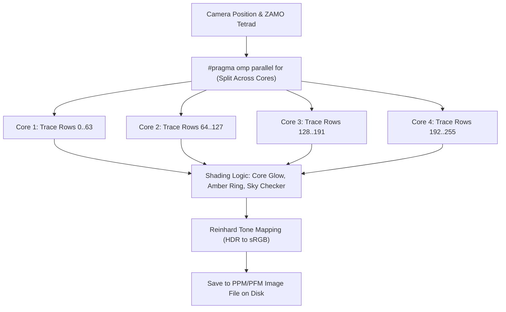

# File 08: `include/gravastar/optics/renderer.hpp` & `src/optics/renderer.cpp` — Multi-Core CPU OpenMP Raymarcher

> **Target Audience**: 9th-Grade High School Student (Algebra 1 knowledge, Zero C++, Zero Graphics Programming)  
> **Source Codes**:
> - [`include/gravastar/optics/renderer.hpp`](file:///home/abrsdxd/Projects/GravastarLab/include/gravastar/optics/renderer.hpp)
> - [`src/optics/renderer.cpp`](file:///home/abrsdxd/Projects/GravastarLab/src/optics/renderer.cpp)  
> **Role in GravastarLab**: The CPU Movie Projector (Distributing Pixels Across CPU Cores)

---

## 1. The Big Picture (What is this file's job?)

If you want to render a $512 \times 512$ image, you have to trace **262,144 independent light rays**. If one processor core traced them one by one, your computer would sit there chugging for minutes.

Modern computer processors have 8, 16, or 32 physical "cores" (mini-brains). 

`renderer.cpp` is the **Factory Boss with a Megaphone**. It shouts:
> *"Worker 1, take rows 0 through 10! Worker 2, take rows 11 through 20! Worker 8, take rows 80 through 90! Everyone trace your rays right now!"*

In C++, this multi-worker system is called **OpenMP (Open Multi-Processing)**. 



### What terrible thing happens if we delete this file or turn it off?
If we delete this file, we cannot render headless reference images without a graphics card. On high-performance computing clusters or testing servers that don't have a GPU screen attached, `renderer.cpp` is how we verify images and create regression test snapshots.

---

## 2. High-School Physics & Math Intuition

### A. The Optical Fingerprint: Gravastar vs Black Hole
If you take a picture of a **Black Hole**, you see:
1. An outer celestial sky distorted by gravitational lensing.
2. A bright ring of light (the photon ring).
3. A completely black, pitch-dark void in the center (the event horizon shadow).

If you take a picture of a **Gravastar**, you see something incredible:
* Because there is **no event horizon**, light aimed near the center does NOT get trapped forever!
* Light penetrates into the thin matter crust, enters the repulsive **de Sitter dark energy core**, refracts through the core, and **shoots out the other side**!
* In our renderer:
  - Trapped rays are colored **Black** (`0, 0, 0`).
  - Core-penetrating rays are colored **Electric Cyan-Blue** (`0.2, 0.7, 1.0`).
  - Shell-skimming rays are colored **Amber Glow** (`1.0, 0.5, 0.1`).

This luminous cyan-blue core ring is the **smoking gun visual signature** that tells astronomers: *"That is not a black hole; that is a gravastar!"*

```
+--------------------------------------------------------+
|                      DEEP SPACE SKY                    |
|                    (Checkered Grid)                    |
|                                                        |
|                   . - ~ ~ ~ - .                        |
|               . '   Amber Ring  ' .                    |
|             /     (Shell Skim)      \                  |
|            /     . - ~ ~ ~ - .       \                 |
|           |    /   Cyan-Blue   \      |                |
|           |   |    Core Glow    |     |                |
|           |    \  (de Sitter)  /      |                |
|            \     ' - ~ ~ ~ - '       /                 |
|             \                       /                  |
|               ' .                 '                    |
|                   ' - ~ ~ ~ - '                        |
+--------------------------------------------------------+
```

### B. Tone Mapping: Shrinking Sunlight onto a Plastic Monitor
In curved spacetime, gravitational blueshift can make light rays thousands of times brighter than ordinary light (High Dynamic Range or **HDR**). 

A normal computer monitor can only display color values between $0$ (pure black) and $255$ (maximum brightness). If you just clamp bright values:
$$\text{if } x > 1.0 \implies x = 1.0$$
any pixel brighter than the sun turns into a blown-out blob of pure solid white!

To fix this, we use **Reinhard Tone Mapping**:
$$f(x) = \frac{x}{1 + x}$$
* When $x = 0 \to f(0) = 0$.
* When $x = 1 \to f(1) = 0.5$.
* When $x = 10 \to f(10) = 0.909$.
* When $x = 1,000,000 \to f(x) = 0.999999$.

No matter how bright the incoming light is, it smoothly approaches $1.0$ without ever exceeding the display limit!

---

## 3. The Line-by-Line Anatomy: `renderer.cpp`

### Chunk 1: Lines 39–51 — The Parallel Screen Loop

```cpp
    #pragma omp parallel for collapse(2) schedule(dynamic)
    for (int y = 0; y < buffer.height; ++y) {
        for (int x = 0; x < buffer.width; ++x) {
            // Screen coordinates NDC in [-1, 1]
            const double ndc_x = (2.0 * (x + 0.5) / buffer.width) - 1.0;
            const double ndc_y = 1.0 - (2.0 * (y + 0.5) / buffer.height); // top to bottom

            const Vec4 p0 = pixel_ray_momentum(tetrad, geom, ndc_x, ndc_y, tan_half_fov, aspect);

            const auto result = integration::trace_ray(params, x0, p0, settings.integrator);

            float* pixel = buffer.at(x, y);
```

#### Plain English Meaning
* **Line 39 (`#pragma omp parallel for`)**: Special compiler command that launches a team of background threads across all available CPU cores. `schedule(dynamic)` automatically hands out new batches of pixels to cores as soon as they finish, so fast pixels don't wait for slow pixels.
* **Lines 43–44**: Converts integer pixel coordinates $(x, y) \in [0, \text{width}] \times [0, \text{height}]$ to **Normalized Device Coordinates (NDC)** in $[-1, +1]$:
  - Left edge is $ndc_x = -1.0$, right edge is $ndc_x = +1.0$.
  - Top edge is $ndc_y = +1.0$, bottom edge is $ndc_y = -1.0$.
* **Line 46**: Calls `pixel_ray_momentum` (File 07!) to calculate the initial photon momentum $p_0$.
* **Line 48**: Calls `integration::trace_ray` (File 05!) to integrate the light ray through curved space.

---

### Chunk 2: Lines 52–80 — Gravastar Shading Logic

```cpp
            if (result.outcome == integration::RayOutcome::CorePassed) {
                // Ray penetrated through the shell into the de Sitter core and escaped
                // Gravastar interior optical signature: distinct energetic core luminescence
                pixel[0] = 0.2f;
                pixel[1] = 0.7f;
                pixel[2] = 1.0f; // Cyan-blue core refraction
            } else if (result.crossed_shell_in) {
                // Skimmed shell
                pixel[0] = 1.0f;
                pixel[1] = 0.5f;
                pixel[2] = 0.1f; // Amber ring
            } else if (result.outcome == integration::RayOutcome::Escaped) {
                // Background sky with simple celestial coordinates pattern
                double final_th = result.final_x[2];
                double final_ph = result.final_x[3];
                // Checker / grid stars
                int u = static_cast<int>(std::floor(final_ph * 3.0 / M_PI));
                int v = static_cast<int>(std::floor(final_th * 6.0 / M_PI));
                if ((u + v) % 2 == 0) {
                    pixel[0] = 0.05f; pixel[1] = 0.05f; pixel[2] = 0.08f;
                } else {
                    pixel[0] = 0.02f; pixel[1] = 0.02f; pixel[2] = 0.03f;
                }
            } else {
                // Trapped / Captured
                pixel[0] = 0.0f;
                pixel[1] = 0.0f;
                pixel[2] = 0.0f;
            }
```

#### Plain English Meaning
* **Lines 52–57 (`CorePassed`)**: Light ray pierced the shell into the dark energy core and escaped out the other side. Colored bright cyan-blue (`R=0.2, G=0.7, B=1.0`).
* **Lines 58–62 (`crossed_shell_in`)**: Ray grazed the ultra-dense matter shell. Colored warm amber (`R=1.0, G=0.5, B=0.1`).
* **Lines 63–74 (`Escaped`)**: Ray flew out into deep space. Looks up the ray's final celestial coordinates $(\theta_{\text{final}}, \phi_{\text{final}})$ and draws a mathematical checkerboard sky! This makes gravitational lensing curves immediately obvious to human eyes.
* **Lines 75–80 (`Captured`)**: Ray fell into an event horizon or photon trap. Colored pitch black (`0, 0, 0`).

---

### Chunk 3: Lines 100–116 — Saving Images to Disk (Netpbm PPM Format)

```cpp
bool write_ppm(const std::string& filepath, const ImageBuffer& image, float exposure) {
    if (image.width <= 0 || image.height <= 0) return false;
    std::ofstream stream(filepath, std::ios::binary);
    if (!stream) return false;

    stream << "P6\n" << image.width << " " << image.height << "\n255\n";
    std::vector<unsigned char> bytes(image.width * 3);

    for (int y = 0; y < image.height; ++y) {
        const float* row = image.at(0, y);
        for (int i = 0; i < image.width * 3; ++i) {
            bytes[i] = static_cast<unsigned char>(tone_map(row[i], exposure) * 255.0f);
        }
        stream.write(reinterpret_cast<const char*>(bytes.data()), bytes.size());
    }
    return stream.good();
}
```

#### Plain English Meaning
* Saves the rendered image into the simplest, most universal picture format in existence: **Binary Netpbm PPM (`P6`)**.
* **Line 105**: Writes the 3-line plain text header:
  - `P6`: Binary RGB image.
  - `width height`: Resolution.
  - `255`: Maximum byte brightness.
* **Line 111**: Applies Reinhard tone mapping to compress HDR colors, multiplies by 255, and casts to an 8-bit byte (`unsigned char`).
* Any image viewer on Linux, Windows, or macOS can open `.ppm` files instantly!

---

## 4. Debugger's Cheat Sheet: `renderer.cpp`

| Symptom | Suspect Line | Root Cause |
| :--- | :--- | :--- |
| Image renders completely black | Line 27 | Camera placed at invalid coordinate (e.g. inside the core or on the polar axis) |
| Output image upside down | Line 44 | Inverted sign on `ndc_y` formula |
| Sky checkerboard distorted into horizontal streaks | Line 68 | Longitudinal wrapping modulo missing in sky shader |
| Crashes with segmentation fault when saving PPM | Line 106 | Buffer size calculation typo (`width * 3` instead of `width * height * 3`) |
| Cores take minutes per frame | Line 39 | OpenMP disabled in compiler flags (running single-threaded) |
