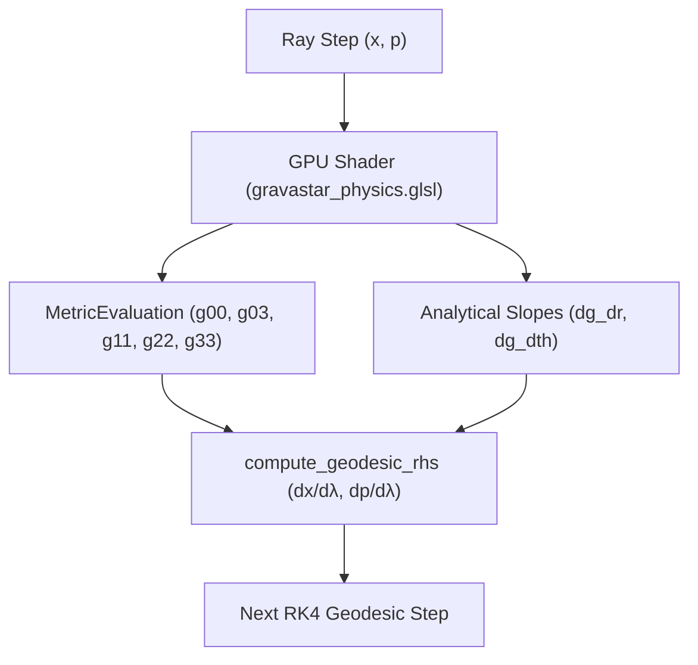

# File 09: `shaders/gravastar_physics.glsl` — The GPU Physics Engine

> **Target Audience**: 9th-Grade High School Student (Algebra 1 knowledge, Zero GLSL, Zero Graphics Shaders)  
> **Source Code**: [`shaders/gravastar_physics.glsl`](file:///home/abrsdxd/Projects/GravastarLab/shaders/gravastar_physics.glsl)  
> **Role in GravastarLab**: The Graphics Card's Einstein Physics Brain (Running on Thousands of GPU Cores)

---

## 1. The Big Picture (What is this file's job?)

A modern graphics card (GPU) is not just one fast brain like your CPU; it is an army of **thousands of tiny mathematical soldier ants** working in unison. 

When you play a video game at 4K resolution (3840 × 2160 pixels), your graphics card has to trace **8.3 million pixels every single frame**, 60 times a second! 

A CPU cannot do this fast enough. But a GPU can! 

However, graphics cards speak a different programming language called **GLSL (OpenGL Shading Language)**. A GPU does not have C++ classes, and it cannot run our `Jet` automatic differentiation engine because `Jet` needs dynamic branching and large memory tables.

`gravastar_physics.glsl` is the **High-Speed GPU Physics Formula Book**:
1. It contains the **exact analytical formulas** for the rotating gravastar metric tensor $g_{\mu\nu}$.
2. It contains the **exact analytical derivatives** $\partial_r g_{\mu\nu}$ and $\partial_\theta g_{\mu\nu}$ written with lightning-fast hardware operations.
3. It contains Hamilton's equations of motion optimized for GPU registers!



### What terrible thing happens if we delete this file or turn it off?
If you delete this file, the graphics card has no physics code. The GPU compute shaders (`.comp`) won't compile, the Vulkan pipeline will crash on startup, and your window will display a fatal shader compiler error.

---

## 2. High-School Physics & Math Intuition

### A. Quotient Rule on a Graphics Card
In `jet.hpp`, we let the computer take derivatives automatically by carrying Taylor series backpacks. 
On a GPU, every nanosecond counts! 

Instead of backpacks, `gravastar_physics.glsl` uses the **High-School Quotient Rule**:
$$\left(\frac{N}{D}\right)' = \frac{N' D - N D'}{D^2}$$
For example, for the metric component $g_{00} = \frac{N_{00}}{\text{denom}}$:
```glsl
float N00 = T * a2 * s2 - delta;
float dN00_dr = dT_dr * a2 * s2 - ddelta_dr;
res.dg_dr00 = (dN00_dr * denom - N00 * ddenom_dr) / (denom * denom);
```
Look at that: $N' \cdot D - N \cdot D'$ divided by $D^2$! It is literally high-school calculus written in GLSL!

### B. The 5 Non-Zero Metric Numbers
In 4D spacetime, a 4×4 matrix has 16 slots. But because our gravastar is symmetrical around its spinning axis, **11 of those slots are zero**:
1. `g00` ($g_{tt}$): Gravitational time slowdown.
2. `g11` ($g_{rr}$): Radial space stretching.
3. `g22` ($g_{\theta\theta}$): Latitude space stretching.
4. `g33` ($g_{\phi\phi}$): Longitude ring circumference.
5. `g03` ($g_{t\phi}$): Whirlpool frame dragging ($g_{30} = g_{03}$).

All other slots ($g_{tr}, g_{t\theta}, g_{r\theta}, \dots$) are exactly zero! 
By storing only these 5 numbers instead of all 16, the GPU saves $70\%$ of its memory bandwidth!

---

## 3. The Line-by-Line Anatomy ("Why This Line?")

Let's walk through the core logic of [`shaders/gravastar_physics.glsl`](file:///home/abrsdxd/Projects/GravastarLab/shaders/gravastar_physics.glsl).

```
Lines 1–15:   MetricEvaluation struct definition
Lines 16–25:  7th-degree septic polynomial and its derivative (smoothstep_c3)
Lines 26–66:  Shell coordinate scaling and transition function
Lines 67–93:  Boyer-Lindquist intermediate scalars (delta, sigma, T, X)
Lines 94–109: The 5 metric components and their inverses
Lines 110–135: Analytical radial derivatives (dg_dr)
Lines 136–155: Analytical polar angle derivatives (dg_dth)
Lines 156–195: Hamilton's Equations RHS (compute_geodesic_rhs)
```

---

### Chunk 1: Lines 16–25 — The Septic Polynomial & Its Derivative

```glsl
float smoothstep_c3(float u) {
    float u2 = u * u;
    return u2 * u2 * (35.0 + u * (-84.0 + u * (70.0 - 20.0 * u)));
}

float dsmoothstep_c3(float u) {
    float u3 = u * u * u;
    return u3 * (140.0 + u * (-420.0 + u * (420.0 - 140.0 * u)));
}
```

#### Plain English Meaning
* **Line 18 (`smoothstep_c3`)**: Evaluates the 7th-degree polynomial:
  $$\mu(u) = 35u^4 - 84u^5 + 70u^6 - 20u^7$$
* **Line 23 (`dsmoothstep_c3`)**: Evaluates its exact derivative using the power rule:
  $$\mu'(u) = 140u^3 - 420u^4 + 420u^5 - 140u^6$$
  Notice that at $u = 0$ and $u = 1$, both $\mu'$ and $\mu''$ vanish! This provides the bump-free $C^3$ highway ramp.

---

### Chunk 2: Lines 70–86 — The Spacetime Constants & Horizon Guard

```glsl
    float r2 = r * r;
    float a2 = a * a;
    float s = sin(theta);
    float c = cos(theta);
    float s2 = s * s;
    float c2 = c * c;
    float sin_2th = sin(2.0 * theta);

    float A = r2 + a2;
    float sigma = r2 + a2 * c2;
    float delta = A * (1.0 - eff_lam * r2 / 3.0) - 2.0 * M * mu * r;
    float T = 1.0 + eff_lam * a2 * c2 / 3.0;
    float X = 1.0 + eff_lam * a2 / 3.0;

    if (delta <= 1e-6 || sigma <= 1e-6 || T <= 1e-6 || X <= 1e-6) {
        return res; // Horizon / singularity
    }
```

#### Plain English Meaning
* Computes the geometric scalars:
  - $\Sigma = r^2 + a^2 \cos^2\theta$.
  - $\Delta(r) = (r^2 + a^2)\left(1 - \frac{\Lambda \lambda}{3} r^2\right) - 2M\mu r$.
* **Lines 84–86**: Guard check! If $\Delta \le 10^{-6}$ or $\Sigma \le 10^{-6}$, the ray is too close to a singularity or horizon; it immediately sets `res.valid = false` and exits, preventing the GPU from dividing by zero.

---

### Chunk 3: Lines 96–109 — Metric Components & Inverses

```glsl
    float denom = sigma * X * X;

    // Metric components
    res.g00 = (T * a2 * s2 - delta) / denom;
    res.g03 = a * s2 * (delta - T * A) / denom;
    res.g33 = s2 * (T * A * A - delta * a2 * s2) / denom;
    res.g11 = sigma / delta;
    res.g22 = sigma / T;

    // Inverse metric
    float pref = (X * X) / sigma;
    res.inv00 = -pref * (A * A / delta - a2 * s2 / T);
    res.inv03 = -a * pref * (A / delta - 1.0 / T);
    res.inv33 = pref * (1.0 / (T * s2) - a2 / delta);
    res.inv11 = delta / sigma;
    res.inv22 = T / sigma;
```

#### Plain English Meaning
* Assembles the 5 metric entries and their exact algebraic matrix inverses. 
* Notice how clean and compact this is compared to a general 4×4 matrix inverter: each inverse component is written in 1 line of arithmetic!

---

### Chunk 4: Lines 160–193 — Hamilton's Equations of Motion

```glsl
void compute_geodesic_rhs(
    in MetricEvaluation m,
    in vec4 x, in vec4 p,
    out vec4 dx, out vec4 dp,
    out float null_constraint)
{
    // dx^mu = g^{mu nu} p_nu
    dx.x = m.inv00 * p.x + m.inv03 * p.w; // t
    dx.y = m.inv11 * p.y;                 // r
    dx.z = m.inv22 * p.z;                 // theta
    dx.w = m.inv03 * p.x + m.inv33 * p.w; // phi

    // Null constraint H = 0.5 * v^mu p_mu
    null_constraint = 0.5 * (dx.x * p.x + dx.y * p.y + dx.z * p.z + dx.w * p.w);

    // dp_0 = 0 (t-symmetry / Energy)
    // dp_3 = 0 (phi-symmetry / Angular momentum)
    dp.x = 0.0;
    dp.w = 0.0;

    // dp_1 (r)
    dp.y = 0.5 * (m.dg_dr00 * dx.x * dx.x
                + 2.0 * m.dg_dr03 * dx.x * dx.w
                + m.dg_dr33 * dx.w * dx.w
                + m.dg_dr11 * dx.y * dx.y
                + m.dg_dr22 * dx.z * dx.z);

    // dp_2 (theta)
    dp.z = 0.5 * (m.dg_dth00 * dx.x * dx.x
                + 2.0 * m.dg_dth03 * dx.x * dx.w
                + m.dg_dth33 * dx.w * dx.w
                + m.dg_dth11 * dx.y * dx.y
                + m.dg_dth22 * dx.z * dx.z);
}
```

#### Plain English Meaning
* **Lines 167–170 (`dx`)**: Evaluates photon velocity: $v^\mu = g^{\mu\nu} p_\nu$.
* **Line 173 (`null_constraint`)**: Computes Hamiltonian $\mathcal{H} = \frac{1}{2} v^\mu p_\mu$.
* **Lines 177–178**: Conserves energy ($p_t$) and angular momentum ($p_\phi$).
* **Lines 181–192 (`dp`)**: Evaluates the bending forces $\frac{dp_r}{d\lambda}$ and $\frac{dp_\theta}{d\lambda}$ by taking the scalar product with the analytical derivatives!

---

## 4. Debugger's Cheat Sheet: `gravastar_physics.glsl`

| Symptom | Suspect Line | Root Cause |
| :--- | :--- | :--- |
| GPU crashes with device lost / frozen driver | Line 84 | Horizon guard threshold too small ($\le 0$), causing division by zero |
| Star has no frame-dragging asymmetry | Line 97 | $g_{03}$ set to 0 or multiplied by wrong spin sign |
| Photons bounce off the shell interface | Line 56 | Missing $\frac{1}{\text{width}}$ chain-rule factor on $d\mu/dr$ |
| Light rays disobey the speed of light ($\mathcal{H} \ne 0$) | Line 182 | Missing `2.0 *` factor on off-diagonal cross term $v^t v^\phi$ |
