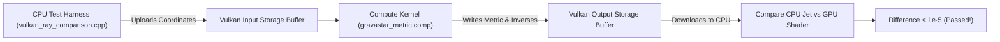

# File 10: `shaders/gravastar_metric.comp` — GPU Metric Validation Kernel

> **Target Audience**: 9th-Grade High School Student (Algebra 1 knowledge, Zero Vulkan, Zero Compute Shaders)  
> **Source Code**: [`shaders/gravastar_metric.comp`](file:///home/abrsdxd/Projects/GravastarLab/shaders/gravastar_metric.comp)  
> **Role in GravastarLab**: The GPU Quality Control Inspector (Testing GPU Physics against CPU Truth)

---

## 1. The Big Picture (What is this file's job?)

Have you ever done a math problem on your calculator, and your friend did the same problem on their phone, and you got two slightly different answers? 

Computers can do that too! 
* A CPU (made by Intel or AMD) calculates decimals one way.
* A GPU (made by NVIDIA, AMD, or Intel) optimizes math for raw speed and might round numbers slightly differently.

Before we let our graphics card render an entire movie of a gravastar, we need an automated way to ask: **"Hey GPU, calculate the metric tensor and its slopes at 1,000 different points in space, and send the answers back to the CPU so we can double-check your homework."**

`gravastar_metric.comp` is the **GPU Quality Control Inspector**.



### What terrible thing happens if we delete this file or turn it off?
If we delete this file, we cannot run our automated Vulkan validation tests (`vulkan_ray_comparison.cpp`). We would have no way of knowing whether a visual glitch on screen is a bug in the physics formulas or just an issue with the display monitor.

---

## 2. High-School Physics & Math Intuition

### A. What is a "Compute Shader"?
In old video games, the graphics card was only allowed to draw colored triangles on the screen. 
In modern graphics APIs like **Vulkan 1.4**, a **Compute Shader** lets you use the graphics card like a supercomputer! 
You give it a list of raw numbers (like coordinates in space), and the GPU executes your algorithm on thousands of numbers at the same instant, writing the results into memory buffers.

### B. Storage Buffers (`std430`)
Imagine a long row of metal lockers numbered $0$ to $999$:
* `layout(std430, binding = 0) readonly buffer Inputs`: The teacher puts math homework problems into the lockers.
* `layout(local_size_x = 64) in`: 64 GPU worker threads walk up to the lockers in lockstep.
* `uint id = gl_GlobalInvocationID.x`: Worker #42 opens Locker #42, reads the radius $r$ and angle $\theta$, calculates the 16 numbers of the metric tensor, and writes them into Output Locker #42!

---

## 3. The Line-by-Line Anatomy ("Why This Line?")

Let's inspect [`shaders/gravastar_metric.comp`](file:///home/abrsdxd/Projects/GravastarLab/shaders/gravastar_metric.comp).

```glsl
#version 460
#extension GL_EXT_shader_explicit_arithmetic_types_float64 : enable

layout(local_size_x = 64, local_size_y = 1, local_size_z = 1) in;

struct InputRecord {
    vec4 coords;        // r, theta, phi, unused
    vec4 params_geom;   // M, a, Lambda, unused
    vec4 params_radii;  // r_in, r_out, family, unused
};

struct OutputRecord {
    uvec4 status;       // ok=1/err=0, id, reserved...
    vec4 scalars;       // mu, lambda, delta, sigma
    float metric[16];   // g_mu_nu (4x4)
    float inverse[16];  // g^{mu nu} (4x4)
    float dg_dr[16];    // partial_r g_mu_nu
    float dg_dth[16];   // partial_theta g_mu_nu
};
```

#### Plain English Meaning
* **Line 1 (`#version 460`)**: Uses the modern GLSL 4.60 standard.
* **Line 4 (`layout(local_size_x = 64)`)**: Organizes GPU threads into teams of 64 (called a "workgroup").
* **Lines 6–19**: Defines the exact memory layout of the input and output lockers:
  - Each `InputRecord` holds the coordinates $(r, \theta, \phi)$ and physical constants ($M, a, \Lambda, r_{\text{in}}, r_{\text{out}}$).
  - Each `OutputRecord` returns the status, the 4 intermediate scalars ($\mu, \lambda, \Delta, \Sigma$), and the full 16-element matrices for $g_{\mu\nu}, g^{\mu\nu}, \partial_r g, \partial_\theta g$.

```glsl
void main() {
    uint id = gl_GlobalInvocationID.x;
    InputRecord in_rec = inputs.records[id];

    float r = in_rec.coords.x;
    float theta = in_rec.coords.y;
    float M = in_rec.params_geom.x;
    float a = in_rec.params_geom.y;
    float Lambda = in_rec.params_geom.z;
    float r_in = in_rec.params_radii.x;
    float r_out = in_rec.params_radii.y;
```

#### Plain English Meaning
* **Line 40**: `gl_GlobalInvocationID.x` is the worker's unique ID number ($0, 1, 2, \dots$).
* **Lines 41–49**: Unpacks the homework assignment for this specific point in curved space.

```glsl
    for (int i = 0; i < 16; ++i) {
        out_rec.metric[i] = 0.0;
        out_rec.inverse[i] = 0.0;
        out_rec.dg_dr[i] = 0.0;
        out_rec.dg_dth[i] = 0.0;
    }

    out_rec.metric[0]  = g00;
    out_rec.metric[3]  = g03;
    out_rec.metric[12] = g03;
    out_rec.metric[15] = g33;
    out_rec.metric[5]  = g11;
    out_rec.metric[10] = g22;

    outputs.records[id] = out_rec;
```

#### Plain English Meaning
* Zeroes out all 16 slots.
* Fills in the 5 non-zero entries (with symmetric terms at index 3 and index 12 for $g_{t\phi} = g_{\phi t}$).
* Writes the completed `OutputRecord` into `outputs.records[id]`, which is mapped to host memory via PCI-Express for CPU verification!

---

## 4. Debugger's Cheat Sheet: `gravastar_metric.comp`

| Symptom | Suspect Line | Root Cause |
| :--- | :--- | :--- |
| CPU test reports buffer mismatch error | Line 15 | Struct alignment mismatch: C++ struct size does not match `std430` layout |
| Worker outputs status = 0 (Error) on valid points | Line 54 | Boundary condition check too strict on polar angle $\theta$ |
| Off-diagonal metric term $g_{30}$ is 0 | Line 121 | Forgot to assign symmetric slot `metric[12] = g03` |
