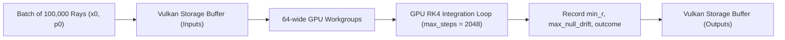

# File 11: `shaders/gravastar_geodesic.comp` — GPU Single-Ray Trajectory Integrator

> **Target Audience**: 9th-Grade High School Student (Algebra 1 knowledge, Zero Vulkan, Zero Parallel Computing)  
> **Source Code**: [`shaders/gravastar_geodesic.comp`](file:///home/abrsdxd/Projects/GravastarLab/shaders/gravastar_geodesic.comp)  
> **Role in GravastarLab**: The GPU Trajectory Laboratory (Simulating Batches of Photon Orbits in Parallel)

---

## 1. The Big Picture (What is this file's job?)

Imagine you are an astrophysicist studying how light orbits a spinning gravastar. You don't just want to take a 2D photograph; you want to run an **experiment**:
* What happens to 100,000 photons shot at slightly different angles around the equator?
* Which ones get swallowed?
* Which ones loop around the star 3 times before flying off?
* What is the closest approach ($r_{\text{min}}$) each photon reaches?

On a CPU, tracing 100,000 photon trajectories step-by-step takes minutes. 

`gravastar_geodesic.comp` is the **Massively Parallel Trajectory Wind Tunnel**. It gives each photon its own personal GPU thread. 100,000 photons are integrated simultaneously in a fraction of a millisecond!



### What terrible thing happens if we delete this file or turn it off?
If we delete this file, we cannot perform GPU-accelerated scientific trajectory analysis or automated CPU-vs-GPU equivalence tests (`tests/vulkan_ray_comparison.cpp`).

---

## 2. High-School Physics & Math Intuition

### A. The 3 Outcomes of a Photon
In this shader, each photon tracks its own fate into a variable called `outcome`:
* **`outcome = 0.0` (Escaped)**: The photon flew past the star and reached the escape distance ($r \ge 50.0$) without ever penetrating the matter shell.
* **`outcome = 1.0` (CorePassed)**: The photon penetrated into the interior shell ($r < 1.5$) into the dark energy core, curved through the core, and successfully escaped out the other side!
* **`outcome = 2.0` (Captured / Exhausted)**: The photon entered an unstable trap, hovered too long, or was captured by a horizon.

### B. Tracking Null Constraint Drift on Hardware
In Einstein's physics, a particle of light must always have zero mass and move at the speed of light. In Hamiltonian math, this means the scalar $\mathcal{H} = \frac{1}{2} v^\mu p_\mu$ must be strictly zero. 

Because 32-bit floats on graphics cards have small rounding errors, `gravastar_geodesic.comp` acts as a scientific auditor:
```glsl
max_null_drift = max(max_null_drift, abs(null1));
```
At every step, it checks how far $\mathcal{H}$ has drifted from zero. If the drift stays tiny ($< 10^{-4}$), you have mathematical proof that the GPU's ray follows Einstein's laws of relativity!

---

## 3. The Line-by-Line Anatomy ("Why This Line?")

Let's walk through the actual shader code in [`shaders/gravastar_geodesic.comp`](file:///home/abrsdxd/Projects/GravastarLab/shaders/gravastar_geodesic.comp).

```glsl
#version 460
#extension GL_GOOGLE_include_directive : enable

layout(local_size_x = 64, local_size_y = 1, local_size_z = 1) in;

#include "gravastar_physics.glsl"
```

#### Plain English Meaning
* **Line 3 (`#extension GL_GOOGLE_include_directive : enable`)**: Allows the shader to use the `#include` command to bring in `gravastar_physics.glsl` (File 09!), sharing the exact same metric evaluation formulas.
* **Line 5**: Packs GPU threads into groups of 64.

```glsl
struct RayInput {
    vec4 x0;            // t, r, theta, phi
    vec4 p0;            // p_t, p_r, p_theta, p_phi
    vec4 params_geom;   // M, a, Lambda, unused
    vec4 params_radii;  // r_in, r_out, unused, unused
    vec4 limits;        // escape_radius, h0, h_min, h_max
    uvec4 options;      // max_steps, unused, unused, unused
};

struct RayOutput {
    vec4 final_x;
    vec4 final_p;
    vec4 stats;         // min_r, max_null_drift, final_lambda, outcome
    uvec4 counts;       // steps, crossed_shell_in, crossed_shell_out, status
};
```

#### Plain English Meaning
* Defines the binary data packet exchanged across the PCI-Express bus between the CPU and GPU.
* Uses 16-byte aligned `vec4` and `uvec4` types to guarantee that GPU memory perfectly matches C++ struct layout without padding errors.

```glsl
    for (uint step = 0; step < max_steps; ++step) {
        steps = step + 1;
        float r = cur_x.y;

        if (r < min_r) min_r = r;
        if (r < r_in) crossed_shell_in = 1;
        if (crossed_shell_in == 1 && r > r_out) crossed_shell_out = 1;

        if (r >= escape_radius) {
            outcome = (crossed_shell_in == 1) ? 1.0 : 0.0;
            break;
        }

        // Adaptive step based on proximity to transition shell
        float dist_shell = min(abs(r - r_in), abs(r - r_out));
        float factor = clamp(dist_shell / r_in, 0.05, 1.0);
        float h = clamp(h0 * factor, h_min, h_max);
```

#### Plain English Meaning
* **Lines 60–71**: The main geodesic flight loop! 
  - Records the lowest altitude reached (`min_r`).
  - Detects if the photon pierced the shell (`crossed_shell_in = 1`).
  - If the ray climbs past `escape_radius = 50.0`, it sets `outcome` and exits.
* **Lines 74–76**: Dynamically throttles step size $h$ as the photon approaches the shell boundaries at $r_{\text{in}} = 1.5$ and $r_{\text{out}} = 1.8$, ensuring sub-millimeter integration precision.

```glsl
        // RK4 Stage 1
        MetricEvaluation m1 = evaluate_gravastar_metric(cur_x.y, cur_x.z, M, a, Lambda, r_in, r_out);
        if (!m1.valid) { outcome = 2.0; break; }
        vec4 dx1, dp1;
        float null1;
        compute_geodesic_rhs(m1, cur_x, cur_p, dx1, dp1, null1);
        max_null_drift = max(max_null_drift, abs(null1));

        // RK4 Stage 2
        vec4 x2 = cur_x + 0.5 * h * dx1;
        vec4 p2 = cur_p + 0.5 * h * dp1;
        MetricEvaluation m2 = evaluate_gravastar_metric(x2.y, x2.z, M, a, Lambda, r_in, r_out);
        if (!m2.valid) { outcome = 2.0; break; }
        vec4 dx2, dp2;
        float null2;
        compute_geodesic_rhs(m2, x2, p2, dx2, dp2, null2);

        // Stages 3 and 4 ...
        cur_x += (h / 6.0) * (dx1 + 2.0 * dx2 + 2.0 * dx3 + dx4);
        cur_p += (h / 6.0) * (dp1 + 2.0 * dp2 + 2.0 * dp3 + dp4);
        lambda += h;
    }
```

#### Plain English Meaning
* Executes full 4-stage Runge-Kutta integration directly on GPU streaming multiprocessors (SMs), taking four metric samples per step and blending them with Simpson's rule.

---

## 4. Debugger's Cheat Sheet: `gravastar_geodesic.comp`

| Symptom | Suspect Line | Root Cause |
| :--- | :--- | :--- |
| All rays report `outcome = 2.0` (Captured) | Line 80 | Metric evaluation returned invalid (e.g. initial $r$ inside singularity) |
| Core-penetrating rays misclassified as normal escapes | Line 69 | `crossed_shell_in` flag logic inverted |
| `max_null_drift` shows large errors | Line 113 | RK4 weighting typo in position or momentum accumulation |
| GPU crashes with TDR (Timeout Detection and Recovery) | Line 60 | `max_steps` set too high ($> 50,000$), triggering Windows/Linux driver timeout |
