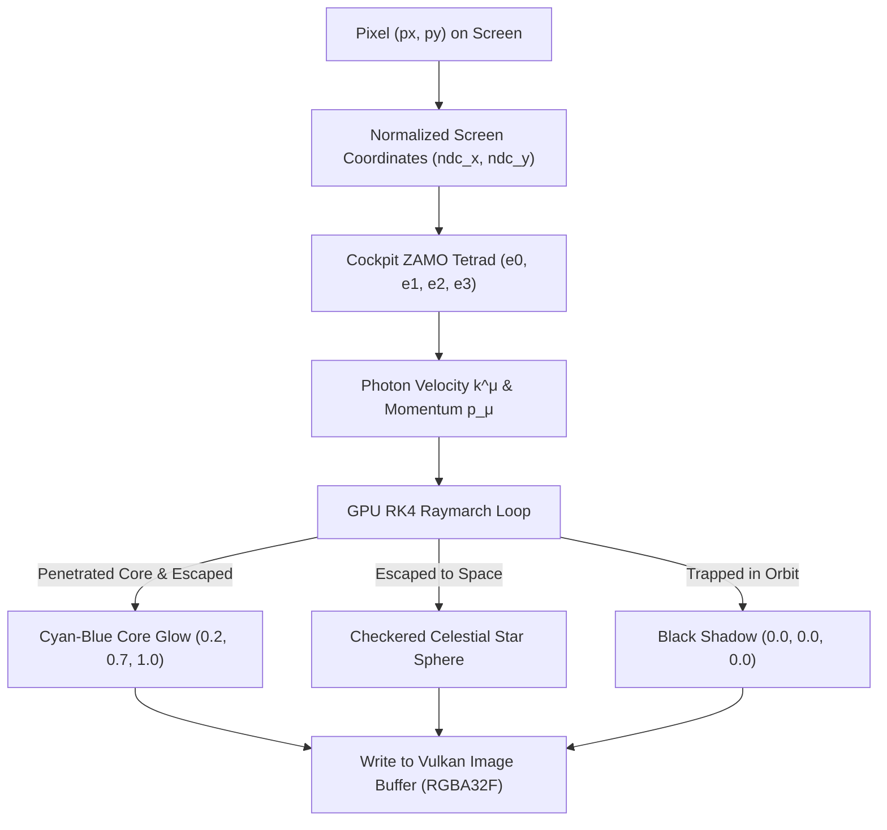

# File 12: `shaders/gravastar_raymarch.comp` — Full-Screen 2D GPU Raymarcher

> **Target Audience**: 9th-Grade High School Student (Algebra 1 knowledge, Zero Vulkan, Zero Computer Graphics)  
> **Source Code**: [`shaders/gravastar_raymarch.comp`](file:///home/abrsdxd/Projects/GravastarLab/shaders/gravastar_raymarch.comp)  
> **Role in GravastarLab**: The Master GPU Painter (Drawing the Gravastar on Screen at 60 Frames Per Second)

---

## 1. The Big Picture (What is this file's job?)

If you launch GravastarLab and look at your screen, you see a majestic, glowing cosmic jewel floating in space. 

As you move your mouse to rotate the camera:
* Light bends and warps in real time.
* The dark energy core glows in electric cyan-blue.
* Distant background constellations are smeared into giant circular arcs by gravitational lensing.

`gravastar_raymarch.comp` is the **Master GPU Painter**. It is the shader running on your graphics card that calculates the color of every single pixel on your screen 60 times every second.



### What terrible thing happens if we delete this file or turn it off?
If you delete this file, the Vulkan graphics engine has no raymarching pipeline. The application window will open to an empty, frozen black frame, and Vulkan will crash with an uncompiled pipeline state error.

---

## 2. High-School Physics & Math Intuition

### A. The Reverse Time Movie Camera
In real life, stars millions of light-years away emit photons in every direction. An infinitesimally tiny fraction of those photons happens to bend around our gravastar and hit your eye. 

If a computer tried to simulate photons starting from stars, $99.9999999\%$ of them would fly off into the empty dark void and never hit the camera. The computer would waste $99.9999999\%$ of its energy!

Instead, computer graphics does a trick called **Backward Raytracing**:
* Start at the camera lens!
* Shoot one ray **backward in time** through each pixel of the screen.
* Follow the ray into curved spacetime.
* If the ray hits the dark energy core, paint that pixel **cyan-blue**.
* If the ray flies off into deep space, look up which constellation it hit and paint that star on the pixel!

### B. Frame-Dragging Asymmetry in Real Time
Because this shader runs in real time at 60 FPS, you can visually observe the **whirlpool dragging of space**:
* Look at the left side of the gravastar (prograde): light bends sharply inward and grazes the surface.
* Look at the right side of the gravastar (retrograde): light is repelled and pushed outward into a wider arc!
The gravastar looks like a flattened egg tilted by the drag of spinning spacetime.

---

## 3. The Line-by-Line Anatomy ("Why This Line?")

Let's walk through the critical sections of [`shaders/gravastar_raymarch.comp`](file:///home/abrsdxd/Projects/GravastarLab/shaders/gravastar_raymarch.comp).

```glsl
struct SceneParams {
    vec4 cam_pos;           // r, theta, phi, tan_half_fov
    vec4 params_geom;       // M, a, Lambda, aspect
    vec4 params_radii;      // r_in, r_out, width, height
    vec4 limits;            // escape_radius, h0, h_min, h_max
    uvec4 options;          // max_steps, render_mode, unused, unused

    // Observer orthonormal tetrad basis vectors (contravariant)
    vec4 tetrad_e0;
    vec4 tetrad_e1;
    vec4 tetrad_e2;
    vec4 tetrad_e3;

    // Observer metric components at camera position
    vec4 metric_diag;       // g00, g11, g22, g33
    vec4 metric_off;        // g03, unused, unused, unused
};
```

#### Plain English Meaning
* **Lines 9–25**: The complete scene description passed from the CPU every frame:
  - Where the camera is located.
  - The mass $M$ and spin $a$ of the gravastar.
  - The 4 tetrad ruler-arrows ($e_0, e_1, e_2, e_3$) calculated by the CPU's ZAMO engine.
  - The local metric numbers at the camera's eye.

```glsl
    uint width = uint(sp.params_radii.z);
    uint height = uint(sp.params_radii.w);
    if (id >= width * height) return;

    uint px = id % width;
    uint py = id / width;

    // NDC coordinates
    float ndc_x = (2.0 * (float(px) + 0.5) / float(width)) - 1.0;
    float ndc_y = 1.0 - (2.0 * (float(py) + 0.5) / float(height));
```

#### Plain English Meaning
* Converts the 1D thread ID into 2D pixel coordinates $(px, py)$.
* Converts pixel $(px, py)$ into Normalized Device Coordinates $(ndc_x, ndc_y) \in [-1, +1]$. The center of the screen is $(0, 0)$.

```glsl
    // Contravariant photon 4-momentum k^mu
    vec4 k_up = -sp.tetrad_e0 + nz * sp.tetrad_e1 - ny * sp.tetrad_e2 + nx * sp.tetrad_e3;

    // Covariant momentum p_mu = g_{mu nu} k^nu
    float pt    = sp.metric_diag.x * k_up.x + sp.metric_off.x * k_up.w;
    float pr    = sp.metric_diag.y * k_up.y;
    float pth   = sp.metric_diag.z * k_up.z;
    float pphi  = sp.metric_off.x * k_up.x + sp.metric_diag.w * k_up.w;

    vec4 cur_x = vec4(0.0, sp.cam_pos.x, sp.cam_pos.y, sp.cam_pos.z);
    vec4 cur_p = vec4(pt, pr, pth, pphi);
```

#### Plain English Meaning
* **Line 76**: Launches the ray backward into the past ($-e_0$) and through the camera lens $(n_x, n_y, n_z)$.
* **Lines 79–82**: Transforms the cockpit direction into canonical momentum $(p_t, p_r, p_\theta, p_\phi)$ using the metric tensor.

```glsl
        if (r >= escape_radius) {
            if (crossed_shell_in == 1) {
                // Ray passed through core and escaped
                color = vec3(0.2, 0.7, 1.0); // Cyan-blue core luminescence
            } else {
                // Celestial background checkerboard
                const float PI = 3.14159265358979323846;
                float final_th = cur_x.z;
                float final_ph = cur_x.w;
                int u = int(floor(final_ph * 3.0 / PI));
                int v = int(floor(final_th * 6.0 / PI));
                if (((u + v) % 2) == 0) {
                    color = vec3(0.05, 0.05, 0.08);
                } else {
                    color = vec3(0.02, 0.02, 0.03);
                }
            }
            break;
        }
```

#### Plain English Meaning
* If a photon traveled through the dark energy core ($r < r_{\text{in}}$) and escaped, it is painted **luminous cyan-blue**!
* If a photon flew past the star into deep space, it computes the celestial latitude and longitude and paints a **deep space celestial grid**.

---

## 4. Debugger's Cheat Sheet: `gravastar_raymarch.comp`

| Symptom | Suspect Line | Root Cause |
| :--- | :--- | :--- |
| Viewport image is stretched horizontally | Line 49 | Aspect ratio not factored into `dx` formula |
| Whole screen is upside down | Line 64 | `ndc_y` subtraction order reversed |
| Core luminescence ring missing | Line 94 | `crossed_shell_in` flag condition never reached |
| Lensing rings are jittery and jagged | Line 120 | Step size $h_0$ set too large, stepping over gravity gradients |
