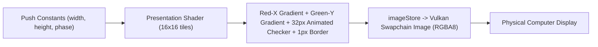

# File 13: `shaders/gravastar_presentation.comp` — GPU Window Blitter & Test Pattern Generator

> **Target Audience**: 9th-Grade High School Student (Algebra 1 knowledge, Zero Vulkan, Zero Compute Shaders)  
> **Source Code**: [`shaders/gravastar_presentation.comp`](file:///home/abrsdxd/Projects/GravastarLab/shaders/gravastar_presentation.comp)  
> **Role in GravastarLab**: The TV Calibration Test Pattern (Testing Screen Resizing & Display Swapchains)

---

## 1. The Big Picture (What is this file's job?)

Before an electrician installs an expensive 4K home theater system, they don't immediately pop in a 3-hour sci-fi movie. First, they turn on a **Color Bar Test Pattern** (the famous grid with red, green, blue stripes and ticking clock numbers).

Why? Because if the screen is flickering or stretched, you want to know immediately whether the problem is the HDMI cable or the movie player!

In GravastarLab, our physics raymarcher (`gravastar_raymarch.comp`) is computationally heavy. If you resize your desktop window from 1080p to 4K, the graphics card has to tear down its old swapchain and build a brand-new swapchain on the fly.

`gravastar_presentation.comp` is the **Vulkan Diagnostic Calibration Card**. It draws an animated, mathematically precise coordinate test pattern directly to the swapchain window at 500+ frames per second.



### What terrible thing happens if we delete this file or turn it off?
If we delete this file, we cannot verify the window presentation swapchain in isolation. When debugging window resize events or Wayland/X11 display crashes, we wouldn't know whether the bug is in the Vulkan swapchain or in the Einstein physics solver.

---

## 2. High-School Physics & Math Intuition

### A. The Diagnostic Rainbow Grid
How do you prove that every single pixel on a screen is mapped to the right memory address?
* **Red Channel ($R$)**: Proportional to $X$ (horizontal position). The left edge has $R = 0$, and the right edge has $R = 255$.
* **Green Channel ($G$)**: Proportional to $Y$ (vertical position). The top edge has $G = 0$, and the bottom edge has $G = 255$.
* **Blue Channel ($B$)**: A 32-pixel alternating checkerboard that shifts over time based on `phase` ($B = 48$ vs $B = 144$).
* **Border**: If a pixel is on the exact edge of the window ($x = 0$, $y = 0$, $x = \text{width}-1$, $y = \text{height}-1$), it turns **pure white** (`255, 255, 255`).

If you grab the edge of the window with your mouse and stretch it:
* If the white border stays exactly 1 pixel thick, the swapchain is resizing perfectly!
* If the border stretches, blurs, or clips, the window aspect ratio is broken!

---

## 3. The Line-by-Line Anatomy ("Why This Line?")

Here is the complete source code of [`shaders/gravastar_presentation.comp`](file:///home/abrsdxd/Projects/GravastarLab/shaders/gravastar_presentation.comp):

```glsl
#version 460
// Integer-addressed diagnostic chart, not a spacetime image. CPU oracle in window_main/capture.
layout(local_size_x=16,local_size_y=16,local_size_z=1) in;
layout(set=0,binding=0,rgba8) uniform writeonly image2D target_image;
layout(push_constant) uniform Parameters { uint width; uint height; uint phase; uint reserved; } p;
```

#### Plain English Meaning
* **Line 3 (`layout(local_size_x=16, local_size_y=16)`)**: Organizes GPU threads into 2D tiles of $16 \times 16 = 256$ threads.
* **Line 4**: Binds directly to the Vulkan Swapchain image formatted as standard 8-bit color (`rgba8`).
* **Line 5 (`push_constant`)**: Ultra-fast GPU register memory that receives the window's `width`, `height`, and animation `phase` directly from the CPU without needing a memory buffer.

```glsl
void main() {
    uvec2 xy=gl_GlobalInvocationID.xy;
    if(xy.x>=p.width || xy.y>=p.height) return;
    uint x=xy.x, y=xy.y;
    uint r=x*255u/max(p.width-1u,1u);
    uint g=y*255u/max(p.height-1u,1u);
    uint b=(((x/32u)+(y/32u)+p.phase)&1u)==0u ? 48u : 144u;
    if(x==0u || y==0u || x+1u==p.width || y+1u==p.height) { r=255u; g=255u; b=255u; }
    imageStore(target_image,ivec2(xy),vec4(r,g,b,255u)/255.0);
}
```

#### Plain English Meaning
* **Line 8**: Out-of-bounds guard: if the thread is outside the window resolution, exit immediately.
* **Lines 10–11**: Calculates the smooth Red and Green gradients across the screen.
* **Line 12**: Integer division by 32 (`x / 32u`) creates 32×32 pixel blocks. Adding `p.phase` makes the checker pattern march diagonally across the screen to prove the window is updating live!
* **Line 13**: Paints the 1-pixel white boundary frame.
* **Line 14 (`imageStore`)**: Writes the finalized color directly into the display monitor's framebuffer.

---

## 4. Debugger's Cheat Sheet: `gravastar_presentation.comp`

| Symptom | Suspect Line | Root Cause |
| :--- | :--- | :--- |
| Window freezes on resize | Line 8 | Push constant `width` or `height` not updated after window event |
| Checker pattern does not animate | Line 12 | CPU forgot to increment `phase` every frame |
| White boundary line missing on right edge | Line 13 | Comparison typo: wrote `x == p.width` instead of `x + 1 == p.width` |
