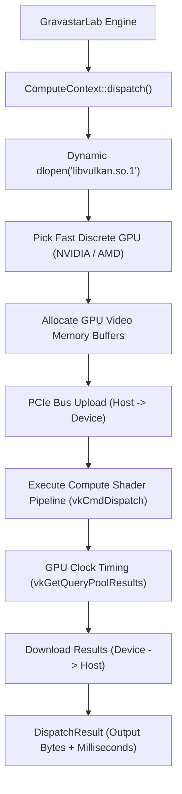

# File 14: `include/gravastar/rendering/vulkan/ComputeContext.hpp` & `src/rendering/vulkan/ComputeContext.cpp` — Dynamic Vulkan 1.4 Compute Loader

> **Target Audience**: 9th-Grade High School Student (Algebra 1 knowledge, Zero C++, Zero Vulkan API)  
> **Source Codes**:
> - [`include/gravastar/rendering/vulkan/ComputeContext.hpp`](file:///home/abrsdxd/Projects/GravastarLab/include/gravastar/rendering/vulkan/ComputeContext.hpp)
> - [`src/rendering/vulkan/ComputeContext.cpp`](file:///home/abrsdxd/Projects/GravastarLab/src/rendering/vulkan/ComputeContext.cpp)
> - [`src/rendering/vulkan/VulkanContext.hpp`](file:///home/abrsdxd/Projects/GravastarLab/src/rendering/vulkan/VulkanContext.hpp)  
> **Role in GravastarLab**: The Graphics Card Commander (Loading Vulkan, Allocating Video RAM, Launching Shaders)

---

## 1. The Big Picture (What is this file's job?)

To run calculations on your graphics card (like an NVIDIA GeForce RTX or AMD Radeon), your computer program cannot just talk to the GPU chips directly. You have to communicate through a specialized driver system called **Vulkan**.

Vulkan is the most powerful, low-level graphics and compute technology in the world. But it is notoriously complex: just getting the GPU to say "Hello World" requires 1,000 lines of setup code!

`ComputeContext` is the **Universal Graphics Card Adapter**. 
1. It locates your graphics card driver (`libvulkan.so.1` on Linux or `vulkan-1.dll` on Windows).
2. It dynamically loads all Vulkan function pointers at runtime without crashing if a driver is missing.
3. It filters through all GPUs in your computer, rejects slow integrated chips, and selects the fastest **Dedicated Discrete Graphics Card**.
4. It sets up video memory (VRAM), loads compiled GPU bytecode (SPIR-V), and executes compute tasks with microsecond precision.



### What terrible thing happens if we delete this file or turn it off?
If we delete this file, GravastarLab cannot talk to the graphics card at all. No GPU shaders can ever run, Vulkan hardware acceleration is dead, and the engine drops back to CPU-only mode.

---

## 2. High-School Physics & Math Intuition

### A. Dynamic Loading: `#define VK_NO_PROTOTYPES`
When you build a standard C++ program, you usually "link" against a library file. If a user runs your game on a computer that doesn't have Vulkan installed, the game immediately crashes with a scary error:
`libvulkan.so.1: cannot open shared object file`.

`ComputeContext` is smarter. It uses `#define VK_NO_PROTOTYPES`:
* It does NOT link to Vulkan at compile time.
* When the game launches, it gently knocks on the operating system door using `dlopen("libvulkan.so.1")`.
* If Vulkan is missing, it prints a polite warning: *"Vulkan driver not found; falling back to CPU."*
* If Vulkan is present, it grabs each function pointer one by one (`vkGetInstanceProcAddr`)!

### B. Hardware Timestamps: Nanosecond Stopwatches
How do you measure how fast a GPU is? 
You can't use your CPU clock (like `std::chrono`), because the CPU only sends the command and walks away; the GPU might execute the work 3 milliseconds later in its own queue!

`ComputeContext` uses **GPU Hardware Query Timestamps**:
* Before dispatching the shader, it writes a timestamp command directly into the GPU command buffer: `vkCmdWriteTimestamp`.
* After the shader finishes, it writes a second timestamp: `vkCmdWriteTimestamp`.
* The GPU's internal quartz oscillator records the exact number of clock ticks elapsed.
* Multiplying by the GPU's `timestampPeriod` gives the exact execution time in milliseconds down to the nanosecond!

---

## 3. The Line-by-Line Anatomy: `ComputeContext.hpp`

```cpp
// Application work budget, independent of permissive driver limits.
inline constexpr std::uint32_t max_headless_workgroups = 16'384;

enum class ValidationMode { automatic, required, disabled };
struct ComputeOptions final {
    int device_index{-1}; // -1 prefers a suitable discrete GPU.
    ValidationMode validation{ValidationMode::automatic};
};
```

#### Plain English Meaning
* **Line 13 (`max_headless_workgroups = 16384`)**: Safety governor! Prevents a faulty shader from asking the GPU to launch 100 billion workgroups, which would freeze your entire operating system.
* **Line 17 (`device_index = -1`)**: Automatically scans all detected GPUs and picks the best one (preferring high-speed discrete graphics cards like an NVIDIA RTX over an Intel low-power laptop chip).

```cpp
struct DeviceInfo final {
    std::uint32_t index{}, api_version{}, driver_version{}, vendor_id{}, device_id{};
    std::uint32_t compute_family{}, timestamp_bits{};
    bool discrete{}, float64{}, suitable{};
    std::string name, rejection;
};
struct DispatchResult final {
    std::vector<std::byte> output;
    double gpu_milliseconds{};
    bool timestamp_available{};
};
```

#### Plain English Meaning
* **`DeviceInfo`**: The GPU passport! Stores the card's name (e.g., `"NVIDIA GeForce RTX 4090"`), driver version, whether it supports 64-bit math, and whether it was accepted or rejected.
* **`DispatchResult`**: The care package returned after a compute shader runs: holds the raw output bytes and the exact GPU running time in milliseconds.

```cpp
    [[nodiscard]] DispatchResult dispatch(std::span<const std::uint32_t> spirv,
                                          std::span<const std::byte> input,
                                          std::size_t output_bytes, std::uint32_t workgroups);
```

#### Plain English Meaning
* **`dispatch(...)`**: The master execution command!
  1. Takes compiled GPU binary code (`spirv`).
  2. Takes input data bytes (`input`).
  3. Prepares an output buffer of `output_bytes`.
  4. Launches `workgroups` teams of GPU threads.
  5. Waits for completion, copies the results back, and returns the data.

---

## 4. The Line-by-Line Anatomy: `VulkanContext.hpp`

### Chunk 1: Lines 25–49 — Vulkan Safety Checks & Enumeration

```cpp
inline void check(VkResult result, const char *operation) {
    if (result != VK_SUCCESS)
        throw std::runtime_error(std::string(operation) + " failed (VkResult " +
                                 std::to_string(static_cast<int>(result)) + ")");
}
```

#### Plain English Meaning
* Every single Vulkan function returns a `VkResult` integer (where `VK_SUCCESS = 0`). If anything goes wrong (like running out of VRAM or invalid arguments), `check()` intercepts the error code and throws an informative C++ exception, preventing silent crashes.

```cpp
template <class T, class Query> std::vector<T> enumerate(Query query, const char *label) {
    for (int retry = 0; retry < 4; ++retry) {
        std::uint32_t count{};
        check(query(&count, static_cast<T *>(nullptr)), label);
        std::vector<T> values(count);
        auto result = query(&count, values.data());
        if (result == VK_INCOMPLETE)
            continue;
        check(result, label);
        values.resize(count);
        return values;
    }
```

#### Plain English Meaning
* In Vulkan, to get a list of items (like available GPUs or extensions), you must query the driver twice:
  1. Call once with a `nullptr` pointer to ask: *"How many items are there?"*
  2. Allocate an array of that size.
  3. Call again to actually fill the array.
* If a new monitor was plugged in between call 1 and call 2, Vulkan returns `VK_INCOMPLETE`. `enumerate()` automatically retries up to 4 times to guarantee thread-safe initialization!

---

## 5. Debugger's Cheat Sheet: `ComputeContext`

| Symptom | Suspect File / Line | Root Cause |
| :--- | :--- | :--- |
| `Cannot load libvulkan.so.1` error on startup | `VulkanContext.hpp` Line 54 | No Vulkan graphics driver installed on the OS |
| Game runs on slow integrated GPU instead of dedicated GPU | `VulkanContext.hpp` | Device suitability selector failed to identify discrete device type |
| `dispatch failed (VkResult -4)` (VK_ERROR_DEVICE_LOST) | `ComputeContext.cpp` Line 26 | Shader hit infinite loop or invalid memory access in VRAM |
| `validation_errors() > 0` | `ComputeContext.cpp` Line 20 | Vulkan validation layers caught API usage violation |
