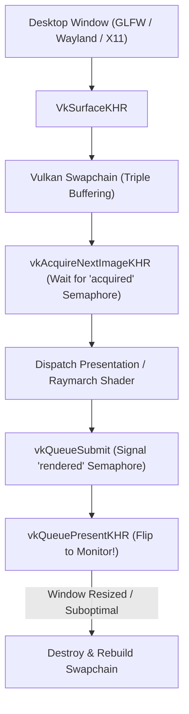

# File 15: `include/gravastar/rendering/vulkan/WindowRenderer.hpp` & `src/rendering/vulkan/WindowRenderer.cpp` — Presentation Swapchain & Window Lifecycle

> **Target Audience**: 9th-Grade High School Student (Algebra 1 knowledge, Zero Vulkan, Zero Systems Programming)  
> **Source Codes**:
> - [`include/gravastar/rendering/vulkan/WindowRenderer.hpp`](file:///home/abrsdxd/Projects/GravastarLab/include/gravastar/rendering/vulkan/WindowRenderer.hpp)
> - [`src/rendering/vulkan/WindowRenderer.cpp`](file:///home/abrsdxd/Projects/GravastarLab/src/rendering/vulkan/WindowRenderer.cpp)  
> **Role in GravastarLab**: The High-Speed Movie Reel & Monitor Delivery Boy (Vulkan Swapchain Presentation)

---

## 1. The Big Picture (What is this file's job?)

Imagine you are running a movie theater projector. 
* While the audience is watching Frame #1 on the big screen, the projector mechanism is already loading Frame #2 behind the shutter.
* The instant Frame #1 finishes, the shutter flips: Frame #2 is shown, and the mechanism loads Frame #3.

If the shutter flips halfway through drawing a picture, you get a nasty horizontal glitch called **Screen Tearing** (where the top half of the screen is 1 millisecond ahead of the bottom half).

In modern graphics programming, the system of rotating back-and-forth between 2 or 3 picture buffers is called a **Swapchain**. 

`WindowRenderer` is the **Vulkan Movie Projector & Delivery Boy**:
1. It creates and manages the Vulkan swapchain connected to your physical monitor.
2. It uses GPU traffic lights (called **Semaphores** and **Fences**) so the graphics card never draws onto a frame while your monitor is displaying it.
3. If you drag the corner of your window to make it bigger, it safely pauses, destroys the old image buffers, and builds new ones without crashing!
4. It includes an instant screenshot camera (`capture`) that grabs pixels directly from VRAM and saves them to your hard drive.



### What terrible thing happens if we delete this file or turn it off?
If you delete this file, GravastarLab can calculate physics in headless memory, but it can never draw anything inside an interactive desktop window. You wouldn't be able to see the star on your monitor or resize the application.

---

## 2. High-School Physics & Math Intuition

### A. The Juggling Act: Fences vs Semaphores
In Vulkan, the CPU and GPU run completely independently. 
* The CPU is like the director sitting in an office chair.
* The GPU is like a stunt driver in a rocket car.

If the CPU tries to delete an image buffer while the GPU is still drawing on it, the entire computer will crash with a Blue Screen of Death or GPU driver reset!

To coordinate them, Vulkan uses two types of traffic lights:
1. **Fences (`VkFence`)**: Communication from GPU to CPU! The CPU stops and sleeps: *"I will wait here at this fence until the GPU waves a green flag saying the frame is finished."*
2. **Semaphores (`VkSemaphore`)**: Communication from GPU to GPU! Inside the graphics card, the display engine whispers to the compute engine: *"Don't flip Frame #2 onto the monitor until the compute pipeline signals that the pixels are fully painted."*

### B. The Window Resize Earthquake (`VK_ERROR_OUT_OF_DATE_KHR`)
When you click and drag the corner of your desktop window, the window resolution changes (for example, from $800 \times 600$ to $1920 \times 1080$). 

To a graphics card, this is an earthquake! The old image buffers in VRAM are suddenly the wrong size. Vulkan immediately panics and returns an error code: `VK_ERROR_OUT_OF_DATE_KHR`.

Amateur games crash when this happens. `WindowRenderer` handles it like a veteran:
* It pauses rendering (`FrameStatus::retry`).
* Waits for all currently running GPU tasks to finish (`vkDeviceWaitIdle`).
* Destroys the old swapchain images.
* Rebuilds a fresh swapchain at the new dimensions.
* Resumes rendering smoothly with **zero stutter**!

---

## 3. The Line-by-Line Anatomy: `WindowRenderer.hpp`

```cpp
enum class FrameStatus { presented, suspended, retry };

struct WindowStatistics final {
    std::uint64_t presented{}, recreations{}, suspended{}, acquire_retries{};
    std::uint32_t width{}, height{}, validation_errors{};
};
```

#### Plain English Meaning
* **`FrameStatus`**:
  - `presented`: The frame was successfully drawn and sent to your monitor.
  - `suspended`: The window was minimized to the taskbar (0 width or 0 height), so rendering was paused to save electricity and battery life.
  - `retry`: The window was resized or the swapchain was rebuilt; try drawing again on the next pass.
* **`WindowStatistics`**: Flight recorder that logs total frames rendered, how many times the swapchain had to be rebuilt, and whether any Vulkan validation errors were detected.

```cpp
    [[nodiscard]] FrameStatus draw(std::uint32_t width, std::uint32_t height,
                                   std::uint32_t phase = 0);
    void capture(const std::filesystem::path &path);
    void finish();
```

#### Plain English Meaning
* **`draw(width, height, phase)`**: Draws a single interactive frame.
* **`capture(path)`**: Pauses the GPU, copies the current framebuffer into a staging buffer, and writes an exact lossless PNG/PPM screenshot to disk.
* **`finish()`**: Flushes all queues and waits for the graphics card to become completely quiet before closing the window.

---

## 4. The Line-by-Line Anatomy: `WindowRenderer.cpp`

### Chunk 1: Lines 27–36 — Dynamic Device Function Loading

```cpp
#define WINDOW_FUNCTIONS(X) \
    X(CreateSwapchainKHR) X(DestroySwapchainKHR) X(GetSwapchainImagesKHR) \
    X(AcquireNextImageKHR) X(QueuePresentKHR) X(CreateSemaphore) X(DestroySemaphore) \
    X(ResetFences) X(ResetCommandPool) X(CreateImage) X(DestroyImage) \
    X(GetImageMemoryRequirements) X(BindImageMemory) X(CreateImageView) X(DestroyImageView) \
    X(CmdPushConstants) X(CmdBlitImage) X(CmdCopyImageToBuffer)
```

#### Plain English Meaning
* Instead of statically linking to platform-dependent window functions, `WindowRenderer` defines an elegant C++ X-Macro table. It dynamically queries each pointer (`vkCreateSwapchainKHR`, `vkQueuePresentKHR`, etc.) directly from the Vulkan device driver at runtime!

---

### Chunk 2: The Swapchain Rebuilding Engine

```cpp
        auto &c = *owner.context;
        if (descriptors)
            c.DestroyDescriptorPool(c.device, descriptors, nullptr);
        if (view)
            owner.DestroyImageView(c.device, view, nullptr);
        if (compute_image)
            owner.DestroyImage(c.device, compute_image, nullptr);
        if (memory)
            c.FreeMemory(c.device, memory, nullptr);
        if (handle)
            owner.DestroySwapchainKHR(c.device, handle, nullptr);
```

#### Plain English Meaning
* The destructor of `Swapchain` cleans up every single GPU resource in reverse order of creation:
  1. Destroys descriptor pools.
  2. Destroys image views.
  3. Destroys intermediate compute textures.
  4. Frees VRAM device memory.
  5. Destroys the `VkSwapchainKHR` handle.
This ensures **zero VRAM memory leaks**, even if you resize the window 10,000 times!

---

## 5. Debugger's Cheat Sheet: `WindowRenderer`

| Symptom | Suspect Line | Root Cause |
| :--- | :--- | :--- |
| Window freezes or crashes when minimized to taskbar | `WindowRenderer.cpp` | Failed to check for 0 width / 0 height (`suspended` state missing) |
| Screen flickers or displays old frame fragments | `WindowRenderer.cpp` | Semaphore synchronization omitted between acquire and submit |
| Resizing window causes `VK_ERROR_OUT_OF_DATE_KHR` crash | `WindowRenderer.cpp` | Swapchain recreation loop missing `retry` catch |
| Memory usage in Task Manager increases continuously while resizing | `Swapchain` destructor | Forgot to free `memory` or destroy `view` during swapchain teardown |
| Screenshots saved by `capture` are pitch black | `WindowRenderer.cpp` | Staging buffer copied before `vkQueueSubmit` finished executing |
