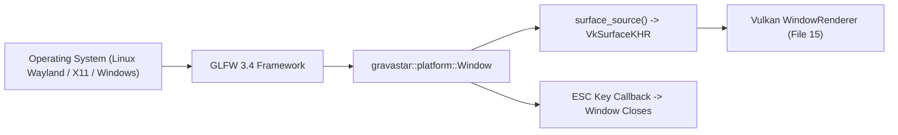

# File 16: `include/gravastar/platform/Window.hpp` & `src/platform/Window.cpp` — GLFW Desktop Window Lifecycle

> **Target Audience**: 9th-Grade High School Student (Algebra 1 knowledge, Zero C++, Zero GUI Programming)  
> **Source Codes**:
> - [`include/gravastar/platform/Window.hpp`](file:///home/abrsdxd/Projects/GravastarLab/include/gravastar/platform/Window.hpp)
> - [`src/platform/Window.cpp`](file:///home/abrsdxd/Projects/GravastarLab/src/platform/Window.cpp)  
> **Role in GravastarLab**: The Desktop Window Frame & User Input Portal (GLFW Wayland/X11/Windows Lifecycle)

---

## 1. The Big Picture (What is this file's job?)

Before you can show a 3D simulation to a player, you need an actual **desktop window** on their monitor:
* A title bar that says `"GravastarLab"`.
* Minimize, Maximize, and Close buttons.
* The ability to listen to keyboard shortcuts (like hitting `ESC` to quit).
* Support for Linux (Wayland & X11), Windows, and macOS.

Different operating systems handle windows completely differently (Linux uses Wayland or X11 protocols, Windows uses Win32). 

Instead of writing custom code for every operating system, programmers use **GLFW** (Graphics Library Framework). 

`Window.hpp` and `Window.cpp` are the **Desktop Window Frame & Handshake**:
1. They create a GLFW window without an OpenGL context (`GLFW_NO_API`), saving all graphics work for Vulkan.
2. They bridge the gap between GLFW and Vulkan by creating a `VkSurfaceKHR`.
3. They listen for keyboard input and handle window minimization and restoration.



### What terrible thing happens if we delete this file or turn it off?
If you delete this file, GravastarLab cannot open a window on your desktop. The application can only run in invisible background mode.

---

## 2. High-School Physics & Math Intuition

### A. The No-OpenGL Rule: `GLFW_NO_API`
Historically, GLFW was created to make windows for OpenGL games. When you call `glfwCreateWindow`, it normally creates an OpenGL drawing context automatically.

In GravastarLab, we use modern Vulkan 1.4! If GLFW accidentally initializes an OpenGL context, your graphics card will be confused by having two different rendering systems fighting over the same screen.
```cpp
glfwWindowHint(GLFW_CLIENT_API, GLFW_NO_API);
```
This line firmly commands GLFW: *"Do not create an OpenGL context! We are bringing our own Vulkan engine."*

### B. High-DPI (Retina Displays): Window Size vs Framebuffer Size
On a high-resolution 4K laptop or MacBook, a window might have a size of $800 \times 600$ "screen units" so buttons don't look microscopically small. 

However, the actual glass screen underneath has **twice as many physical pixels** ($1600 \times 1200$)! 
* `glfwGetWindowSize`: Returns the virtual size for mouse clicks.
* `glfwGetFramebufferSize`: Returns the true physical pixel count for the graphics card.

`Window.cpp` always uses `framebuffer_size()` so our gravastar is rendered with razor-sharp native pixel resolution!

---

## 3. The Line-by-Line Anatomy ("Why This Line?")

Let's walk through the actual implementation in [`src/platform/Window.cpp`](file:///home/abrsdxd/Projects/GravastarLab/src/platform/Window.cpp).

```cpp
Window::Window(int width, int height, const std::string &title) : impl_(std::make_unique<Impl>()) {
    if (width < 1 || height < 1 || width > 8192 || height > 8192)
        throw std::invalid_argument("Window dimensions must be in [1,8192]");
    if (active_window)
        throw std::runtime_error("Only one GLFW window owner is supported");
    if (!glfwInit())
        throw std::runtime_error(glfw_error("glfwInit"));
    impl_->initialized = true;
    active_window = true;
    if (!glfwVulkanSupported())
        throw std::runtime_error("GLFW cannot find a Vulkan loader/driver");
    glfwWindowHint(GLFW_CLIENT_API, GLFW_NO_API);
    glfwWindowHint(GLFW_RESIZABLE, GLFW_TRUE);
    impl_->window = glfwCreateWindow(width, height, title.c_str(), nullptr, nullptr);
```

#### Plain English Meaning
* **Line 38**: Sanity check! Rejects negative sizes or absurd dimensions larger than 8K ($8192 \times 8192$).
* **Line 40 (`active_window`)**: Single-owner guard. GLFW has process-global state; this ensures only one window manages the GLFW lifecycle at a time, preventing race conditions.
* **Line 46 (`glfwVulkanSupported`)**: Asks the operating system: *"Is the Vulkan graphics driver installed and ready?"*
* **Line 48 (`GLFW_NO_API`)**: Tells GLFW not to attach OpenGL.
* **Line 50**: Creates the desktop window!

```cpp
    glfwSetKeyCallback(impl_->window, [](GLFWwindow *window, int key, int, int action, int) {
        if (key == GLFW_KEY_ESCAPE && action == GLFW_PRESS)
            glfwSetWindowShouldClose(window, GLFW_TRUE);
    });
```

#### Plain English Meaning
* Registers a keyboard listener. If the user taps the **Escape** key (`GLFW_KEY_ESCAPE`), it flags the window to close gracefully, triggering a smooth engine shutdown.

```cpp
rendering::vulkan::SurfaceSource Window::surface_source() {
    std::uint32_t count{};
    const auto extensions = glfwGetRequiredInstanceExtensions(&count);
    if (!extensions || !count)
        throw std::runtime_error(glfw_error("glfwGetRequiredInstanceExtensions"));
    rendering::vulkan::SurfaceSource source;
    source.poll_events = [] { glfwPollEvents(); };
    for (std::uint32_t i = 0; i < count; ++i)
        source.instance_extensions.emplace_back(extensions[i]);
    source.create = [this](std::uintptr_t bits) {
        VkSurfaceKHR surface{};
        auto result = glfwCreateWindowSurface(reinterpret_cast<VkInstance>(bits), impl_->window,
                                              nullptr, &surface);
        if (result != VK_SUCCESS)
            throw std::runtime_error("glfwCreateWindowSurface failed (VkResult " +
                                     std::to_string(result) + ")");
        std::uint64_t handle{};
        std::memcpy(&handle, &surface, sizeof(surface));
        return handle;
    };
    return source;
}
```

#### Plain English Meaning
* **The Vulkan Surface Handshake**:
  1. Queries GLFW for the exact OS-specific extensions needed (e.g. `VK_KHR_wayland_surface` on Ubuntu Wayland or `VK_KHR_win32_surface` on Windows).
  2. Creates a C++ lambda function (`source.create`) that calls `glfwCreateWindowSurface`.
  3. Hands this package to the `WindowRenderer` so Vulkan can draw directly inside the window!

---

## 4. Debugger's Cheat Sheet: `Window.cpp`

| Symptom | Suspect Line | Root Cause |
| :--- | :--- | :--- |
| Application crashes on startup with `GLFW cannot find a Vulkan loader` | Line 46 | No Vulkan graphics driver installed on the OS |
| Window opens but cannot be resized | Line 49 | `GLFW_RESIZABLE` set to `GLFW_FALSE` |
| ESC key does not close window | Line 54 | Key callback action check missing (`action == GLFW_PRESS`) |
| Image looks blurry on 4K laptop monitor | Line 89 | Window size used instead of physical `framebuffer_size` |
