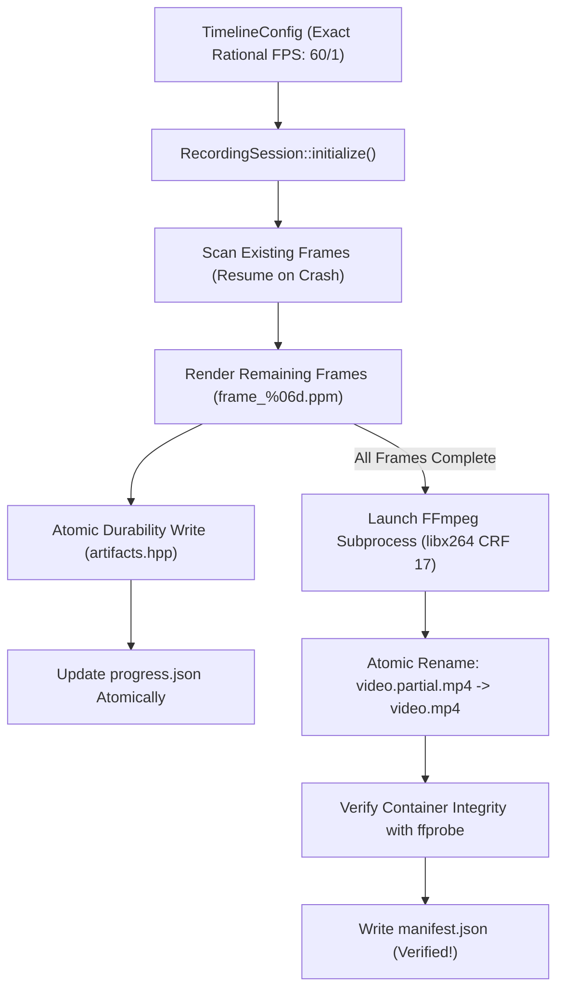

# File 17: `include/gravastar/recording/recorder.hpp` & `src/recording/recorder.cpp` — Deterministic Video Recorder & FFmpeg Pipeline

> **Target Audience**: 9th-Grade High School Student (Algebra 1 knowledge, Zero C++, Zero Video Encoding)  
> **Source Codes**:
> - [`include/gravastar/recording/recorder.hpp`](file:///home/abrsdxd/Projects/GravastarLab/include/gravastar/recording/recorder.hpp)
> - [`src/recording/recorder.cpp`](file:///home/abrsdxd/Projects/GravastarLab/src/recording/recorder.cpp)  
> **Role in GravastarLab**: The Flight Recorder & Hollywood Movie Director (Deterministic Timelines, Crash Resumption, FFmpeg MP4 Export)

---

## 1. The Big Picture (What is this file's job?)

Rendering a 10-second scientific video of a gravastar at 60 frames per second means computing **600 distinct 4K photographs**. 

If each frame takes 10 seconds to render, the entire recording job will take **100 minutes** (nearly two hours).

What happens if someone accidentally trips over the power cord at minute 95? 
* **In bad software**: All 95 minutes of work are lost. You have to start over from Frame 0.
* **In GravastarLab**: The recording engine is **crash-proof**! Every frame is written to disk with atomic durability. When you restart the computer, the engine scans the directory, says: *"Frames 0 through 569 are safe on disk! Resuming at Frame 570,"* and finishes the job!

Once all 600 frames are finished, it launches **FFmpeg** to assemble the individual pictures into a broadcast-quality MP4 movie file, and uses **ffprobe** to verify the container.



If GravastarLab were a NASA mission, `recorder.cpp` is the **Black Box Flight Recorder & Video Broadcast Crew**.

### What terrible thing happens if we delete this file or turn it off?
If you delete this file, GravastarLab cannot produce scientific videos or export MP4 movies for research papers and YouTube presentations.

---

## 2. High-School Physics & Math Intuition

### A. The Floating-Point Clock Drift Trap
In standard computer programming, programmers often store time using a decimal float:
```cpp
float t = 0.0f;
for (int i = 0; i < 600; ++i) {
    t += 1.0f / 60.0f; // 0.016666666...
}
```
In computer binary, $\frac{1}{60}$ cannot be represented cleanly (just like $\frac{1}{3} = 0.33333\dots$). After thousands of frames, the tiny rounding errors accumulate, and the camera's orbital position **drifts out of sync** with real time!

`recorder.hpp` uses an **Exact Rational Fraction**:
```cpp
struct FrameRational {
    std::uint64_t num{60};
    std::uint64_t den{1};
};
```
To calculate the time at frame $N$, it calculates:
$$\text{Time}(N) = N \times \frac{\text{den}}{\text{num}} = \frac{N \times 1}{60}$$
This has **zero cumulative clock drift** over billions of frames!

### B. What is "Atomic Writing"?
Imagine writing an essay on your computer. While the computer is saving, the power shuts off halfway through. The file on your hard drive is now cut in half and corrupted!

To prevent this, `recorder.cpp` uses **Atomic Renaming**:
1. It writes the picture into a temporary hidden scratch file: `frame_000123.ppm.tmp`.
2. It flushes the hard drive controller (`fsync`).
3. It renames the temporary file to `frame_000123.ppm`.
In computer operating systems, renaming a file is an **atomic transaction**: it either happens 100% completely, or not at all. A half-written corrupted frame can **never** exist on your hard drive!

---

## 3. The Line-by-Line Anatomy ("Why This Line?")

Let's walk through [`src/recording/recorder.cpp`](file:///home/abrsdxd/Projects/GravastarLab/src/recording/recorder.cpp).

```cpp
std::string format_frame_filename(std::uint64_t idx) {
    std::ostringstream ss;
    ss << "frame_" << std::setfill('0') << std::setw(6) << idx << ".ppm";
    return ss.str();
}
```

#### Plain English Meaning
* **Lines 18–22**: Formats each picture file with 6 zero-padded digits:
  - Frame 0 becomes `"frame_000000.ppm"`.
  - Frame 42 becomes `"frame_000042.ppm"`.
  This allows video encoders like FFmpeg to sort and ingest them in perfect numerical order.

```cpp
    // Inspect existing frames for resumption
    std::uint64_t found_frames = 0;
    while (found_frames < config_.frame_count()) {
        fs::path frame_path = job_dir_ / "frames" / format_frame_filename(found_frames);
        if (!fs::exists(frame_path) || fs::file_size(frame_path) == 0) {
            break;
        }
        ++found_frames;
    }

    progress_.completed_frames = found_frames;
    progress_.status = (found_frames == config_.frame_count()) ? "completed" : "in_progress";
```

#### Plain English Meaning
* **Lines 84–95**: The **Crash-Resumption Engine**! 
  - Scans the `frames/` folder starting from 0.
  - If a frame exists and has a non-zero file size, it increments `found_frames`.
  - The instant it finds a missing or incomplete frame, it stops scanning and sets `completed_frames = found_frames`.
  - You can cancel, restart, or reboot your PC at any time without losing completed frames!

```cpp
    std::vector<std::string> ffmpeg_args = {
        "ffmpeg",
        "-hide_banner",
        "-nostdin",
        "-v", "error",
        "-y",
        "-framerate", std::to_string(fps_val),
        "-start_number", "0",
        "-i", (job_dir_ / "frames" / "frame_%06d.ppm").string(),
        "-frames:v", std::to_string(config_.frame_count()),
        "-an",
        "-c:v", "libx264",
        "-preset", "ultrafast",
        "-crf", "17",
        "-pix_fmt", "yuv420p",
        "-movflags", "+faststart",
        video_partial.string()
    };
```

#### Plain English Meaning
* **Lines 187–205**: Launches the industry-standard FFmpeg encoder:
  - `-framerate 60`: Exactly 60 frames per second.
  - `-c:v libx264`: High-efficiency H.264 video compression.
  - `-crf 17`: Visually lossless image quality (standard cinema mastering level).
  - `-pix_fmt yuv420p`: Standard pixel color format compatible with all smartphones, browsers, and YouTube.
  - `-movflags +faststart`: Moves the video index to the front of the file so web browsers can stream it instantly without downloading the whole movie!

```cpp
    // Probe with ffprobe
    std::vector<std::string> probe_args = {
        "ffprobe",
        "-v", "error",
        "-select_streams", "v:0",
        "-show_entries", "stream=width,height,r_frame_rate,nb_frames",
        "-of", "default=noprint_wrappers=1",
        video_path.string()
    };
    int probe_code = tools::run(probe_args);
    if (probe_code != 0) {
        throw std::runtime_error("ffprobe validation failed on output container");
    }
```

#### Plain English Meaning
* **Lines 216–227**: Calls `ffprobe` to verify that the generated MP4 file has valid headers, matching dimensions, and zero corrupted frames before stamping it as `"verified"` in `manifest.json`.

---

## 4. Debugger's Cheat Sheet: `recorder.cpp`

| Symptom | Suspect Line | Root Cause |
| :--- | :--- | :--- |
| Video camera speeds up or slows down over time | `TimelineConfig` | Clock drift from floating-point accumulation (use `time_at_frame`) |
| Resumption re-renders completed frames | Line 87 | Frame file size check missing; corrupt 0-byte file halted scan early |
| FFmpeg fails with `No such file or directory` | Line 195 | Path formatting error in `frame_%06d.ppm` pattern |
| MP4 video does not play on mobile phones | Line 201 | Pixel format missing `-pix_fmt yuv420p` (defaults to 4:4:4) |
