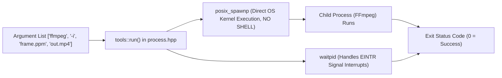

# File 18: `include/gravastar/tools/process.hpp` — Safe POSIX Process Spawner

> **Target Audience**: 9th-Grade High School Student (Algebra 1 knowledge, Zero C++, Zero Operating Systems)  
> **Source Code**: [`include/gravastar/tools/process.hpp`](file:///home/abrsdxd/Projects/GravastarLab/include/gravastar/tools/process.hpp)  
> **Role in GravastarLab**: The Safe Subprocess Launcher (Launching FFmpeg and System Utilities Without Shell Injection)

---

## 1. The Big Picture (What is this file's job?)

Sometimes a program needs to launch another program installed on your computer (like calling `ffmpeg` to encode a video or `ffprobe` to inspect a file).

Many amateur programs do this using the old C library command `std::system("ffmpeg -i file.ppm video.mp4")`. 

In computer science, `system()` is considered **extremely dangerous**! 
* It launches an entire command-line shell (`/bin/sh`).
* If your file path has a space, semicolon, or parenthesis in it (e.g. `My Video; rm -rf /`), the shell might interpret the semicolon as a new command and accidentally delete your files! This is the classic **Shell Injection Security Vulnerability**.

`process.hpp` is the **Secure Subprocess Launcher**:
1. It bypasses the shell completely using modern POSIX primitives (`posix_spawnp`).
2. It passes arguments directly to the operating system kernel as a clean array of words.
3. It waits for the program to finish, handles operating system signal interrupts (`EINTR`), and returns the exact integer exit status code.



### What terrible thing happens if we delete this file or turn it off?
If we delete this file, GravastarLab cannot launch external video encoding tools, verify media containers, or run automated integration scripts.

---

## 2. High-School Physics & Math Intuition

### A. The Shell Injection Trap
Imagine you are at an airport security checkpoint:
* **`system()` is like handing a letter to a messenger**: If someone wrote a secret trick command inside the letter, the messenger reads it and accidentally carries out the trick.
* **`posix_spawnp` is like putting items into sealed plastic bins**: Each word (like `"ffmpeg"`, `"-y"`, `"my movie (1).mp4"`) sits in its own sealed container. Even if a filename contains spaces, asterisks, or semicolons, the computer treats it purely as a filename, making shell injection physically impossible!

### B. The `EINTR` Signal Glitch
In operating systems like Linux, while your program is waiting for FFmpeg to finish (`waitpid`), a background system timer or mouse click might send a tiny electrical signal to your CPU. 

When this happens, the operating system pauses the wait and returns an error code: `errno = EINTR` (Interrupted System Call). 

If a program doesn't expect this, it crashes! 
`process.hpp` handles this with an ironclad loop:
```cpp
while (waitpid(pid, &status, 0) < 0) {
    if (errno != EINTR)
        throw std::runtime_error("waitpid failed");
}
```
If the wait was interrupted by a harmless signal, it just smiles and goes right back to waiting!

---

## 3. The Line-by-Line Anatomy ("Why This Line?")

Here is the entire 31-line source code of [`include/gravastar/tools/process.hpp`](file:///home/abrsdxd/Projects/GravastarLab/include/gravastar/tools/process.hpp):

```cpp
// SPDX-License-Identifier: MIT
#pragma once
#include <cerrno>
#include <spawn.h>
#include <stdexcept>
#include <string>
#include <sys/wait.h>
#include <vector>

extern char **environ;

namespace gravastar::tools {

inline int run(std::vector<std::string> args) {
  if (args.empty())
    throw std::invalid_argument("empty process argument vector");

  std::vector<char *> pointers;
  for (auto &a : args)
    pointers.push_back(a.data());
  pointers.push_back(nullptr);
```

#### Plain English Meaning
* **Line 9 (`extern char **environ`)**: Accesses the computer's current environment variables (such as `PATH`, so Linux knows where FFmpeg is installed).
* **Lines 14–17**: The POSIX C library requires argument lists to end with a null pointer (`nullptr`). This loop converts the C++ `std::vector<std::string>` into a standard array of C string pointers (`char*[]`) with a terminating `nullptr`.

```cpp
  pid_t pid{};
  int code = posix_spawnp(&pid, pointers[0], nullptr, nullptr, pointers.data(),
                          environ);
  if (code)
    throw std::runtime_error("cannot launch " + args[0] + ": " +
                             std::to_string(code));
```

#### Plain English Meaning
* **Line 19 (`posix_spawnp`)**: Launches the child process directly with its PID (Process ID):
  - `pointers[0]`: The name of the program to run (e.g. `"ffmpeg"`).
  - `pointers.data()`: The argument list.
  - `environ`: Inherits standard environment variables.
* **Line 21**: If the program doesn't exist on the computer, `posix_spawnp` returns a non-zero error code immediately without hanging.

```cpp
  int status{};
  while (waitpid(pid, &status, 0) < 0) {
    if (errno != EINTR)
      throw std::runtime_error("waitpid failed");
  }
  return WIFEXITED(status) ? WEXITSTATUS(status) : 128 + WTERMSIG(status);
}
} // namespace gravastar::tools
```

#### Plain English Meaning
* **Lines 24–28**: Pauses the parent program until the child program exits, safely swallowing any `EINTR` signal interruptions.
* **Line 29**: Decodes the exit status:
  - If the program finished normally (`WIFEXITED`), it returns the program's return code (`WEXITSTATUS`, where $0$ means success).
  - If the program was killed by an external signal (like hitting `Ctrl+C`), it returns $128 + \text{signal number}$.

---

## 4. Debugger's Cheat Sheet: `process.hpp`

| Symptom | Suspect Line | Root Cause |
| :--- | :--- | :--- |
| `cannot launch ffmpeg: 2` (ENOENT) | Line 21 | FFmpeg is not installed or not present in the user's `$PATH` |
| Process crashes with segmentation fault on launch | Line 17 | Forgot terminating `nullptr` at the end of the argument vector |
| Parent program crashes when a timer alarm fires | Line 26 | Missing `EINTR` check in `waitpid` loop |
