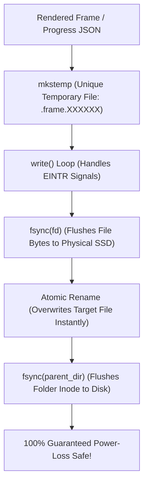

# File 19: `include/gravastar/tools/artifacts.hpp` — Cryptographic SHA-256 & Atomic Disk Durability

> **Target Audience**: 9th-Grade High School Student (Algebra 1 knowledge, Zero C++, Zero Database Durability)  
> **Source Code**: [`include/gravastar/tools/artifacts.hpp`](file:///home/abrsdxd/Projects/GravastarLab/include/gravastar/tools/artifacts.hpp)  
> **Role in GravastarLab**: The Cryptographic Vault & Indestructible Safe (SHA-256 Integrity & fsync Atomic Writing)

---

## 1. The Big Picture (What is this file's job?)

Have you ever had a video game save file get corrupted because your console lost power while saving? You open the game the next day, and your 100-hour save file is gone!

Why does that happen? 
When a computer writes a file to an SSD or hard drive, it doesn't write directly to the physical storage chips. It writes to a temporary memory buffer in RAM. The operating system might wait several seconds before actually writing that data to the magnetic or silicon drive. If power cuts out, the file on disk is half-written garbage.

`artifacts.hpp` is the **Bank Vault of Data Durability**:
1. It contains a full, standalone **SHA-256 Cryptographic Hash Engine** built from scratch without external dependencies.
2. It generates a **cryptographic fingerprint** of every source file in the project so nobody can tamper with the scientific code.
3. It implements **Atomic File Durability with Directory fsync**: files are written to a hidden temporary file, flushed physically to the SSD platter (`fsync`), atomically renamed, and the parent folder's directory table is flushed too!



### What terrible thing happens if we delete this file or turn it off?
If we delete this file, GravastarLab loses its crash-durability guarantees. If the power cuts out during a long recording session, save files and frame images will be corrupted, and scientific manifests cannot be verified.

---

## 2. High-School Physics & Math Intuition

### A. SHA-256: The Mathematical Fingerprint
Imagine you have a 500-page encyclopedia. How can you prove to someone that you didn't change even a single comma on page 342 without re-reading the entire book?

You run the text through a **Cryptographic Hash Function** like **SHA-256**:
* It scrambles the bytes through 64 rounds of non-linear mathematical operations (bit rotations, XORs, and modular additions).
* It outputs a single 64-character hex string (like `e3b0c44298fc1c149afbf4c8996fb92427ae41e4649b934ca495991b7852b855`).
* If you change even one single letter in the entire book, the output hash changes completely!

`artifacts.hpp` uses SHA-256 to create a `manifest.json` that locks the exact code version to the scientific outputs.

### B. Why You Must `fsync` the Parent Directory
Almost every programmer knows that `fsync(file_descriptor)` forces the hard drive to save the file contents.

**The Pro Secret**: Almost nobody remembers to `fsync` the **folder**!
In Linux operating systems (like ext4):
1. The file bytes live in storage blocks on the drive.
2. The folder is like an address book (an "inode directory table") that points to those blocks.
3. When you rename `.frame.tmp` to `frame.ppm`, you didn't change the file bytes; you changed the **folder's address book**!
If power cuts out before the address book is saved to disk, your computer will reboot, look in the folder, and find... nothing!

`artifacts.hpp` does the complete job:
```cpp
int dir = open(path.parent_path().c_str(), O_RDONLY | O_DIRECTORY);
if (dir >= 0) {
    (void)fsync(dir);
    (void)close(dir);
}
```
It opens the folder itself and forces the operating system to write the address book to disk!

---

## 3. The Line-by-Line Anatomy ("Why This Line?")

Let's walk through the key functions in [`include/gravastar/tools/artifacts.hpp`](file:///home/abrsdxd/Projects/GravastarLab/include/gravastar/tools/artifacts.hpp).

```cpp
inline std::string sha256(const std::string &input) {
  constexpr std::array<std::uint32_t, 64> k{
      0x428a2f98, 0x71374491, 0xb5c0fbcf, 0xe9b5dba5, ...
  };
  std::array<std::uint32_t, 8> h{
      0x6a09e667, 0xbb67ae85, 0x3c6ef372, 0xa54ff53a, ...
  };
```

#### Plain English Meaning
* **Lines 22–36**: The 64 constant fractional cube roots of prime numbers ($k$) and the 8 initial square roots of primes ($h$) that define the SHA-256 algorithm.
* **Lines 50–60**: Uses modern C++20 bitwise rotations (`std::rotr`) to run the 64 cryptographic compression rounds in ultra-fast CPU machine code.

```cpp
inline void atomic_bytes(const fs::path &path, const std::string &bytes) {
  fs::create_directories(path.parent_path());
  std::string pattern =
      (path.parent_path() / ("." + path.filename().string() + ".XXXXXX"))
          .string();
  std::vector<char> name(pattern.begin(), pattern.end());
  name.push_back('\0');
  int fd = mkstemp(name.data());
  if (fd < 0)
    throw std::runtime_error("cannot create atomic temporary file");
```

#### Plain English Meaning
* **Lines 167–175**: Creates an exclusive temporary file using `mkstemp`. The `XXXXXX` characters are replaced by the operating system with random letters (e.g. `.frame_000042.ppm.Ab3x9Z`), preventing multiple running programs from overwriting each other.

```cpp
  try {
    std::size_t offset = 0;
    while (offset < bytes.size()) {
      auto n = write(fd, bytes.data() + offset, bytes.size() - offset);
      if (n < 0 && errno == EINTR)
        continue;
      if (n <= 0)
        throw std::runtime_error("report write failed");
      offset += static_cast<std::size_t>(n);
    }
    if (fsync(fd) != 0)
      throw std::runtime_error("report flush failed");
    int closed = close(fd);
    fd = -1;
    if (closed != 0)
      throw std::runtime_error("report close failed");
    fs::rename(name.data(), path);
    int dir = open(path.parent_path().c_str(), O_RDONLY | O_DIRECTORY);
    if (dir >= 0) {
      (void)fsync(dir);
      (void)close(dir);
    }
```

#### Plain English Meaning
* **Lines 178–185**: Writes the data chunk-by-chunk, handling signal interrupts (`EINTR`).
* **Line 186 (`fsync(fd)`)**: Commands the storage device hardware: *"Flush all physical write caches immediately."*
* **Line 192 (`fs::rename`)**: Atomically swaps the temporary file into the final destination filename.
* **Lines 193–197**: Flushes the directory inode so the filename update survives power loss!

---

## 4. Debugger's Cheat Sheet: `artifacts.hpp`

| Symptom | Suspect Line | Root Cause |
| :--- | :--- | :--- |
| `cannot create atomic temporary file` error | Line 173 | Parent directory does not exist or user lacks write permissions |
| Temporary `.XXXXXX` files littering the directory | Line 199 | An exception occurred before rename, but cleanup handler failed |
| Files disappear after unexpected computer reboot | Line 195 | Directory `fsync` failed or was disabled |
| SHA-256 hash does not match standard `sha256sum` tool | Line 38 | Endianness bit-shifting error in 64-bit length padding |
