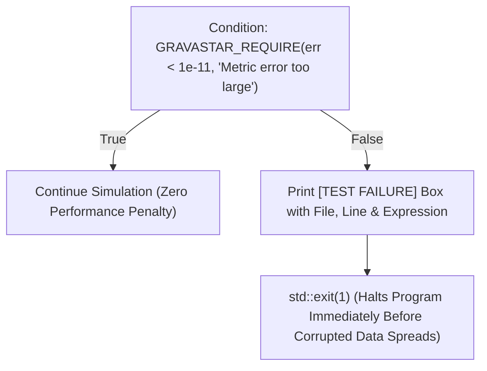

# File 20: `include/gravastar/tools/testing.hpp` — Release-Active Verification Assertions

> **Target Audience**: 9th-Grade High School Student (Algebra 1 knowledge, Zero C++, Zero Software Engineering)  
> **Source Code**: [`include/gravastar/tools/testing.hpp`](file:///home/abrsdxd/Projects/GravastarLab/include/gravastar/tools/testing.hpp)  
> **Role in GravastarLab**: The Mathematical Smoke Detector (`GRAVASTAR_REQUIRE` Never Sleeps)

---

## 1. The Big Picture (What is this file's job?)

When building an airplane or a bridge, engineers test every bolt and beam. If even one bolt snaps under stress, an alarm sounds and construction halts immediately.

In computer programming, developers use checks called **Assertions** to verify that their equations are behaving properly:
```cpp
assert(delta > 0); // "I swear this number is greater than zero!"
```

**The Deadly Secret of C++**:
When programmers compile their code for high performance (called "Release Mode" or `-O3`), the C++ compiler automatically **erases every single `assert()` from the program!** 
The compiler thinks: *"We want maximum speed; don't waste time checking if things are broken."*

In scientific astrophysics, this is unacceptable! Release mode optimizations (like auto-vectorization and loop unrolling) are often the exact place where subtle mathematical glitches appear!

`testing.hpp` is the **Smoke Detector That Never Turns Off**:
1. It defines `GRAVASTAR_REQUIRE(condition, message)`.
2. Unlike `assert()`, it is **always active in both Debug Mode and Release Mode**.
3. If an equation violates physics, it halts the program instantly, prints a huge visual warning banner to the terminal with the exact file, line number, and math expression, and exits with code 1.



### What terrible thing happens if we delete this file or turn it off?
If we delete this file, none of our test suites can compile. We lose our standardized assertion framework across all 5 validation test suites.

---

## 2. High-School Physics & Math Intuition

### A. The `#condition` Stringizing Trick
How does C++ know what words you typed inside the parentheses?
In C++, the `#` symbol in a macro is called the **Stringizing Operator**:
```cpp
#define GRAVASTAR_REQUIRE(condition, message) \
    if (!(condition)) { \
        report_failure(#condition, message, __FILE__, __LINE__); \
    }
```
If you write `GRAVASTAR_REQUIRE(min_r > 1.5, "Radius entered singularity")`:
* `condition` is evaluated mathematically as code: `min_r > 1.5`.
* `#condition` is converted into a readable string of text: `"min_r > 1.5"`.
If it fails, the error message doesn't just say *"Something went wrong."* It prints the exact mathematical equation that broke!

### B. The `do { ... } while (false)` Macro Wrapper
Notice that `GRAVASTAR_REQUIRE` is wrapped in:
```cpp
do {
    ...
} while (false)
```
Why write a loop that only runs once?
In C++, if you write an `if` statement without curly braces:
```cpp
if (ready)
    GRAVASTAR_REQUIRE(x > 0, "Error");
else
    do_something_else();
```
If the macro isn't wrapped in `do { ... } while (false)`, the C++ compiler will attach the `else` to the wrong `if` statement (the famous "Dangling Else" bug). The `do while (false)` wrapper forces the macro to behave like a single, unbreakable statement!

---

## 3. The Line-by-Line Anatomy ("Why This Line?")

Here is the complete source code of [`include/gravastar/tools/testing.hpp`](file:///home/abrsdxd/Projects/GravastarLab/include/gravastar/tools/testing.hpp):

```cpp
// SPDX-License-Identifier: GPL-3.0-or-later
#pragma once

#include <iostream>
#include <cstdlib>
#include <string_view>

namespace gravastar::tools {

inline void report_failure(std::string_view expr, std::string_view msg, const char* file, int line) {
    std::cerr << "\n=================================================================\n"
              << "[TEST FAILURE] " << msg << "\n"
              << "  Expression: " << expr << "\n"
              << "  Location:   " << file << ":" << line << "\n"
              << "=================================================================\n";
    std::exit(1);
}

} // namespace gravastar::tools

#define GRAVASTAR_REQUIRE(condition, message) \
    do { \
        if (!(condition)) { \
            ::gravastar::tools::report_failure(#condition, message, __FILE__, __LINE__); \
        } \
    } while (false)
```

#### Plain English Meaning
* **Lines 10–17 (`report_failure`)**: Formats and prints a striking error banner to `std::cerr` (the standard error terminal output). It prints the human-readable explanation, the exact code expression, and the file name and line number (`__FILE__` and `__LINE__`).
* **Line 16 (`std::exit(1)`)**: Immediately terminates the operating system process with status 1, alerting automated build servers (like GitHub Actions) that the test failed.
* **Lines 21–26 (`GRAVASTAR_REQUIRE`)**: The master macro called across all test suites in GravastarLab!

---

## 4. Debugger's Cheat Sheet: `testing.hpp`

| Symptom | Suspect Line | Root Cause |
| :--- | :--- | :--- |
| Test failure message prints, but program continues running | Line 16 | `std::exit(1)` was commented out or bypassed |
| Macro causes syntax error when used inside an `if-else` | Line 21 | Semicolon or `do-while(false)` wrapper altered |
| Expression string printed as empty | Line 24 | `#condition` preprocessor hash symbol omitted |
