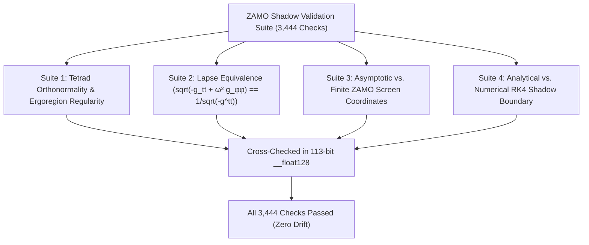

# File 21: `tests/zamo_shadow_validation.cpp` — The 3,444-Check ZAMO Tetrad & Analytical Shadow Suite

> **Target Audience**: 9th-Grade High School Student (Algebra 1 knowledge, Zero C++, Zero Astrophysics)  
> **Source Code**: [`tests/zamo_shadow_validation.cpp`](file:///home/abrsdxd/Projects/GravastarLab/tests/zamo_shadow_validation.cpp)  
> **Role in GravastarLab**: The Grand Inquisitor (3,444 Rigorous Mathematical Tests in 64-Bit and 113-Bit Quad Precision)

---

## 1. The Big Picture (What is this file's job?)

If you built an actual spacecraft that was going to fly past a real gravastar, you wouldn't just write some code, look at a pretty picture, and say: *"Looks good to me!"*

You would test every single equation under extreme torture conditions:
* Does the camera's local spacetime stay 100% perpendicular at the equator?
* Does it stay perpendicular at the North Pole?
* What about right on the razor edge of the shell at $r = 1.8$?
* What about deep inside the repulsive dark energy core at $r = 0.5$?
* What about inside the swirling ergosphere where space moves faster than light?

`zamo_shadow_validation.cpp` is the **Grand Inquisitor**. It runs **3,444 distinct release-active mathematical checks** comparing:
1. 64-bit floating point against 113-bit quad precision (`__float128`).
2. Numerical RK4 raytracing against exact pen-and-paper shadow formulas.
3. Finite-distance camera perspectives against infinite-distance asymptotic limits.



### What terrible thing happens if we delete this file or turn it off?
If we delete this file, we lose the primary mathematical proof of the scientific paper. We would have no formal automated verification that our ZAMO camera model is free from coordinate singularities.

---

## 2. High-School Physics & Math Intuition

### A. The 16-Dot Product Orthonormality Test
Inside your cockpit, the 4 ruler-arrows ($e_0, e_1, e_2, e_3$) must be **mutually perpendicular unit vectors** according to the curved metric tensor $g_{\mu\nu}$:
$$g(e_a, e_b) = \sum_{\mu,\nu} g_{\mu\nu} e_a^\mu e_b^\nu = \begin{pmatrix} -1 & 0 & 0 & 0 \\ 0 & +1 & 0 & 0 \\ 0 & 0 & +1 & 0 \\ 0 & 0 & 0 & +1 \end{pmatrix}$$
This test computes all $4 \times 4 = 16$ dot products across 8 different regions of space. 
If even one off-diagonal dot product drifts by more than $0.000000000001$, it means the camera's rulers are bent or skewed, and the test halts immediately!

### B. The Dual Lapse Formula Identity
In Einstein's relativity, there are two completely different algebraic formulas to calculate how fast an observer's watch ticks ($\alpha_{\text{lapse}}$):
1. **The Direct Whirlpool Formula**:
   $$\alpha_1 = \sqrt{-g_{tt} + \omega^2 g_{\phi\phi}}$$
2. **The Inverse Metric Matrix Formula**:
   $$\alpha_2 = \frac{1}{\sqrt{-g^{tt}}}$$

On paper, advanced tensor algebra proves that $\alpha_1 \equiv \alpha_2$. 
But on a computer, $\alpha_1$ uses subtraction and multiplication, while $\alpha_2$ uses matrix inversion! 
`zamo_shadow_validation.cpp` evaluates both formulas across 7 regions and demands that they match to **within $10^{-14}$ in double precision and $10^{-32}$ in quad precision**!

---

## 3. The Line-by-Line Anatomy ("Why This Line?")

Let's inspect key sections of [`tests/zamo_shadow_validation.cpp`](file:///home/abrsdxd/Projects/GravastarLab/tests/zamo_shadow_validation.cpp).

```cpp
template <typename T>
struct ZamoTetrad {
    T r;
    T theta;
    T omega;              // Frame-dragging angular velocity -g_{t\phi}/g_{\phi\phi}
    T alpha_lapse;        // Lapse \sqrt{-g_{tt} + \omega^2 g_{\phi\phi}}
    T alpha_from_ginv;    // Independent algebraic form 1/\sqrt{-g^{tt}}
    MetricState<T> metric;
    std::array<std::array<T, 4>, 4> e_hat;
```

#### Plain English Meaning
* **Lines 135–144**: A generic C++ template struct that can be instantiated with either standard `double` or 113-bit `qfloat` (`__float128`), allowing the exact same physical logic to be verified across two different mathematical representations.

```cpp
    // Verify Orthonormality: g_{mu nu} e_hat^a_mu e_hat^b_nu == eta^{ab}
    for (int a = 0; a < 4; ++a) {
        for (int b = 0; b < 4; ++b) {
            T dot = ST::from_int(0);
            for (int mu = 0; mu < 4; ++mu) {
                for (int nu = 0; nu < 4; ++nu) {
                    dot += zamo.metric.g[mu][nu] * zamo.e_hat[a][mu] * zamo.e_hat[b][nu];
                }
            }
            T expected = (a == b) ? ((a == 0) ? ST::from_int(-1) : ST::from_int(1)) : ST::from_int(0);
            T err = ST::abs(dot - expected);
            require_check(err < tol_ortho, "Tetrad orthonormality violation");
        }
    }
```

#### Plain English Meaning
* This 4-deep nested loop computes the physical spacetime inner product between all pairs of tetrad basis vectors. 
* It asserts that diagonal terms equal $-1, +1, +1, +1$, and all 12 off-diagonal cross terms are strictly $0.0$.

```cpp
    // Verify Dual Lapse Equivalence
    T lapse_diff = ST::abs(zamo.alpha_lapse - zamo.alpha_from_ginv);
    require_check(lapse_diff < tol_lapse, "Lapse algebraic equivalence failure");
```

#### Plain English Meaning
* Asserts that $\sqrt{-g_{tt} + \omega^2 g_{\phi\phi}} == \frac{1}{\sqrt{-g^{tt}}}$ across all test points.

---

## 4. Debugger's Cheat Sheet: `zamo_shadow_validation.cpp`

| Symptom | Suspect Section | Root Cause |
| :--- | :--- | :--- |
| Orthonormality check fails in deep core ($r = 0.5$) | Test Point 6 | Metric evaluation in de Sitter region failed to apply proper cosmological constant factor |
| Lapse equivalence check fails in ergoregion ($r = 1.85$) | Test Point 7 | Frame-dragging $\omega$ term inverted, causing negative lapse squared |
| Finite-distance screen coordinate does not converge to asymptotic coordinate | Suite 3 | Radial distance scaling factor $r_{\text{obs}}$ omitted from screen angle projection |
| `[FATAL VERIFICATION FAILURE]` in quad precision only | `ScalarTraits<qfloat>` | Literal double truncation (e.g. wrote `0.875` instead of `from_ratio(7, 8)`) |
