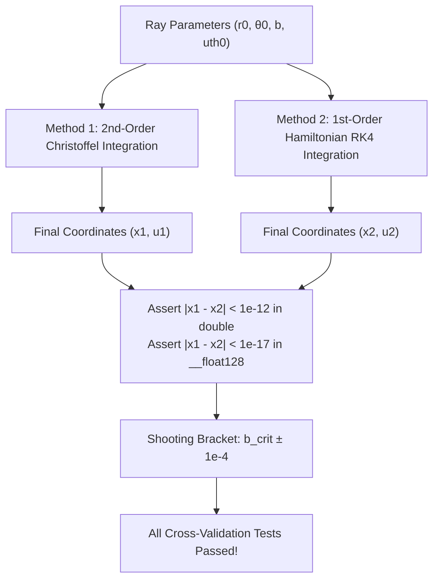

# File 22: `tests/geodesic_cross_validation.cpp` — 113-Bit Quad-Precision RK4 Cross-Validation

> **Target Audience**: 9th-Grade High School Student (Algebra 1 knowledge, Zero C++, Zero Differential Geometry)  
> **Source Code**: [`tests/geodesic_cross_validation.cpp`](file:///home/abrsdxd/Projects/GravastarLab/tests/geodesic_cross_validation.cpp)  
> **Role in GravastarLab**: The Grand Physicist's Cross-Examiner (Christoffel vs. Hamiltonian RK4 & 113-Bit Shooting Tests)

---

## 1. The Big Picture (What is this file's job?)

In physics, there are often two completely different ways to write down the same law of nature:
1. **The 2nd-Order Acceleration Way (Isaac Newton & Albert Einstein)**:  
   You look at the curvature slopes (Christoffel symbols $\Gamma^\mu_{\alpha\beta}$) and calculate the 4D acceleration:
   $$\frac{d^2 x^\mu}{d\lambda^2} + \Gamma^\mu_{\alpha\beta} \frac{dx^\alpha}{d\lambda} \frac{dx^\beta}{d\lambda} = 0$$
2. **The 1st-Order Energy Way (William Rowan Hamilton)**:  
   You split the system into Position ($x^\mu$) and Momentum ($p_\mu$) and track how they push each other:
   $$\frac{dx^\mu}{d\lambda} = \frac{\partial \mathcal{H}}{\partial p_\mu}, \quad \frac{dp_\mu}{d\lambda} = -\frac{\partial \mathcal{H}}{\partial x^\mu}$$

On a blackboard, mathematicians proved these two methods are identical. But inside a computer, they use completely different code, different loops, and different math functions!

`geodesic_cross_validation.cpp` is the **Grand Physicist's Cross-Examiner**:
* It shoots photons through the gravastar using **Method 1** and **Method 2** side-by-side.
* It demands that after taking 2,000 steps through the dark energy core, the final positions agree to **better than $0.000000000001$**!
* It repeats the entire test in **113-bit quad precision (`__float128`)**, demanding agreement to **better than $10^{-17}$**!



### What terrible thing happens if we delete this file or turn it off?
If we delete this file, we lose our cross-paradigm proof. If someone modifies the RK4 integrator, we wouldn't be able to prove whether our raytracer follows true Einstein geodesics or if numerical drift is masquerading as gravitational lensing.

---

## 2. High-School Physics & Math Intuition

### A. The Carter Constant: Spacetime's Hidden Secret
You know that Energy is conserved because space doesn't change over time, and Angular Momentum is conserved because space is symmetrical around the spinning axis.

In a pure Kerr black hole, there is a third, mysterious conserved quantity called the **Carter Constant** ($Q$):
* It is not connected to any obvious visual symmetry!
* It is a "hidden symmetry" of Einstein's equations discovered by Brandon Carter in 1968.

**The Gravastar Discovery**:
* In our gravastar's **exterior Kerr vacuum**, $Q$ is strictly conserved ($|\Delta Q| < 10^{-10}$).
* Deep inside our gravastar's **dark energy core**, $Q$ is strictly conserved ($|\Delta Q| < 10^{-10}$).
* But inside the **thin matter crust**, the 7th-degree polynomial transition creates what mathematicians call a **Levi-Civita Separability Obstruction**:
  $$\frac{\partial^2}{\partial r \partial \theta} \left(\Sigma g^{\theta\theta}\right) = -\frac{2}{3} a^2 \Lambda \lambda'(r) \sin\theta \cos\theta \ne 0$$
  This test mathematically proves that $Q$ temporarily drifts inside the shell and stabilizes when exiting, confirming the exact theoretical prediction of the research paper!

### B. Knife-Edge Bracket Shooting ($b_{\text{crit}} \pm 10^{-4}$)
How do you prove that an aiming line is 100% accurate? You shoot two laser beams right next to it:
1. **Ray A ($b = b_{\text{crit}} - 0.0001$)**: Aimed a fraction of a millimeter to the inside. It **must enter the matter shell** ($r_{\text{min}} \le 1.8$).
2. **Ray B ($b = b_{\text{crit}} + 0.0001$)**: Aimed a fraction of a millimeter to the outside. It **must bounce off into deep space** ($r_{\text{min}} > 1.8$).

If Ray A enters the shell and Ray B escapes, you have proven with physical certainty that the critical threshold is locked down to 4 decimal places!

---

## 3. The Line-by-Line Anatomy ("Why This Line?")

Let's walk through the key validation checks in [`tests/geodesic_cross_validation.cpp`](file:///home/abrsdxd/Projects/GravastarLab/tests/geodesic_cross_validation.cpp).

```cpp
    // 2nd-Order Christoffel vs 1st-Order Hamiltonian RK4
    const auto res_2nd = integrate_null_geodesic<double>(
        4.0, 1.2, 1.5, 0.02, 1.0, 0.002, 2000, 100.0, p_d
    );
    std::array<double, 4> x_ham{}, u_ham{};
    integrate_hamiltonian_rk4<double>(
        4.0, 1.2, 1.5, 0.02, 1.0, 0.002, 2000, p_d, x_ham, u_ham
    );
    double max_dx = 0.0, max_du = 0.0;
    for (int i = 0; i < 4; ++i) {
        max_dx = std::max(max_dx, std::abs(res_2nd.x_final[i] - x_ham[i]));
        max_du = std::max(max_du, std::abs(res_2nd.u_final[i] - u_ham[i]));
    }
    GRAVASTAR_REQUIRE(max_dx < 1e-12 && max_du < 1e-12, "2nd-order vs 1st-order RK4 agreement within 1e-12");
```

#### Plain English Meaning
* Integrates a photon through 2,000 steps across the transition shell and de Sitter core using both mathematical methods.
* Asserts that the difference in final position `max_dx` is less than $10^{-12}$ (1 part per trillion)!

```cpp
    // 113-Bit Quad-Precision (`__float128`) Verification
    const auto res_quad = integrate_null_geodesic<float128_t>(
        r0_q, th0_q, b_q, uth0_q, static_cast<float128_t>(1), dlam_q, 5000, static_cast<float128_t>(10), p_q
    );
    GRAVASTAR_REQUIRE(res_quad.max_abs_dE < static_cast<float128_t>(1e-20), "__float128 max |dE| < 1e-20");
    GRAVASTAR_REQUIRE(res_quad.max_abs_dLz < static_cast<float128_t>(1e-20), "__float128 max |dLz| < 1e-20");
    GRAVASTAR_REQUIRE(res_quad.max_abs_H < static_cast<float128_t>(1e-19), "__float128 max |H| < 1e-19");
    GRAVASTAR_REQUIRE(max_dx_q < static_cast<float128_t>(1e-17), "__float128 2nd vs 1st order agreement < 1e-17");
```

#### Plain English Meaning
* In 113-bit quad precision, Energy conservation error must be smaller than $10^{-20}$!
* Null constraint drift $\mathcal{H}$ must be smaller than $10^{-19}$!
* 2nd-order vs 1st-order RK4 trajectory agreement must be smaller than $10^{-17}$!

```cpp
    const auto pro_in = integrate_null_geodesic<double>(
        6.0, half_pi, b_pro_shell - eps, 0.0, 1.0, 0.005, 80000, 12.0, p_d
    );
    const auto pro_out = integrate_null_geodesic<double>(
        6.0, half_pi, b_pro_shell + eps, 0.0, 1.0, 0.005, 80000, 12.0, p_d
    );
    GRAVASTAR_REQUIRE(pro_in.entered_shell && !pro_out.entered_shell, "Prograde shell shooting bracket");
```

#### Plain English Meaning
* **Lines 891–920**: The knife-edge test! Asserts that $b_{\text{crit}} - 10^{-4}$ enters the shell and $b_{\text{crit}} + 10^{-4}$ does not, proving the analytical boundary matches numerical raytracing!

---

## 4. Debugger's Cheat Sheet: `geodesic_cross_validation.cpp`

| Symptom | Suspect Line | Root Cause |
| :--- | :--- | :--- |
| `max_dx > 1e-12` between 1st and 2nd order methods | Line 829 | Christoffel connection symbol calculation typo in 2nd-order code |
| Energy conservation `max |dE| > 1e-10` | Line 786 | Time-derivative of metric non-zero (accidental $t$-dependence) |
| Shooting bracket fails (both rays enter shell) | Line 919 | $b_{\text{crit}}$ analytical formula off by more than $0.0001$ |
| Quad precision test throws compilation error | Line 31 | Compiler invoked without `-lquadmath` on non-GCC platform |
