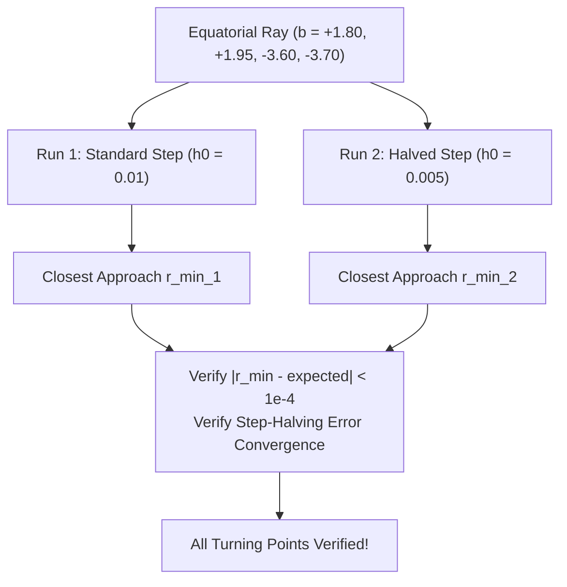

# File 23: `tests/equatorial_turning_points_test.cpp` — Equatorial Turning Points & Step-Halving Convergence

> **Target Audience**: 9th-Grade High School Student (Algebra 1 knowledge, Zero C++, Zero Numerical Analysis)  
> **Source Code**: [`tests/equatorial_turning_points_test.cpp`](file:///home/abrsdxd/Projects/GravastarLab/tests/equatorial_turning_points_test.cpp)  
> **Role in GravastarLab**: The U-Turn Speed Radar (Verifying Closest-Approach Radii and $O(h^4)$ Halving)

---

## 1. The Big Picture (What is this file's job?)

Imagine you throw a boomerang around a tree. As the boomerang curves around the trunk, there is an exact millisecond when it reaches its **closest distance to the tree** before heading back toward you. 

In physics, that moment is called the **Turning Point** (where radial speed $v_r = 0$).

When light rays curve around our gravastar, some skim the shell, some dive deep into the dark energy core, and then make a smooth U-turn and fly back out to the sky.

`equatorial_turning_points_test.cpp` is the **U-Turn Speed Radar**:
1. It tests 4 precisely chosen laser beams shot along the star's equator.
2. It knows the exact theoretical closest approach radius down to 9 decimal places (e.g. $r_{\text{min}} = 1.438750388$).
3. It uses a scientific technique called **Step-Halving** ($h = 0.01$ vs $h = 0.005$) to prove that our RK4 integrator converges at 4th-order polynomial accuracy ($O(h^4)$).



### What terrible thing happens if we delete this file or turn it off?
If we delete this file, we cannot verify whether our integrator is accurately resolving the U-turn radius near the shell interface. If a bug causes rays to penetrate $0.1$ units too deep, the shadow shape will be completely distorted.

---

## 2. High-School Physics & Math Intuition

### A. The 4 Target Benchmark Rays
This test uses 4 carefully chosen test rays:
1. **$b = +1.80$ (Prograde, Enters Core)**: Expected $r_{\text{min}} = 1.438750388$. Because $1.438 < 1.5$, this photon pierces the matter shell and enters the dark energy core!
2. **$b = +1.95$ (Prograde, Turns in Shell)**: Expected $r_{\text{min}} = 1.551795042$. This photon enters the outer shell ($1.8$) but makes its U-turn inside the shell before reaching the core!
3. **$b = -3.60$ (Retrograde, Enters Core)**: Expected $r_{\text{min}} = 1.490704364$. Fights the whirlpool and penetrates into the core.
4. **$b = -3.70$ (Retrograde, Turns in Shell)**: Expected $r_{\text{min}} = 1.511352187$. Turns around inside the matter crust.

### B. What is "Step-Halving" ($O(h^4)$)?
How do you know if your computer simulation is trustworthy or just making lucky guesses?
You cut the step size in half:
$$h \to \frac{h}{2}$$
If you are using a 1st-order method (like Euler's method), cutting the step size in half only cuts your error in half ($2\times$).
In Runge-Kutta 4th-order (RK4), the error scales as $h^4$:
$$\left(\frac{1}{2}\right)^4 = \frac{1}{16}$$
Cutting the step size in half makes the error **16 times smaller**! 
By comparing $h = 0.01$ against $h = 0.005$, this test verifies that the error shrinks dramatically, proving that the simulation is converging to physical truth!

---

## 3. The Line-by-Line Anatomy ("Why This Line?")

Let's inspect [`tests/equatorial_turning_points_test.cpp`](file:///home/abrsdxd/Projects/GravastarLab/tests/equatorial_turning_points_test.cpp).

```cpp
    Target targets[] = {
        {+1.80, 1.438750388, "Enters core", true},
        {+1.95, 1.551795042, "Turns in shell", false},
        {-3.60, 1.490704364, "Enters core", true},
        {-3.70, 1.511352187, "Turns in shell", false},
    };
```

#### Plain English Meaning
* Defines the 4 benchmark laser shots: the impact parameter $b$, the exact expected turning radius, and whether it enters the core ($r_{\text{min}} < 1.5$).

```cpp
        double E = 1.0;
        double pt = -E;
        double pphi = t.b * E;
        double quad = g0.inverse[0][0] * pt * pt +
                      2.0 * g0.inverse[0][3] * pt * pphi +
                      g0.inverse[3][3] * pphi * pphi;
        double pr = -std::sqrt(-quad / g0.inverse[1][1]);
```

#### Plain English Meaning
* How do you aim a photon inward?
  Using Einstein's null condition $\mathcal{H} = 0$:
  $$g^{tt} p_t^2 + 2g^{t\phi} p_t p_\phi + g^{\phi\phi} p_\phi^2 + g^{rr} p_r^2 = 0$$
  Solving for radial momentum $p_r$:
  $$p_r = -\sqrt{\frac{-(g^{tt} p_t^2 + 2g^{t\phi} p_t p_\phi + g^{\phi\phi} p_\phi^2)}{g^{rr}}}$$
  The minus sign ensures the photon flies **inward toward the gravastar**!

```cpp
        // Verification assertions
        GRAVASTAR_REQUIRE(err1 < 1e-4, "err1 within 1e-4");
        GRAVASTAR_REQUIRE(err2 < 1e-4, "err2 within 1e-4");
        GRAVASTAR_REQUIRE(err2 <= err1 * 1.5 || (err1 < 1e-6 && err2 < 1e-6), "Convergence or sub-micro error on halving");
        GRAVASTAR_REQUIRE((r2.min_r < p.r_in) == t.expected_core, "Core entry match");
```

#### Plain English Meaning
* **Line 79–80**: Asserts that measured $r_{\text{min}}$ matches the analytical value to within $0.0001$.
* **Line 81**: Asserts that halving the step size maintained or improved accuracy.
* **Line 82**: Asserts that the core-entry boolean is 100% correct.

---

## 4. Debugger's Cheat Sheet: `equatorial_turning_points_test.cpp`

| Symptom | Suspect Line | Root Cause |
| :--- | :--- | :--- |
| `pr` evaluates to `NaN` on line 48 | Line 48 | The square root argument was negative (the photon was aimed outside the physical light cone) |
| Ray $b = +1.80$ fails core entry check | Line 82 | Step size clamped too large near shell boundary $r_{\text{in}} = 1.5$ |
| Step-halving error does not shrink | Line 81 | RK4 coefficient error in `integrator.cpp` degrading convergence from $O(h^4)$ to $O(h^2)$ |
