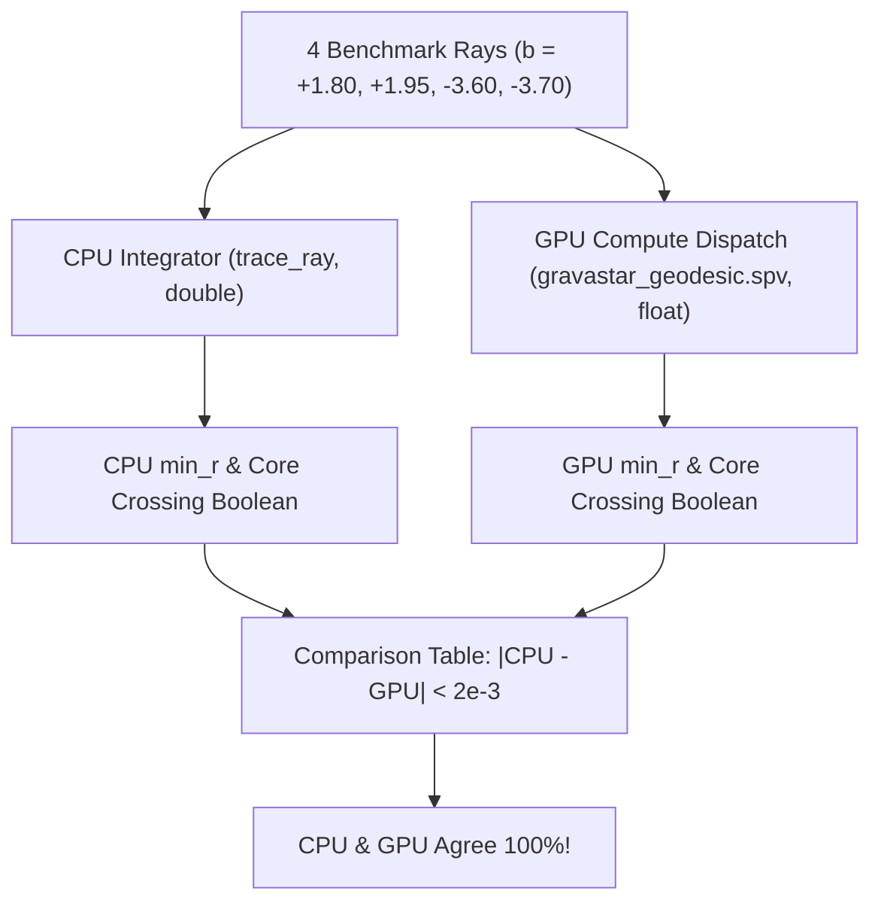

# File 24: `tests/vulkan_ray_comparison.cpp` — GPU vs. CPU Ray Trajectory Equivalence Harness

> **Target Audience**: 9th-Grade High School Student (Algebra 1 knowledge, Zero Vulkan, Zero Hardware Architecture)  
> **Source Code**: [`tests/vulkan_ray_comparison.cpp`](file:///home/abrsdxd/Projects/GravastarLab/tests/vulkan_ray_comparison.cpp)  
> **Role in GravastarLab**: The Silicon Duel (Putting the CPU and GPU in a Ring to Cross-Examine Each Other)

---

## 1. The Big Picture (What is this file's job?)

Writing computer graphics shaders for a graphics card (GPU) is notoriously difficult. On a CPU, you can pause the code, set breakpoints, and print debugging logs to the screen. On a GPU running 10,000 threads simultaneously, you can't easily set a breakpoint!

If your graphics card draws a weird black circle on the screen, how do you know if the GPU is calculating the physics correctly or if a single-precision floating point bug is ruining the math?

`vulkan_ray_comparison.cpp` is the **Silicon Duel**:
1. It shoots 4 benchmark rays through the gravastar on the **CPU** (using 64-bit C++ math).
2. It packs the exact same rays into a binary buffer, uploads them over the PCIe bus to the **Vulkan GPU**, and runs the compiled compute shader `gravastar_geodesic.spv`.
3. It downloads the results and puts CPU and GPU side-by-side in a comparison table!



### What terrible thing happens if we delete this file or turn it off?
If we delete this file, we cannot verify whether our Vulkan compute shaders are faithful to our C++ reference model.

---

## 2. High-School Physics & Math Intuition

### A. The 32-Bit Float vs 64-Bit Double Tolerance
* **The CPU** uses 64-bit numbers (`double`), which has 16 decimal places of precision.
* **The GPU** uses 32-bit numbers (`float`), which has only 7 decimal places of precision!

Because 32-bit floats have less precision, the GPU's ray will not land on the exact same atom as the CPU's ray after 25,000 integration steps. 

In numerical science, you cannot ask `CPU == GPU`. 
Instead, you establish an **Epsilon Tolerance Bound**:
$$|r_{\text{min, CPU}} - r_{\text{min, GPU}}| < 0.002$$
If the closest approach radius matches to within $0.002$ gravitational units ($2 \times 10^{-3}$), and both processors agree 100% on whether the photon entered the dark energy core, the GPU is declared **scientifically valid**!

---

## 3. The Line-by-Line Anatomy ("Why This Line?")

Let's walk through [`tests/vulkan_ray_comparison.cpp`](file:///home/abrsdxd/Projects/GravastarLab/tests/vulkan_ray_comparison.cpp).

```cpp
    for (size_t i = 0; i < num_rays; ++i) {
        double E = 1.0;
        double pt = -E;
        double pphi = targets[i].b * E;
        double quad = g0.inverse[0][0] * pt * pt +
                      2.0 * g0.inverse[0][3] * pt * pphi +
                      g0.inverse[3][3] * pphi * pphi;
        double pr = -std::sqrt(-quad / g0.inverse[1][1]);

        integration::Vec4 x0 = {0.0, r0, th0, 0.0};
        integration::Vec4 p0 = {pt, pr, 0.0, pphi};
        cpu_results[i] = integration::trace_ray(p, x0, p0, opt);
```

#### Plain English Meaning
* Integrates each benchmark ray on the CPU and stores the result in `cpu_results[i]`.

```cpp
        // Fill GPU RayInput
        inputs[i].x0[0] = static_cast<float>(x0[0]);
        inputs[i].x0[1] = static_cast<float>(x0[1]);
        inputs[i].p0[0] = static_cast<float>(p0[0]);
        inputs[i].p0[1] = static_cast<float>(p0[1]);
        inputs[i].params_geom[0] = static_cast<float>(p.mass);
        inputs[i].params_geom[1] = static_cast<float>(p.spin);
        inputs[i].params_geom[2] = static_cast<float>(p.cosmological_constant);
        inputs[i].params_radii[0] = static_cast<float>(p.r_in);
        inputs[i].params_radii[1] = static_cast<float>(p.r_out);
```

#### Plain English Meaning
* Packs the physical parameters into a Vulkan `RayInput` struct, casting 64-bit doubles down to 32-bit GPU floats.

```cpp
        ComputeOptions opt;
        opt.validation = ValidationMode::disabled;
        ComputeContext ctx(opt);

        auto spirv = load_spirv(GRAVASTAR_GEODESIC_SPV);
        std::span<const std::byte> input_span(reinterpret_cast<const std::byte*>(inputs.data()),
                                              inputs.size() * sizeof(RayInput));
        size_t output_bytes = num_rays * sizeof(RayOutput);

        auto result = ctx.dispatch(spirv, input_span, output_bytes, 1);
        const auto* outputs = reinterpret_cast<const RayOutput*>(result.output.data());
```

#### Plain English Meaning
* Initializes the Vulkan hardware engine, loads the compiled SPIR-V binary shader, and dispatches the rays to the GPU!
* Reads the output buffer returned from VRAM into the `outputs` pointer.

```cpp
        for (size_t i = 0; i < num_rays; ++i) {
            double cpu_min_r = cpu_results[i].min_r;
            float gpu_min_r = outputs[i].stats[0];
            double diff = std::abs(cpu_min_r - static_cast<double>(gpu_min_r));

            bool cpu_core = cpu_results[i].crossed_shell_in;
            bool gpu_core = (outputs[i].counts[1] == 1);

            GRAVASTAR_REQUIRE(cpu_core == gpu_core, "Core crossing agreement between CPU and GPU");
            GRAVASTAR_REQUIRE(diff < 2e-3, "Turning radius diff within single-precision tolerance 2e-3");
        }
```

#### Plain English Meaning
* **Line 167**: Asserts that CPU and GPU agree 100% on whether each photon penetrated the dark energy core.
* **Line 168**: Asserts that the difference in closest-approach radius between CPU and GPU is less than $0.002$!

---

## 4. Debugger's Cheat Sheet: `vulkan_ray_comparison.cpp`

| Symptom | Suspect Line | Root Cause |
| :--- | :--- | :--- |
| `Failed to open SPIR-V file` exception | Line 34 | Shaders were not compiled before running the test (run `cmake --build`) |
| GPU reports completely different turning radius ($diff > 1.0$) | Line 104 | Axis ordering mismatch between CPU `Vec4` and GLSL `vec4` (e.g. radius in `.y` vs `.x`) |
| `Core crossing agreement` assertion fails | Line 167 | Shell radius boundary $r_{\text{in}}$ not passed correctly in `params_radii` |
