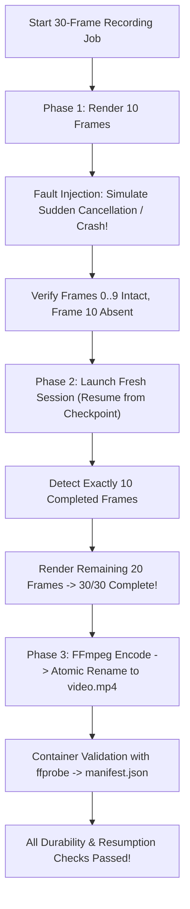

# File 25: `tests/deterministic_recording_test.cpp` — Fault Injection, Resumption & Container Verification

> **Target Audience**: 9th-Grade High School Student (Algebra 1 knowledge, Zero C++, Zero Fault-Tolerance Engineering)  
> **Source Code**: [`tests/deterministic_recording_test.cpp`](file:///home/abrsdxd/Projects/GravastarLab/tests/deterministic_recording_test.cpp)  
> **Role in GravastarLab**: The Fire Drill (Simulating Power Cuts, Testing Checkpoints, and Verifying MP4 Movies)

---

## 1. The Big Picture (What is this file's job?)

Imagine you are in a school fire drill. You don't wait for a real fire to find out if the alarm bells work and the emergency exits open. You pull the fire alarm on purpose, watch everyone walk outside in an orderly line, and check off every box on your clipboard!

In software engineering, testing what happens when things go wrong on purpose is called **Fault Injection Testing**.

`deterministic_recording_test.cpp` is the **GravastarLab Fire Drill**:
1. It starts a 30-frame recording job.
2. At Frame 10, it **yanks the virtual power plug**! It cancels the session abruptly to simulate a computer crash or power outage.
3. It inspects the hard drive to verify that Frames 0 through 9 are safe and uncorrupted.
4. It starts a brand-new recording session, watches it discover the 10 existing frames, and verifies that it resumes smoothly from Frame 10 to Frame 30.
5. It launches FFmpeg to encode the finished frames into `video.mp4` and runs ffprobe to verify the video container.



### What terrible thing happens if we delete this file or turn it off?
If we delete this file, we cannot automatically test the recording session's fault-tolerance. If a bug breaks checkpoint resumption or corrupts partial MP4 files, scientists running overnight render jobs might lose hours of work.

---

## 2. High-School Physics & Math Intuition

### A. The 3 Phases of the Fire Drill
* **Phase 1: The Crash (Fault Injection)**:
  Renders frames 0 through 9. Cancels immediately. Proves that the program doesn't panic or leave half-written corrupt files on disk.
* **Phase 2: The Resurrection (Checkpoint Resumption)**:
  Launches a new C++ object pointing to the directory. It scans the files on disk:
  $$\text{Found Frames} = 10 \quad \Longrightarrow \quad \text{Remaining Frames} = 30 - 10 = 20$$
  It renders only the 20 missing frames!
* **Phase 3: The Movie Premiere (FFmpeg Encoding)**:
  Calls external FFmpeg to encode the frames into H.264 video. Confirms that `video.partial.mp4` is atomically swapped into `video.mp4` only after encoding succeeds completely!

---

## 3. The Line-by-Line Anatomy ("Why This Line?")

Let's walk through [`tests/deterministic_recording_test.cpp`](file:///home/abrsdxd/Projects/GravastarLab/tests/deterministic_recording_test.cpp).

```cpp
    // Phase 1: Fault Injection - render only 10 frames and simulate cancellation
    std::cout << "[Step 1] Initializing job and rendering 10 frames...\n";
    {
        RecordingSession session1(test_dir, config, p);
        session1.initialize();
        GRAVASTAR_REQUIRE(session1.progress().completed_frames == 0, "Initial completed frames must be 0");

        for (int i = 0; i < 10; ++i) {
            bool cont = session1.render_frame();
            GRAVASTAR_REQUIRE(cont == true, "Session must indicate continuation before frame 10");
        }
        GRAVASTAR_REQUIRE(session1.progress().completed_frames == 10, "Expected 10 completed frames");

        session1.cancel();
        bool stopped = session1.render_frame();
        GRAVASTAR_REQUIRE(stopped == false, "Cancelled session must return false from render_frame");
        GRAVASTAR_REQUIRE(session1.progress().status == "cancelled", "Session status must be cancelled");
    }
```

#### Plain English Meaning
* **Lines 38–53**: Runs `session1`. It renders 10 frames, calls `session1.cancel()`, and asserts that the session stops immediately and marks itself as `"cancelled"`.

```cpp
    // Verify disk state after interruption
    for (int i = 0; i < 10; ++i) {
        std::ostringstream ss;
        ss << "frame_" << std::setfill('0') << std::setw(6) << i << ".ppm";
        GRAVASTAR_REQUIRE(fs::exists(test_dir / "frames" / ss.str()), "Interrupted frame file must exist on disk");
    }
    GRAVASTAR_REQUIRE(!fs::exists(test_dir / "frames" / "frame_000010.ppm"), "Frame 10 must not exist after cancellation");
```

#### Plain English Meaning
* **Lines 56–61**: Crime scene investigation! Asserts that all 10 completed frames (`frame_000000.ppm` through `frame_000009.ppm`) exist on disk, and that `frame_000010.ppm` was never created.

```cpp
    // Phase 2: Resumption from Checkpoint
    std::cout << "[Step 2] Resuming job from existing checkpoint...\n";
    {
        RecordingSession session2(test_dir, config, p);
        session2.initialize();
        GRAVASTAR_REQUIRE(session2.progress().completed_frames == 10, "Resumed session must detect exactly 10 existing frames");

        session2.render_all();
        GRAVASTAR_REQUIRE(session2.progress().completed_frames == 30, "Resumed session must finish all 30 frames");
        GRAVASTAR_REQUIRE(session2.progress().status == "completed", "Session status must be completed");
```

#### Plain English Meaning
* **Lines 66–76**: Launches `session2`. It detects that 10 frames already exist, renders the remaining 20 frames, and verifies that total completed frames equals 30!

```cpp
        // Phase 3: Video Encoding with FFmpeg & Container Verification
        std::cout << "[Step 3] Encoding to video.mp4 via FFmpeg and verifying...\n";
        bool encoded = session2.encode_video();
        GRAVASTAR_REQUIRE(encoded == true, "encode_video() must return true on success");
        GRAVASTAR_REQUIRE(fs::exists(test_dir / "video.mp4"), "video.mp4 must exist after encoding");
        GRAVASTAR_REQUIRE(fs::file_size(test_dir / "video.mp4") > 1000, "video.mp4 must not be an empty or truncated file");
        GRAVASTAR_REQUIRE(fs::exists(test_dir / "manifest.json"), "manifest.json must exist");
        GRAVASTAR_REQUIRE(!fs::exists(test_dir / "video.partial.mp4"), "video.partial.mp4 must be cleanly renamed");
    }
```

#### Plain English Meaning
* **Lines 79–85**: Launches FFmpeg, encodes `video.mp4`, asserts that the file is non-empty, asserts that `video.partial.mp4` was cleanly replaced, and verifies that `manifest.json` was written to disk!

---

## 4. Debugger's Cheat Sheet: `deterministic_recording_test.cpp`

| Symptom | Suspect Line | Root Cause |
| :--- | :--- | :--- |
| `Resumed session must detect exactly 10 existing frames` fails | Line 69 | Directory scanner in `recorder.cpp` failed to count padded filenames properly |
| `video.mp4 must not be an empty or truncated file` fails | Line 82 | FFmpeg command failed or timed out during encoding |
| `video.partial.mp4 must be cleanly renamed` fails | Line 84 | Atomic rename operation failed due to permission or file lock error |
| Test hangs during execution | Line 31 | `fast_test_pattern` was set to false, causing CPU to run full raytracing instead of fast test pattern |
