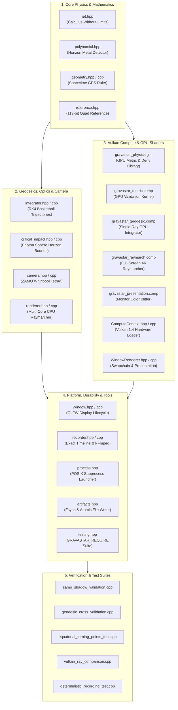

# GravastarLab: The Complete 9th-Grader's Field Guide to Curved Spacetime

> **"If you can't explain it simply, you don't understand it well enough."**  
> — *Richard Feynman*

Welcome to **GravastarLab**! This guide is written for a curious 9th-grade high school student who knows high school algebra, but knows **zero C++** and **zero college-level calculus or tensor math**.

Every file in this project is broken down line-by-line with everyday analogies (trampolines, basketballs, whirlpools, conveyor belts, movie projectors), interactive diagrams, and debugger cheat sheets showing what happens if a single character breaks.

---

## What is GravastarLab? (The 30-Second Elevator Pitch)

You have probably heard of **Black Holes**: stars so heavy and collapsed that not even light can escape them, surrounded by a point of no return called an **Event Horizon**, with an infinite density "singularity" at the center where physics breaks down.

Many physicists ask: *What if nature hates infinite singularities? Could something else exist?*

In 2001, physicists Pawel Mazur and Emil Mottola proposed the **Gravastar** (Gravitational Vacuum Star):
1. **The Core**: A sphere of pure, repulsive **Dark Energy** (called *de Sitter space*) pushing outward.
2. **The Shell**: A hyper-dense, paper-thin crust of ultra-stiff matter holding the dark energy in.
3. **The Exterior**: Normal gravitational space curving around a spinning mass (called *Kerr spacetime*).

Because the outward push of dark energy perfectly balances the inward crush of gravity, **no event horizon ever forms**! A gravastar is a completely solid, non-singular, horizonless cosmic star that looks almost identical to a black hole from far away, but allows light to graze, orbit, and even pass through its interior!

**GravastarLab** is a high-performance C++20 and Vulkan GPU scientific engine that simulates and renders what a spinning gravastar actually looks like to a human camera.

---

## Visual Architecture Map

---

## Master Table of Contents

### Part I: Core Physics & Mathematics
* [**File 01: `include/gravastar/math/jet.hpp`**](01_math_jet.md)  
  *Automatic differentiation without doing calculus by hand.* The dual-number 4×4 Taylor polynomial engine.
* [**File 02: `include/gravastar/math/polynomial.hpp`**](02_math_polynomial.md)  
  *Arbitrary-precision BigInt, exact fractions, Sturm sequences, and Bernstein polynomial horizon certificates.*
* [**File 03: `include/gravastar/geometry/geometry.hpp` & `src/geometry/geometry.cpp`**](03_geometry_metric.md)  
  *The Ilijić & DeBenedictis rotating metric evaluator.* The spacetime GPS ruler with the 7th-degree transition polynomial.
* [**File 04: `include/gravastar/geometry/reference.hpp`**](04_geometry_reference.md)  
  *The 113-bit IEEE 754 quad-precision reference calculator.* 34 decimal digits of verification truth.

### Part II: Geodesics, Optics & Camera
* [**File 05: `include/gravastar/integration/integrator.hpp` & `src/integration/integrator.cpp`**](05_integration_integrator.md)  
  *Hamiltonian RK4 photon raytracer.* Bending light through curved space with Runge-Kutta 4th-order step-halving.
* [**File 06: `include/gravastar/integration/critical_impact.hpp` & `src/integration/critical_impact.cpp`**](06_integration_critical_impact.md)  
  *Critical impact parameters ($b_{\text{crit}}$).* The mathematical boundary between light that escapes and light that falls in.
* [**File 07: `include/gravastar/optics/camera.hpp` & `src/optics/camera.cpp`**](07_optics_camera.md)  
  *The ZAMO (Zero Angular Momentum Observer) / Bardeen tetrad.* How to point a camera inside a rotating whirlpool.
* [**File 08: `include/gravastar/optics/renderer.hpp` & `src/optics/renderer.cpp`**](08_optics_renderer.md)  
  *Multi-threaded CPU OpenMP raymarcher.* Parallel raycasting over screen pixels.

### Part III: Vulkan Compute & GPU Shaders
* [**File 09: `shaders/gravastar_physics.glsl`**](09_shaders_physics.md)  
  *GLSL physics library.* Real-time metric evaluation and derivatives on the graphics card.
* [**File 10: `shaders/gravastar_metric.comp`**](10_shaders_metric.md)  
  *GPU metric validation compute shader.* Checking GPU calculations against CPU ground truth.
* [**File 11: `shaders/gravastar_geodesic.comp`**](11_shaders_geodesic.md)  
  *Single-ray trajectory shader.* Tracing individual photon paths.
* [**File 12: `shaders/gravastar_raymarch.comp`**](12_shaders_raymarch.md)  
  *Full-screen raymarcher shader.* Core glow, celestial skybox, and gravitational lensing at 60 FPS.
* [**File 13: `shaders/gravastar_presentation.comp`**](13_shaders_presentation.md)  
  *Window blitter & color format adapter.*
* [**File 14: `include/gravastar/rendering/vulkan/ComputeContext.hpp` & `src/rendering/vulkan/ComputeContext.cpp`**](14_vulkan_compute_context.md)  
  *Vulkan 1.4 compute hardware loader.* Memory buffers, pipelines, and descriptors.
* [**File 15: `include/gravastar/rendering/vulkan/WindowRenderer.hpp` & `src/rendering/vulkan/WindowRenderer.cpp`**](15_vulkan_window_renderer.md)  
  *Swapchain presentation and live window resizing.*

### Part IV: Platform, Durability & Tools
* [**File 16: `include/gravastar/platform/Window.hpp` & `src/platform/Window.cpp`**](16_platform_window.md)  
  *GLFW Wayland/X11 window lifecycle.*
* [**File 17: `include/gravastar/recording/recorder.hpp` & `src/recording/recorder.cpp`**](17_recording_recorder.md)  
  *Deterministic rational timeline & FFmpeg lossless video encoder.*
* [**File 18: `include/gravastar/tools/process.hpp`**](18_tools_process.md)  
  *POSIX child process launcher for FFmpeg.*
* [**File 19: `include/gravastar/tools/artifacts.hpp`**](19_tools_artifacts.md)  
  *Atomic file durability and directory fsync.*
* [**File 20: `include/gravastar/tools/testing.hpp`**](20_tools_testing.md)  
  *Release-active assertion framework (`GRAVASTAR_REQUIRE`).*

### Part V: Validation Suites & Test Harnesses
* [**File 21: `tests/zamo_shadow_validation.cpp`**](21_tests_zamo_shadow.md)  
  *3,444-check ZAMO tetrad and analytical shadow contour test suite.*
* [**File 22: `tests/geodesic_cross_validation.cpp`**](22_tests_geodesic_cross_validation.md)  
  *113-bit quad-precision RK4 trajectory cross-validation.*
* [**File 23: `tests/equatorial_turning_points_test.cpp`**](23_tests_equatorial_turning_points.md)  
  *Equatorial turning points and $O(h^4)$ step-halving validation.*
* [**File 24: `tests/vulkan_ray_comparison.cpp`**](24_tests_vulkan_ray_comparison.md)  
  *CPU vs GPU ray trajectory equivalence harness.*
* [**File 25: `tests/deterministic_recording_test.cpp`**](25_tests_deterministic_recording.md)  
  *Fault-injection, resume, and ffprobe container verification.*

---

## 5 Universal Physics Analogies to Remember

Throughout this guide, keep these 5 physical pictures in mind:

1. **The Trampoline (The Metric Tensor $g_{\mu\nu}$)**  
   If you place a bowling ball on a trampoline, the fabric sags. An ant walking on the trampoline doesn't feel a magical force; it just follows the curved fabric. The *Metric Tensor* is our digital tape measure for that stretched fabric.
2. **The Whirlpool (The ZAMO / Bardeen Frame)**  
   When water drains in a bathtub, it swirls. If you try to hold a rubber duck completely stationary, the swirling water pushes against it. A *Zero Angular Momentum Observer* lets the duck spin with the water so it feels no side forces.
3. **The Roller-Coaster On-Ramp (The 7th-Degree Septic Polynomial)**  
   If an on-ramp to a 70 mph highway has a sharp corner or a bump, your car will rattle or launch into the air. A *septic polynomial* connects two completely different universes (interior dark energy and exterior spinning gravity) so smoothly that not even the third derivative has a bump.
4. **The Thrown Basketball (Runge-Kutta RK4 Integration)**  
   To predict where a basketball lands, you don't just look at its starting velocity. You look ahead to where it might be in 1 second, check the wind and gravity there, average 4 different predictions together, and take one smooth, confident step forward.
5. **The Metal Detector (Sturm Chains & Bernstein Polynomials)**  
   If the gravity equation hits zero, an Event Horizon appears and turns our gravastar into a black hole! Sturm sequences and Bernstein polynomials act as mathematical metal detectors that prove with 100% certainty that the equation never touches zero anywhere.
