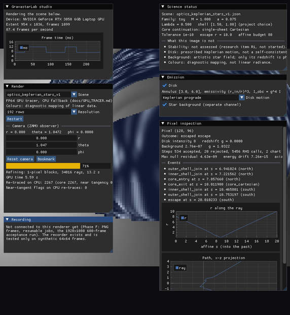

# Desktop studio (Phase E, 2026-11-24)



```text
cmake --preset desktop-release && cmake --build --preset desktop-release
build/desktop-release/gravastar_studio                      # default scene
build/desktop-release/gravastar_studio --scene benchmarks/optics_keplerian_kerr_stars_v1.json
```

The first launch after a build is slow: the GPU driver compiles the FP64
tracer shader. The Render panel says so until the first rays arrive.

## What you see

The window shows the selected scene traced by the FP64 GPU tracer with CPU
fallback (`GPU_TRACER.md`), refined coarse to fine: one ray per 16x16 block,
then 8, 4, 2 and 1. Any change (resolution, camera, emission, scene) cancels
the current job between 2048-ray chunks and starts again; the first blocky
image takes a fraction of a second. Colours are the diagnostic mapping of the
linear data (`I/(1+I)`, gamma 1/2.2), not linear radiance. A 256x192 image
takes about 6.5 s of GPU time on the RTX 3050.

| Panel | Contents |
| --- | --- |
| GravastarLab studio | Device, window extent, frame rate and an ImPlot frame-time plot |
| Render | Scene preset, resolution (96–384 rows at the scene's aspect), Restart, progress, refinement level, GPU time, CPU re-trace counts by reason; the orbit camera (r, theta, phi), Reset camera, bookmarks |
| Science status | Family and parameters, core continuation, capture proxy, tolerances; and what the image is not: stability not assessed, prescribed disk motion, artistic star field, diagnostic colours |
| Emission | Disk on/off, ZAMO or Keplerian prograde (refused outside the stable timelike orbits), star background channel on/off |
| Pixel inspection | Right-click a pixel: the CPU tracer re-traces it with its trajectory; outcome, disk intensity and redshift or background, steps, null and invariant drifts, every event and near tangency, r along the ray, and the path in the x-z plane |
| Recording | Points to `gravastar_record` (`RECORDING.md`); the studio itself does not record |

**Camera.** Drag on the image to orbit, scroll to zoom, or edit r, theta and
phi. The camera is the scene's ZAMO observer moved to the new position.
Elevation stops 0.05 rad short of either pole (the launch frame's polar
margin), so the view never flips over the axis; distance stays between 2.5 and
90% of the scene's escape radius. Bookmarks (up to 16) last for the session.

Command-line options for scripted use: `--camera r,theta,phi`,
`--inspect x,y` (prints the inspection), `--screenshot image.ppm` (the last
presented frame with panels), `--frames N`, `--width`, `--height`.

## How it is built

- Dear ImGui 1.93.0 and ImPlot 1.1, vendored unmodified (`THIRD_PARTY.md`).
- The window renderer copies its compute image to the swapchain image, then
  draws ImGui over it with Vulkan 1.3 dynamic rendering. Captures read the
  compute image, so the calibration smoke test's exact-pixel checks are
  unchanged; `screenshot()` copies the presented frame, overlay included.
- The view shader (`shaders/gravastar_view.comp`) shows an RGBA8 source
  buffer scaled to the window with its aspect kept.
- `tools/studio_render.cpp` runs the progressive render on a worker thread
  that owns the `GpuTracer`; the UI thread only copies the latest image.
- Ray colour and radiance come from `ray_sample`/`sample_color` in
  `include/gravastar/optics/scene.hpp`, shared with the CPU reports.

## Tests

| CTest | What it does |
| --- | --- |
| `vulkan_studio_smoke` | Calibration pattern, 24 frames, resize, minimize/restore, three exact-pixel captures, at least 20 frames with the ImGui overlay drawn |
| `vulkan_studio_render_smoke` | Real render: first image; a long 384-row job cancelled by a quality change (measured 52 ms to the next job, ceiling 3 s); resize; minimize/restore; a camera change; finished image; screenshot with at least 50 colours (measured 638) |

**Limits found by the tests.** This Wayland session ignores the program's own
minimize request, so neither smoke test can check that no frames are drawn
while minimized; the render smoke test prints that it was not exercised.
Vulkan validation layers are not installed on this machine, so the overlay's
Vulkan use has not been checked by them.

## Not covered

No FP32 preview tracer, so interaction is limited by FP64 speed (the first
blocky pass is fast; a full 384-row image takes about 25 s). No time
dependence, hotspots or polarization. Bookmarks are not saved between
sessions. Recording is done by `gravastar_record`, not from inside the
studio (no camera-track editor yet). Panels can cover much of a
small window; they can be collapsed or moved.
